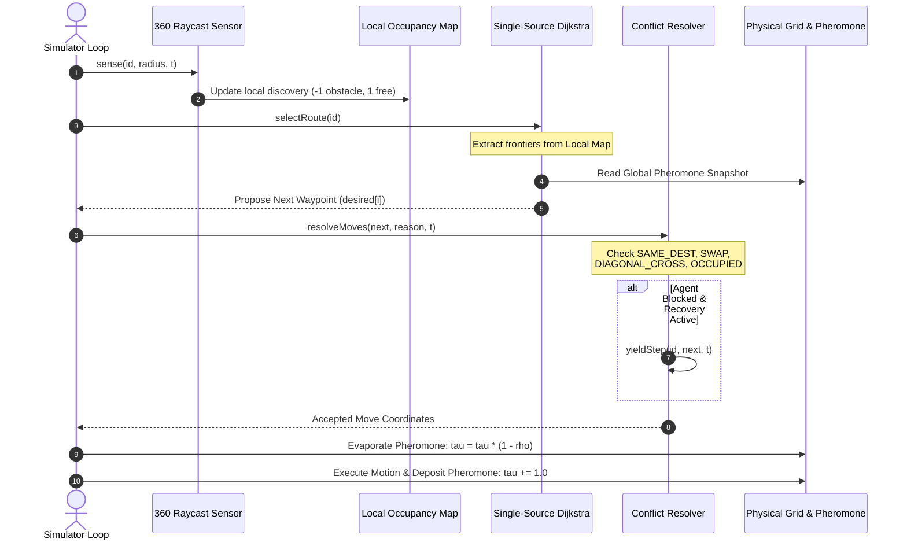
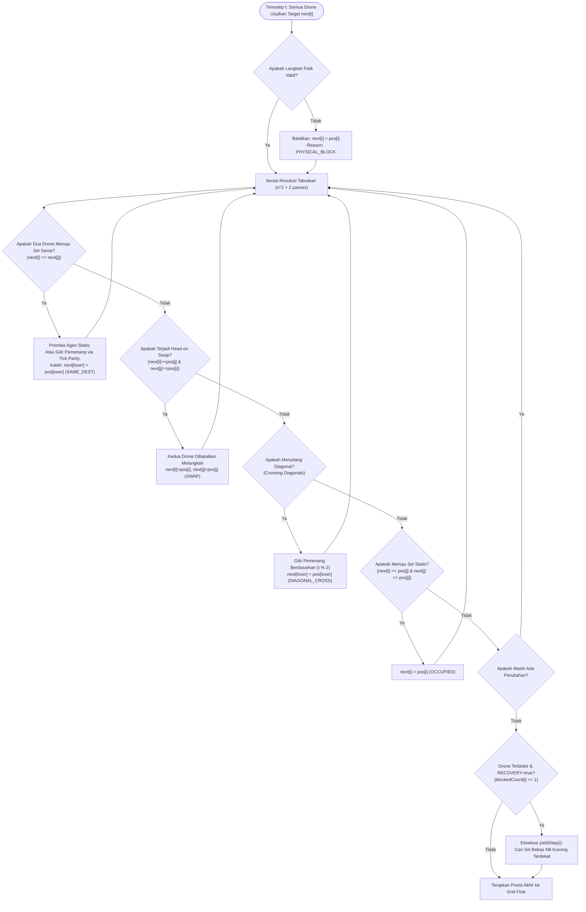
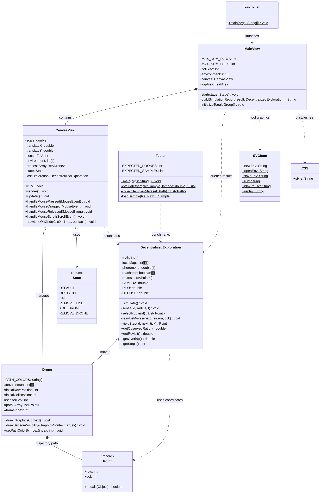

# Decentralized Swarm Coverage Using Frontier-Based Exploration and Repulsive Pheromone Stigmergy (FBE-RPS)

[](https://openjdk.org/)
[](https://openjfx.io/)
[](https://maven.apache.org/)
[]()
[]()

---

## Daftar Isi (Table of Contents)
- [1. Ringkasan Eksekutif & Latar Belakang Akademik](#1-ringkasan-eksekutif--latar-belakang-akademik)
- [2. Formulasi Matematis & Model Algoritma](#2-formulasi-matematis--model-algoritma)
  - [2.1 Representasi Lingkungan & Sensor Raycasting](#21-representasi-lingkungan--sensor-raycasting)
  - [2.2 Frontier-Based Exploration (FBE)](#22-frontier-based-exploration-fbe)
  - [2.3 Repulsive Pheromone Stigmergy (RPS)](#23-repulsive-pheromone-stigmergy-rps)
  - [2.4 Fungsi Utilitas Rute (Single-Source Dijkstra)](#24-fungsi-utilitas-rute-single-source-dijkstra)
  - [2.5 Metrik Kinerja Akademik](#25-metrik-kinerja-akademik)
- [3. Arsitektur Sistem & Diagram Alur](#3-arsitektur-sistem--diagram-alur)
  - [3.1 Siklus Keputusan Multi-Agent (Sequence Diagram)](#31-siklus-keputusan-multi-agent-sequence-diagram)
  - [3.2 Resolusi Konflik Simultan & Yield Step (Flowchart)](#32-resolusi-konflik-simultan--yield-step-flowchart)
  - [3.3 Diagram Hubungan Antar Kelas (Class Diagram UML)](#33-diagram-hubungan-antar-kelas-class-diagram-uml)
  - [3.4 State Diagram Mode Interaksi UI](#34-state-diagram-mode-interaksi-ui)
- [4. Bedah Rinci Source Code (Classes, Methods, & Variables)](#4-bedah-rinci-source-code-classes-methods--variables)
  - [4.1 DecentralizedExploration.java](#41-decentralizedexplorationjava-inti-algoritma)
  - [4.2 Drone.java](#42-dronejava-entitas-drone--visualisasi)
  - [4.3 CanvasView.java](#43-canvasviewjava-mesin-rendering--interaksi)
  - [4.4 MainView.java](#44-mainviewjava-antarmuka-pengguna-javafx)
  - [4.5 Tester.java](#45-testerjava-headless-batch-evaluation)
  - [4.6 Kelas Pendukung (Point, State, SVGIcon, CSS, Launcher)](#46-kelas-pendukung-point-state-svgicon-css-launcher)
- [5. Dataset Tolok Ukur (Benchmark Scenarios)](#5-dataset-tolok-ukur-benchmark-scenarios)
- [6. Panduan Penggunaan & Eksekusi](#6-panduan-penggunaan--eksekusi)
  - [6.1 Menjalankan GUI Simulator](#61-menjalankan-gui-simulator)
  - [6.2 Menjalankan Headless Batch Benchmark](#62-menjalankan-headless-batch-benchmark)
  - [6.3 Konfigurasi Parameter Eksperimen (JVM Properties)](#63-konfigurasi-parameter-eksperimen-jvm-properties)
- [7. Sitasi & Referensi](#7-sitasi--referensi)

---

## 1. Ringkasan Eksekutif & Latar Belakang Akademik

Proyek ini mengimplementasikan simulator dan mesin tolok ukur (benchmarking engine) berkinerja tinggi untuk **eksplorasi dan cakupan area kooperatif multi-drone terdesentralisasi (Decentralized Multi-UAV Swarm Area Coverage)** pada lingkungan 2D grid tak dikenal (*unknown environments*). 

Dalam literatur robotika swarm, eksplorasi berbasis perbatasan (**Frontier-Based Exploration / FBE**, dipelopori oleh Yamauchi pada tahun 1997) secara klasik mengarahkan agen ke batas antara area yang telah diketahui bebas (*known free*) dan area yang belum terpetakan (*unknown*). Namun, ketika diterapkan pada kawanan multi-agen (*swarm*) tanpa koordinator pusat, FBE standar menderita **anomali konvergensi (clustering/congestion)**: banyak drone secara serentak memilih frontier terdekat yang sama, menyebabkan:
1. **Redundansi Eksplorasi Tinggi (High Overlap)**: Agen saling menumpuk dan memindai area yang sama.
2. **Kunjungan Berulang yang Berlebihan (Excessive Revisit)**: Agen terperangkap dalam osilasi lokal.
3. **Deadlock & Kemacetan Fisik**: Konflik pergerakan pada lorong sempit.

Untuk mengatasi limitasi tersebut secara elegan tanpa memerlukan infrastruktur komunikasi terpusat ber-bandwidth tinggi, proyek ini mengintegrasikan **Repulsive Pheromone Stigmergy (RPS)** yang terinspirasi dari komunikasi stigmergis tidak langsung serangga sosial. Lapangan feromon tolak-menolak global yang meluruh seiring waktu (evaporating repulsive pheromones) bertindak sebagai memori kolektif ruang. Setiap drone menghitung rute optimal menuju frontier menggunakan algoritma **Single-Source Dijkstra**, di mana setiap sel yang memiliki residu feromon tinggi memberikan penalti tambahan. Hal ini secara alami mendispersikan anggota kawanan ke berbagai sektor lingkungan yang belum terjamah.

### Sorotan Fitur Unggulan
- **Decentralized Local Occupancy Maps**: Setiap drone memelihara peta keterisian lokal (*local occupancy grid*) independen $\mathcal{M}_i$, bebas dari kebocoran informasi *ground truth*.
- **Realistic 360° Raycasting Sensor**: Model pemindaian radial 360 derajat dengan deteksi oklusi rintangan dan resolusi sub-cell ($0.125$ cell steps).
- **Stigmergic Dispersion ($\lambda$-Repulsion)**: Penalti feromon terintegrasi sepanjang lintasan graf Dijkstra yang mendorong diversifikasi spasial drone.
- **Simultaneous Conflict Resolution**: Resolusi deterministik tanpa *oracle* untuk tabrakan tujuan (*same destination*), pertukaran sel (*head-on swap*), perlintasan diagonal (*diagonal cross*), dan sel terisi (*occupied cell*).
- **Deadlock Recovery & Yield Protocol**: Mekanisme mengalah (*yield maneuver*) deterministik dan pelacakan kelelahan frontier (*frontier exhaustion tracking*) untuk membebaskan agen yang terhambat di koridor sempit.
- **Dual Execution Modes**: Antarmuka visual interaktif berbasis JavaFX (pan/zoom kamera halus, replay sinkron, editor lingkungan grafis) dan *headless batch tester* untuk 100 skenario tolok ukur.

---

## 2. Formulasi Matematis & Model Algoritma

```
+------------------------------------------------------------------------------------------------+
|                                    ALGORITHM WORKFLOW (v1.1)                                   |
|                                                                                                |
|   +--------------------+       +-----------------------+       +---------------------------+   |
|   | 360-deg Raycasting | ----> | Local Occupancy Map   | ----> | Frontier Extraction (N8)  |   |
|   | Sensor Model       |       | M_i in {-1, 0, 1}     |       | Free cells bordering unk. |   |
|   +--------------------+       +-----------------------+       +---------------------------+   |
|                                                                              |                 |
|                                                                              v                 |
|   +--------------------+       +-----------------------+       +---------------------------+   |
|   | Simultaneous Move  | <---- | Deterministic Move    | <---- | Single-Source Dijkstra    |   |
|   | & Pheromone Update |       | Conflict Resolution   |       | Cost = Dist + Lambda * Tau|   |
|   +--------------------+       +-----------------------+       +---------------------------+   |
+------------------------------------------------------------------------------------------------+
```

### 2.1 Representasi Lingkungan & Sensor Raycasting

Lingkungan fisik didefinisikan sebagai grid diskrit $\mathcal{M}_{\text{truth}} \in \{-1, 0\}^{H \times W}$, dengan tinggi $H$ (`rows`) dan lebar $W$ (`cols`):
- $-1$ merepresentasikan sel rintangan (*obstacle/wall*).
- $0$ merepresentasikan sel bebas (*free space*).

Setiap drone $i \in \{1, \dots, n\}$ memelihara peta keterisian lokal $\mathcal{M}_i \in \{-1, 0, 1\}^{H \times W}$:
- $0$: Belum diketahui (*unexplored / unknown*).
- $1$: Diketahui bebas (*known free*).
- $-1$: Diketahui rintangan (*known obstacle*).

Pada setiap timestep $t$, drone $i$ pada koordinat $(r_i, c_i)$ memancarkan 360 berkas sinar raycasting ($\theta = 0^\circ, 1^\circ, \dots, 359^\circ$) hingga jangkauan sensor maksimum $R_{\text{max}} = \text{sensorFoV} + 0.5$ (default $\text{sensorFoV} = 4$ sel):

$$\vec{u}(\theta) = (\sin\theta, \cos\theta)$$

Titik sampel sinar pada jarak $d \in [0.125, R_{\text{max}}]$ dengan langkah $\Delta d = 0.125$:

$$r(d) = \lfloor (r_i + 0.5) + d \cdot \sin\theta \rfloor, \quad c(d) = \lfloor (c_i + 0.5) + d \cdot \cos\theta \rfloor$$

Jika $\mathcal{M}_{\text{truth}}(r(d), c(d)) = -1$, sel tersebut ditandai sebagai rintangan pada $\mathcal{M}_i$ dan penelusuran sinar pada sudut $\theta$ dihentikan seketika (simulasi oklusi visual optik).

---

### 2.2 Frontier-Based Exploration (FBE)

Sebuah sel $(r, c)$ diklasifikasikan sebagai **frontier cell** bagi drone $i$ jika dan hanya jika sel tersebut telah terkonfirmasi bebas, namun berbatasan langsung dengan minimal satu sel yang masih misterius dalam ketetanggaan 8 arah ($\mathcal{N}_8$):

$$\mathcal{F}_i^{(t)} = \left\{ (r, c) \in \mathbb{Z}^2 \;\middle|\; \mathcal{M}_i^{(t)}(r, c) = 1 \;\land\; \exists (dr, dc) \in \mathcal{N}_8 \text{ s.t. } \mathcal{M}_i^{(t)}(r+dr, c+dc) = 0 \right\}$$

di mana himpunan perpindahan ketetanggaan $\mathcal{N}_8$ didefinisikan secara deterministik berurutan:

$$\mathcal{N}_8 = \{(0, 1), (1, 1), (1, 0), (1, -1), (0, -1), (-1, -1), (-1, 0), (-1, 1)\}$$

---

### 2.3 Repulsive Pheromone Stigmergy (RPS)

Medan feromon tolak-menolak $\tau(r, c) \in \mathbb{R}_{\ge 0}$ diperbarui pada setiap langkah simulasi global melalui dua fase:

1. **Evaporasi Global (Global Evaporation)**:
   Seluruh sel mengalami peluruhan eksponensial dengan laju penguapan $\rho \in [0, 1]$ (default $\rho = 0.05$):
   $$\tau^{(t+1/2)}(r, c) = (1 - \rho) \cdot \tau^{(t)}(r, c)$$

2. **Deposisi Berbasis Pergerakan (Movement-Based Deposition)**:
   Hanya drone yang berhasil berpindah ke sel baru $(nr, nc) \neq (r, c)$ yang mendepositkan feromon sebesar $\Delta \tau$ (default $\Delta \tau = 1.0$):
   $$\tau^{(t+1)}(nr, nc) = \tau^{(t+1/2)}(nr, nc) + \Delta \tau$$

> [!NOTE]
> Jika drone tidak bergerak (berdiam diri / terhalang), drone tersebut **tidak** mendepositkan feromon baru. Hal ini mencegah pembentukan akumulasi feromon artifisial akibat agen yang sedang mengantre atau terhenti.

---

### 2.4 Fungsi Utilitas Rute (Single-Source Dijkstra)

Drone $i$ mengeksekusi algoritma Dijkstra satu sumber (*single-source Dijkstra*) dari posisinya $(sr, sc)$ di atas graf sel bebas lokal $\mathcal{M}_i(r, c) = 1$. Bobot langkah ortogonal adalah $1.0$ dan langkah diagonal adalah $\sqrt{2} \approx 1.41421356$, dengan syarat bebas potong sudut (*corner clearance*):

$$\text{LegalDiagonal}((r, c) \to (r+dr, c+dc)) \iff \mathcal{M}_i(r, c+dc) = 1 \;\land\; \mathcal{M}_i(r+dr, c) = 1$$

Untuk setiap kandidat frontier $f \in \mathcal{F}_i^{(t)}$ yang terjangkau, biaya total dievaluasi dengan mengintegrasikan jejak feromon di sepanjang jalur terpendek $\Pi(sr \to f)$:

$$\mathcal{J}(f) = \mathcal{D}(sr, f) + \lambda \sum_{k \in \Pi(sr \to f)} \tau^{(t)}(k)$$

```
                                    +----------------------------------+
                                    |    FBE-RPS Objective Function    |
                                    |                                  |
                                    |  J(f) = D(sr, f) + lambda * P(f) |
                                    +----------------------------------+
                                                     |
                    +--------------------------------+-------------------------------+
                    |                                                                |
                    v                                                                v
        +-----------------------+                                        +-----------------------+
        |      lambda = 0       |                                        |      lambda > 0       |
        |  Pure Greedy Frontier |                                        | Repulsive Stigmergy   |
        |  Minimizes path dist. |                                        | Penalizes congested,  |
        |  High swarm overlap   |                                        | previously-visited    |
        +-----------------------+                                        | corridors & frontiers |
                                                                         +-----------------------+
```

Frontier optimal $f^*$ dipilih sebagai:

$$f^* = \arg\min_{f \in \mathcal{F}_i^{(t)}} \mathcal{J}(f)$$

**Aturan Pemutus Seri (Tie-Breaking Rule)**:
Jika terdapat nilai $\mathcal{J}(f)$ yang identik (dalam batas $\epsilon = 10^{-9}$):
1. Pilih jarak geodesik $\mathcal{D}(sr, f)$ terkecil.
2. Jika masih identik, pilih indeks baris terkecil (`row`).
3. Jika masih identik, pilih indeks kolom terkecil (`col`).
*Aturan deterministik ketat ini menjamin reproduksibilitas ilmiah 100% pada eksperimen berulang.*

---

### 2.5 Metrik Kinerja Akademik

Evaluasi kuantitatif dihitung berdasarkan empat indikator utama sesuai standar publikasi internasional:

| Simbol | Nama Metrik | Formulasi Matematis | Deskripsi Fisis |
| :---: | :--- | :---: | :--- |
| $\mathcal{C}$ | **Observed Coverage** | $\frac{\left|\mathcal{M}_{\text{observed}} \cap \mathcal{M}_{\text{reachable}}\right|}{\left|\mathcal{M}_{\text{reachable}}\right|} \times 100\%$ | Persentase sel bebas terjangkau yang berhasil disapu oleh sinar sensor kawanan drone. |
| $\mathcal{R}$ | **Revisit Ratio** | $\frac{V_{\text{total}} - V_{\text{unique}}}{V_{\text{total}}} \times 100\%$ | Tingkat inefisiensi eksplorasi; mengukur proporsi langkah fisik yang menginjak kembali sel yang pernah dilalui. |
| $\mathcal{O}$ | **Overlap Ratio** | $\frac{\left|\left\{ c \in \mathcal{V}_{\text{unique}} \;\middle|\; |\text{Visitors}(c)| > 1 \right\}\right|}{|\mathcal{V}_{\text{unique}}|} \times 100\%$ | Proporsi area yang dikunjungi oleh lebih dari satu drone berbeda (indikator pemborosan koordinasi). |
| $\mathcal{S}$ | **Completion Steps** | $\min \{ t \ge 0 \mid \mathcal{C}(t) = 100\% \}$ | Kecepatan konvergensi total. Jika eksplorasi berhenti sebelum $100\%$, bernilai `N/A`. |

---

## 3. Arsitektur Sistem & Diagram Alur

### 3.1 Siklus Keputusan Multi-Agent (Sequence Diagram)

Diagram sekuens berikut menggambarkan interaksi sinkron multi-agen per *simulation tick*:



---

### 3.2 Resolusi Konflik Simultan & Yield Step (Flowchart)

Diagram alir logika arbitrase tabrakan tanpa supervisor terpusat:



---

### 3.3 Diagram Hubungan Antar Kelas (Class Diagram UML)



---

### 3.4 State Diagram Mode Interaksi UI

```mermaid
stateDiagram-v2
    [*] --> DEFAULT : Startup Application

    DEFAULT --> OBSTACLE : Select Tool Wall
    DEFAULT --> LINE : Select Tool Draw Line
    DEFAULT --> REMOVE_LINE : Select Tool Remove Line
    DEFAULT --> ADD_DRONE : Select Tool Add Drone
    DEFAULT --> REMOVE_DRONE : Select Tool Remove Drone

    OBSTACLE --> DEFAULT : Select Transform
    LINE --> DEFAULT : Select Transform
    REMOVE_LINE --> DEFAULT : Select Transform
    ADD_DRONE --> DEFAULT : Select Transform
    REMOVE_DRONE --> DEFAULT : Select Transform

    note right of DEFAULT
        Pan Kamera (Tombol Tengah/Kiri Drag)
        Zoom In/Out (Scroll Wheel)
        Geser Drone Awal (Primary Drag)
    end note

    note right of OBSTACLE
        Klik Kiri: Toggle Sel Rintangan (-1 / 0)
    end note

    note right of LINE
        Klik Kiri & Drag: Algoritma Garis Bresenham
        Membangun Dinding Lurus
    end note
```

---

## 4. Bedah Rinci Source Code (Classes, Methods, & Variables)

### 4.1 `DecentralizedExploration.java` (Inti Algoritma)

Kelas `final` ini merupakan jantung komputasi algoritma eksplorasi swarm. Kelas ini mengeksekusi simulasi secara penuh saat dikonstruksi tanpa dependensi ke komponen grafis (headless-ready).

#### Variabel & Konstanta Utama:
- `private static final int[][] N8`: Matriks perpindahan 8-arah deterministik.
- `private final double LAMBDA`: Bobot repulsi feromon (dibaca dari `-Dswarm.lambda`, default `1.0`).
- `private final double RHO`: Rasio evaporasi feromon per timestep (dibaca dari `-Dswarm.rho`, default `0.05`).
- `private final double DEPOSIT`: Kuantitas feromon yang ditambahkan tiap langkah (dibaca dari `-Dswarm.deposit`, default `1.0`).
- `private final int MAX_STEPS`: Batas iterasi simulasi (default `2500`).
- `private final int STALL_LIMIT`: Ambang batas stagnasi gerakan sebelum terminasi `STALL` (default `30` langkah).
- `private final int[][][] localMaps`: Peta lokal masing-masing drone `[droneIndex][row][col]`. Nilai: `0` (unknown), `1` (free), `-1` (obstacle).
- `private final double[][] pheromone`: Lapangan feromon repulsif global bersama `[row][col]`.
- `private final boolean[][] reachable`: Mask penanda sel bebas yang dapat dijangkau (*flood-fill reachable area*).
- `private final int[][] firstObservedAt`: Catatan *timestep* pertama kali sel $(r, c)$ terdeteksi sensor.
- `private final int[][][] exhaustedAtVersion`: Memori tabu untuk frontier yang gagal ditembus pada versi peta tertentu guna mencegah penguncian osilasi.

#### Metode-Metode Kunci:
- `public DecentralizedExploration(int[][] environment, ArrayList<Drone> agents)`:
  Konstruktor utama. Menginisialisasi matriks, memvalidasi koordinat awal, menjalankan `markReachable()`, memanggil `simulate()`, dan menghitung metrik akhir ($\mathcal{C}, \mathcal{R}, \mathcal{O}, \mathcal{S}$).
- `private int markReachable()`:
  Menggunakan antrean BFS 8-arah dari seluruh koordinat awal drone untuk menandai seluruh ruang bebas fisik yang dapat diakses (`reachableFree`).
- `private void sense(int id, int radius, int t)`:
  Melakukan *raycasting* 360 derajat radial dengan interval jarak $0.125$ sel. Memperbarui `localMaps[id]` secara eksklusif.
- `private List<Point> selectRoute(int id)`:
  Mengeksekusi *Single-Source Dijkstra* dari posisi drone saat ini ke seluruh sel bebas yang diketahui. Menghitung akumulasi feromon di sepanjang rute menuju setiap frontier, mengevaluasi $\mathcal{J}(f) = \text{dist} + \lambda \cdot \text{penalty}$, dan merekonstruksi rute terbalik via pointer *parent*.
- `private void resolveMoves(Point[] next, String[] reason, int tick)`:
  Memeriksa dan menyelesaikan konflik perpindahan simultan antar seluruh drone secara deterministik berpasangan:
  1. `SAME_DEST`: Dua drone memilih sel tujuan yang sama. Prioritas diberikan ke agen yang berdiam diri; bila keduanya bergerak, pemenang ditentukan berdasarkan paritas `tick % 2`.
  2. `SWAP`: Dua drone saling bertukar posisi secara berhadapan langsung. Kedua pergerakan dibatalkan.
  3. `DIAGONAL_CROSS`: Jalur perpindahan diagonal dua drone saling bersilangan tegak lurus. Satu drone dibatalkan.
  4. `OCCUPIED`: Drone mencoba masuk ke sel yang sedang ditempati drone diam.
- `private Point yieldStep(int id, Point[] next, int tick)`:
  Protokol pemulihan *deadlock*. Jika drone terhalang (`blockedCount >= 1`), drone memindai ketetanggaan $\mathcal{N}_8$ untuk melangkah mengalah ke sel kosong yang tidak diperebutkan.
- `private void simulate()`:
  Loop utama simulasi waktu diskrit ($t = 0 \dots \text{MAX\_STEPS}-1$). Mengorkestrasi penginderaan, perencanaan, arbitrase tabrakan, evaporasi feromon, deposisi feromon, dan verifikasi terminasi.

---

### 4.2 `Drone.java` (Entitas Drone & Visualisasi)

Mewakili representasi fisik dan visual dari setiap wahana udara tak berawak di dalam kawanan.

#### Fitur & Variabel:
- `private static final String[] PATH_COLORS`: Palet 30 warna kontras tinggi hex (`#FF204E`, `#00C2FF`, `#FFB000`, dll.) untuk membedakan jejak lintasan antar-drone secara visual.
- `protected ArrayList<Point> path`: Riwayat rekaman seluruh koordinat posisi diskrit $(r, c)$ sepanjang simulasi (digunakan untuk *frame-by-frame replay*).
- `protected int frameIndex`: Indeks frame aktif saat mode pemutaran ulang (*replay*).
- `protected int sensorFoV`: Radius bidang pandang sensor ($4$ sel).
- `draw(GraphicsContext gc)`: Merender sasis badan drone (bodi tengah, lengan silang diagonal, 4 propeler bulat berputar, dan label nama serta koordinat aktual).
- `drawSensoreVisibility(GraphicsContext gc, double sx, double sy)`: Merender poligon visual kerucut sapuan sensor 360 derajat semi-transparan (warna oranye `#FF7D29`, alpha $0.3$) yang terhalang kontur dinding.

---

### 4.3 `CanvasView.java` (Mesin Rendering & Interaksi)

Subkelas dari `javafx.scene.canvas.Canvas` yang menangani seluruh visualisasi grafis, manipulasi kanvas interaktif, dan pemutaran ulang.

#### Fitur & Logika Utama:
- **Kamera & Transformasi Ruang**:
  Mendukung *Pan* kamera (tombol tengah mouse atau drag bebas) dan *Zoom* kontinu ($0.1\times$ hingga $20.0\times$) terpusat pada kursor mouse melalui metode `screenToWorldX/Y` dan matriks translasi/skala `gc.translate` & `gc.scale`.
- **Editor Lingkungan**:
  - `drawLineOnGrid(r0, c0, r1, c1, addObstacle)`: Implementasi algoritma garis **Bresenham** untuk menggambar atau menghapus dinding rintangan secara cepat antar dua titik klik.
  - `checkWallType()`: Analisis ketetanggaan dinding 4-arah (East, South, West, North) untuk merender garis batas arsir (*hatching*) arsitektural.
- **Visualisasi Multilapis (*Layered Rendering*)**:
  1. *Latar Belakang & Grid*: Garis panduan kelipatan 10 sel bergaris tebal.
  2. *Obstacle & Bayangan*: Kotak rintangan toska `#03A6A1` dengan bayangan proyeksi offset 3px `#505050`.
  3. *Fog-of-War / Unknown Area*: Penutup gelap semi-transparan `#263241` untuk sel yang belum terobservasi pada frame replay aktif.
  4. *Visitation Footprint*: Arsiran jejak hijau pudar `#79CDB2` pada sel-sel yang pernah diinjak kawanan.
  5. *Trajectories*: Garis berwarna individual sesuai palet masing-masing drone.
  6. *Entitas Drone*: Unit drone beserta kerucut visibilitas sensornya.
- **Synchronized Playback Engine**:
  Menggunakan `AnimationTimer` dengan interval tick presisi $95 \text{ ms}$ (~$10.5 \text{ timestep/detik}$) untuk memutar ulang proses eksplorasi secara sinkron.

---

### 4.4 `MainView.java` (Antarmuka Pengguna JavaFX)

Aplikasi utama JavaFX yang mengintegrasikan bilah menu, tombol tindakan dengan ikon SVG kustom, panel canvas, dan konsol status eksekusi.

#### Fitur & Metode Kunci:
- `start(Stage stage)`: Mengonfigurasi antarmuka layar penuh (*SplitPane* horizontal) yang memisahkan kanvas eksplorasi dan konsol laporan teks.
- `buildSimulationReport(DecentralizedExploration result)`: Menghasilkan laporan diagnostik komprehensif berisi:
  - Status terminasi (`ALL_REACHABLE_FREE_CELLS_OBSERVED`, `MAX_STEPS`, `STALL`).
  - Empat indikator kinerja utama ($\mathcal{C}, \mathcal{R}, \mathcal{O}, \mathcal{S}$).
  - Dimensi bounding box observasi fisik (`MIN/MAX Row & Col`).
  - Jejak lengkap koordinat lintasan semua drone (`(r,c)-(r,c)-...`).
- *Shortcut Toolbar*:
  Menyediakan tombol interaktif: *New, Open, Save, Free Transform, Add Drone, Remove Drone, Wall, Draw Line, Remove Line, Run Simulation, Play/Pause Replay, Replay Reset*.

---

### 4.5 `Tester.java` (Headless Batch Evaluation)

Harness pengujian otomatis mandiri tanpa JavaFX (*headless*) untuk validasi eksperimen berskala besar.

#### Karakteristik & Protokol:
- Memverifikasi keselarasan properti JVM (`swarm.lambda`, `swarm.rho`, `swarm.deposit`, dll.).
- Menguji 100 sampel skenario tolok ukur berpasangan secara otomatis:
  - Eksperimen Baseline: $\lambda = 0.0$ (Murni Greedy FBE).
  - Eksperimen Proposed: $\lambda = 1.0$ (FBE + Repulsive Pheromone Stigmergy).
- Melakukan verifikasi konsistensi internal metrik (memastikan perhitungan matriks persis sama dengan output GUI).
- Mengekspor hasil lengkap ke format file CSV dengan pembatas `;` atau `,` serta log terminasi status per sampel.

---

### 4.6 Kelas Pendukung (`Point`, `State`, `SVGIcon`, `CSS`, `Launcher`)

- **`Point.java`**: Java Record `record Point(int row, int col)` nir-mutasi (*immutable*) dengan optimasi performa komparasi nilai.
- **`State.java`**: Enum mode interaksi kanvas (`DEFAULT`, `OBSTACLE`, `LINE`, `REMOVE_LINE`, `ADD_DRONE`, `REMOVE_DRONE`).
- **`SVGIcon.java`**: Kumpulan string data path geometris vektor SVG resolusi independen untuk tombol GUI.
- **`CSS.java`**: Lembar gaya (*inline CSS stylesheet*) untuk tema modern gelap/terang JavaFX.
- **`Launcher.java`**: Titik masuk *bootstrapping* (`main`) standar Java untuk meluncurkan JavaFX runtime tanpa modulasi runtime error.

---

## 5. Dataset Tolok Ukur (Benchmark Scenarios)

Proyek ini dilengkapi dengan **100 skenario tolok ukur resmi** yang tersimpan di dalam direktori `dataset/`, terbagi ke dalam 5 kategori topologi lingkungan dengan karakteristik spasial yang menantang:

```
src/main/java/drone/decentralizedswarmcoverage_fbe_rps/dataset/
├── S01_Open_Space/            # 20 File: S01_G01_C.sc s/d S01_G10_D.sc
├── S02_Partitioned_Rooms/     # 20 File: S02_G01_C.sc s/d S02_G10_D.sc
├── S03_Branching_Corridors/   # 20 File: S03_G01_C.sc s/d S03_G10_D.sc
├── S04_Serpentine/            # 20 File: S04_G01_C.sc s/d S04_G10_D.sc
└── S05_Bottleneck/            # 20 File: S05_G01_C.sc s/d S05_G10_D.sc
```

| Kode | Nama Topologi | Karakteristik Lingkungan | Tantangan Swarm Terdesentralisasi |
| :---: | :--- | :--- | :--- |
| **S01** | `Open_Space` | Ruang terbuka luas dengan sedikit atau tanpa partisi internal. | Risiko dispersi acak dan penelusuran batas terluar yang tumpang tindih. |
| **S02** | `Partitioned_Rooms` | Tata letak menyerupai gedung perkantoran bersekat banyak pintu. | Terjebak pada satu ruangan yang sama jika tidak ada tolakan feromon. |
| **S03** | `Branching_Corridors` | Jaringan lorong labirin dengan banyak percabangan $T$ dan $+$. | Pemilihan cabang yang optimal tanpa koordinator pusat; pencegahan eksplorasi cabang ganda. |
| **S04** | `Serpentine` | Lorong berliku-liku tajam berbentuk spiral/ular. | Potensi kebuntuan pergerakan beruntun (*convoys*) dan waktu tempuh bolak-balik yang panjang. |
| **S05** | `Bottleneck` | Area luas yang dihubungkan oleh celah sempit (*chokepoint*). | Titik rawan tabrakan ekstrem (*extreme deadlock risk*) saat banyak drone melintasi celah sempit bersamaan. |

### Konfigurasi Posisi Awal Berpasangan:
Setiap geometri (G01 hingga G10) memiliki dua varian konfigurasi awal:
1. **`_C` (Centered Start)**:
   Seluruh 4 drone ditempatkan saling menempel di pusat peta (contoh: koordinat $(43,41), (43,42), (44,41), (44,42)$). Merupakan uji stres paling berat untuk menguji daya tolak awal dan pencegahan tabrakan seketika.
2. **`_D` (Dispersed Start)**:
   Keempat drone disebar di 4 sudut atau tepi terjauh lingkungan. Menguji kemampuan kawanan menyatukan peta persepsi parsial tanpa redundansi di area pertemuan.

---

## 6. Panduan Penggunaan & Eksekusi

### Prasyarat Sistem
- **Java Development Kit (JDK)**: Versi 21 atau lebih baru (Disarankan JDK 24).
- **Apache Maven**: Versi 3.9+.
- **Sistem Operasi**: Windows, Linux, atau macOS.

---

### 6.1 Menjalankan GUI Simulator

Untuk membuka antarmuka visual interaktif:

```bash
# Menggunakan Maven JavaFX Plugin
mvn clean javafx:run
```

Atau melalui IntelliJ IDEA:
1. Buka project di IntelliJ IDEA.
2. Navigasikan ke file `src/main/java/drone/decentralizedswarmcoverage_fbe_rps/Launcher.java`.
3. Klik kanan $\rightarrow$ **Run 'Launcher.main()'**.

#### Alur Kerja di GUI:
1. Klik **Open Environment** untuk memuat salah satu file skenario `.sc` dari folder `dataset/`.
2. Klik tombol **Run** untuk mengeksekusi algoritma FBE-RPS.
3. Gunakan kontrol **Play / Pause** dan slider kecepatan untuk mengamati proses eksplorasi secara animasi.
4. Baca metrik evaluasi lengkap yang muncul di panel log sebelah kanan.

---

### 6.2 Menjalankan Headless Batch Benchmark

Untuk menjalankan pengujian otomatis 100 sampel (membandingkan $\lambda=0$ vs $\lambda=1$):

```bash
# Kompilasi project
mvn test-compile

# Jalankan Tester langsung dari class target
java -cp target/classes drone.decentralizedswarmcoverage_fbe_rps.Tester
```

Hasil benchmarking akan otomatis disimpan di folder `results/ExplorationResults<timestamp>.csv`.

---

### 6.3 Konfigurasi Parameter Eksperimen (JVM Properties)

Seluruh parameter algoritmik dapat dikonfigurasi secara dinamis saat runtime melalui flag `-D` Java:

| Properti JVM | Tipe | Nilai Default | Penjelasan Fisis |
| :--- | :---: | :---: | :--- |
| `swarm.lambda` | `double` | `1.0` | Bobot repulsi feromon ($\lambda$). Set `0.0` untuk mode murni FBE. |
| `swarm.rho` | `double` | `0.05` | Rasio evaporasi feromon per timestep ($\rho \in [0, 1]$). |
| `swarm.deposit` | `double` | `1.0` | Besaran feromon yang didepositkan saat berpindah sel ($\Delta\tau$). |
| `swarm.recovery` | `boolean` | `true` | Mengaktifkan protokol penghindaran deadlock (*yield maneuver*). |
| `swarm.maxSteps` | `int` | `2500` | Batas maksimum timestep simulasi sebelum dihentikan paksa. |
| `swarm.stallLimit` | `int` | `30` | Batas timestep tanpa ada pergerakan drone sebelum terminasi stall. |
| `swarm.trace` | `String` | `""` | Path file CSV untuk mencatat log mikroskopis gerakan tiap drone per tick. |

Contoh menjalankan simulasi dengan repulsi tinggi:
```bash
java -Dswarm.lambda=2.5 -Dswarm.rho=0.02 -cp target/classes drone.decentralizedswarmcoverage_fbe_rps.Tester
```

---

## 7. Sitasi & Referensi

Jika Anda menggunakan source code, algoritma, atau dataset dari repositori ini dalam penelitian akademis Anda, silakan sitasi sebagai berikut:

```bibtex
@software{fossalgo_fbe_rps_2026,
  author       = {FOSSALGO and Sugiarto Cokrowibowo},
  title        = {Decentralized Swarm Coverage Using Frontier-Based Exploration and Repulsive Pheromone Stigmergy (FBE-RPS)},
  year         = {2026},
  publisher    = {GitHub},
  journal      = {GitHub repository},
  howpublished = {\url{https://github.com/FOSSALGO/DecentralizedSwarmCoverage_FBE_RPS}}
}
```

### Referensi Terkait:
1. **Yamauchi, B. (1997).** *A frontier-based approach for autonomous exploration.* Proceedings 1997 IEEE International Symposium on Computational Intelligence in Robotics and Automation, pp. 146-151.
2. **Dorigo, M., & Di Caro, G. (1999).** *Ant colony optimization: a new meta-heuristic.* Proceedings of the 1999 Congress on Evolutionary Computation, 2, pp. 1470-1477.
3. **Sauter, J. A., et al. (2005).** *Digital Pheromones for Swarm Robotics: Coverage and Target Tracking.* IEEE Swarm Intelligence Symposium.

---
*Dikembangkan dengan dedikasi untuk kemajuan riset Multi-Agent Systems & Swarm Robotics di Indonesia dan Dunia.*
