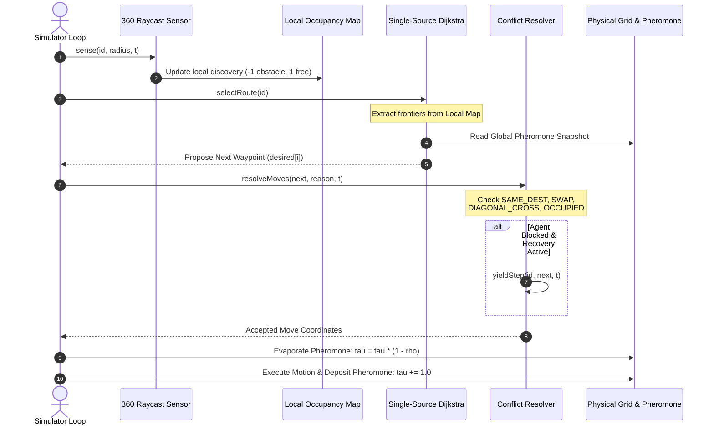
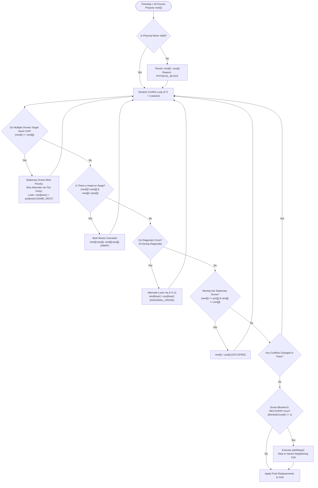
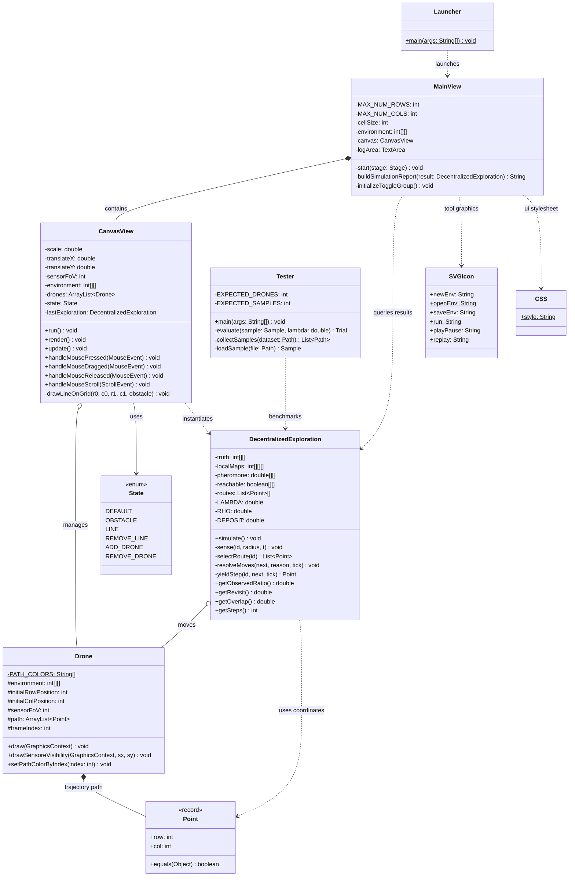
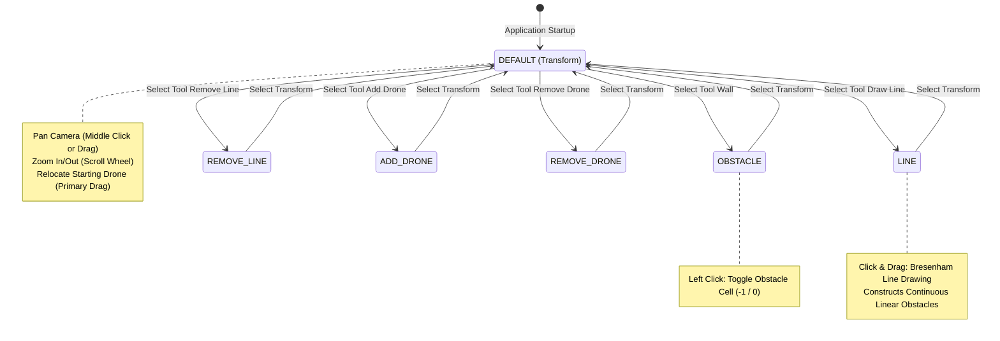

# Decentralized Swarm Coverage Using Frontier-Based Exploration and Repulsive Pheromone Stigmergy (FBE-RPS)

[](https://openjdk.org/)
[](https://openjfx.io/)
[](https://maven.apache.org/)
[]()
[]()

---

## Table of Contents
- [1. Executive Summary & Academic Background](#1-executive-summary--academic-background)
- [2. Mathematical Formulation & Algorithmic Model](#2-mathematical-formulation--algorithmic-model)
  - [2.1 Environment Representation & Raycasting Sensor Model](#21-environment-representation--raycasting-sensor-model)
  - [2.2 Frontier-Based Exploration (FBE)](#22-frontier-based-exploration-fbe)
  - [2.3 Repulsive Pheromone Stigmergy (RPS)](#23-repulsive-pheromone-stigmergy-rps)
  - [2.4 Route Utility Function (Single-Source Dijkstra)](#24-route-utility-function-single-source-dijkstra)
  - [2.5 Academic Evaluation Metrics](#25-academic-evaluation-metrics)
- [3. System Architecture & Workflows](#3-system-architecture--workflows)
  - [3.1 Multi-Agent Decision Cycle (Sequence Diagram)](#31-multi-agent-decision-cycle-sequence-diagram)
  - [3.2 Simultaneous Conflict Resolution & Yield Protocol (Flowchart)](#32-simultaneous-conflict-resolution--yield-protocol-flowchart)
  - [3.3 Class Relationship Diagram (UML Class Diagram)](#33-class-relationship-diagram-uml-class-diagram)
  - [3.4 UI Interaction State Diagram](#34-ui-interaction-state-diagram)
- [4. In-Depth Codebase Breakdown (Classes, Methods, & Variables)](#4-in-depth-codebase-breakdown-classes-methods--variables)
  - [4.1 DecentralizedExploration.java (Algorithmic Core)](#41-decentralizedexplorationjava-algorithmic-core)
  - [4.2 Drone.java (Drone Entity & Kinematic Visualization)](#42-dronejava-drone-entity--kinematic-visualization)
  - [4.3 CanvasView.java (Rendering Engine & Interactive Canvas)](#43-canvasviewjava-rendering-engine--interactive-canvas)
  - [4.4 MainView.java (JavaFX User Interface & Reporting)](#44-mainviewjava-javafx-user-interface--reporting)
  - [4.5 Tester.java (Headless Batch Benchmark Evaluation)](#45-testerjava-headless-batch-benchmark-evaluation)
  - [4.6 Supporting Classes (Point, State, SVGIcon, CSS, Launcher)](#46-supporting-classes-point-state-svgicon-css-launcher)
- [5. Benchmark Scenarios & Topologies](#5-benchmark-scenarios--topologies)
- [6. Getting Started & Execution Guide](#6-getting-started--execution-guide)
  - [6.1 Running the GUI Simulator](#61-running-the-gui-simulator)
  - [6.2 Running the Headless Batch Benchmark](#62-running-the-headless-batch-benchmark)
  - [6.3 Experimental Parameter Configuration (JVM System Properties)](#63-experimental-parameter-configuration-jvm-system-properties)
- [7. Citation & Academic References](#7-citation--academic-references)

---

## 1. Executive Summary & Academic Background

This repository implements a high-performance simulation and benchmarking engine for **Decentralized Multi-UAV Swarm Area Coverage and Exploration** in unknown 2D grid environments.

In multi-robot and swarm robotics literature, classic **Frontier-Based Exploration (FBE)** (pioneered by Brian Yamauchi in 1997) guides autonomous agents to boundaries separating known free space from unmapped areas. However, when deployed in decentralized swarms without a centralized global coordinator, standard FBE suffers from **severe convergence anomalies (clustering and congestion)**: multiple drones simultaneously select the same nearest frontier, resulting in:
1. **High Exploration Redundancy (Excessive Overlap)**: Swarm members clump together and repeatedly scan the same regions.
2. **Excessive Path Revisitation**: Agents oscillate locally without dispersing into distinct partitions.
3. **Deadlocks and Bottleneck Contention**: Severe movement conflicts arise in narrow corridors and chokepoints.

To address these limitations without requiring complex, high-bandwidth peer-to-peer negotiation or single-point-of-failure centralized coordinators, this framework integrates **Repulsive Pheromone Stigmergy (RPS)**. Inspired by biological indirect communication in social insects, an evaporating, globally shared virtual repulsive pheromone field serves as a spatial collective memory. Each drone plans its path using **Single-Source Dijkstra** with integrated pheromone path penalties. Corridors and frontiers previously traversed or targeted by other agents accumulate repulsive deposits, thereby naturally dispersing the swarm across distinct uncharted sectors of the environment.

### Key Framework Highlights
- **Decentralized Local Occupancy Maps**: Each drone maintains an independent local occupancy grid $\mathcal{M}_i$, strictly insulated from ground-truth oracle leakage.
- **Realistic 360° Raycasting Sensor**: Radial beam sensor with physical obstacle occlusion and fine sub-cell resolution ($0.125$ cell steps).
- **Stigmergic Dispersion ($\lambda$-Repulsion)**: Integrated path-accumulated pheromone penalties that drive spatial diversification without explicit task assignment.
- **Simultaneous Conflict Resolution**: Deterministic, decentralized collision arbitration handling target conflicts (*same destination*), head-on swaps (*swap*), crossing paths (*diagonal cross*), and static obstacle blocks (*occupied cell*).
- **Deadlock Recovery & Yield Protocol**: Local yield maneuvers and frontier exhaustion tracking prevent persistent oscillations when agents encounter spatial bottlenecks.
- **Dual Execution Modes**: Interactive JavaFX GUI with smooth camera pan/zoom, synchronized multi-agent replay, and environment editing tools, alongside a high-throughput headless batch tester for 100 benchmark topologies.

---

## 2. Mathematical Formulation & Algorithmic Model

```
+------------------------------------------------------------------------------------------------+
|                                    ALGORITHM WORKFLOW (v1.1)                                   |
|                                                                                                |
|   +--------------------+       +-----------------------+       +---------------------------+   |
|   | 360-deg Raycasting | ----> | Local Occupancy Map   | ----> | Frontier Extraction (N8)  |   |
|   | Sensor Model       |       | M_i in {-1, 0, 1}     |       | Free cells bordering unk. |   |
|   +--------------------+       +-----------------------+       +---------------------------+   |
|                                                                              |                 |
|                                                                              v                 |
|   +--------------------+       +-----------------------+       +---------------------------+   |
|   | Simultaneous Move  | <---- | Deterministic Move    | <---- | Single-Source Dijkstra    |   |
|   | & Pheromone Update |       | Conflict Resolution   |       | Cost = Dist + Lambda * Tau|   |
|   +--------------------+       +-----------------------+       +---------------------------+   |
+------------------------------------------------------------------------------------------------+
```

### 2.1 Environment Representation & Raycasting Sensor Model

The ground-truth physical environment is defined as a discrete grid $\mathcal{M}_{\text{truth}} \in \{-1, 0\}^{H \times W}$, where $H$ (`rows`) and $W$ (`cols`):
- $-1$ represents an impassable obstacle/wall.
- $0$ represents traversable free space.

Each individual drone $i \in \{1, \dots, n\}$ maintains its own local occupancy map $\mathcal{M}_i \in \{-1, 0, 1\}^{H \times W}$:
- $0$: Unknown / unexplored cell.
- $1$: Known traversable free cell.
- $-1$: Known obstacle cell.

At each simulation timestep $t$, drone $i$ positioned at grid coordinate $(r_i, c_i)$ emits 360 radial rays ($\theta = 0^\circ, 1^\circ, \dots, 359^\circ$) up to a maximum sensing radius $R_{\text{max}} = \text{sensorFoV} + 0.5$ (default $\text{sensorFoV} = 4$ cells):

$$\vec{u}(\theta) = (\sin\theta, \cos\theta)$$

Ray sample coordinates at continuous distance $d \in [0.125, R_{\text{max}}]$ with step size $\Delta d = 0.125$:

$$r(d) = \lfloor (r_i + 0.5) + d \cdot \sin\theta \rfloor, \quad c(d) = \lfloor (c_i + 0.5) + d \cdot \cos\theta \rfloor$$

If $\mathcal{M}_{\text{truth}}(r(d), c(d)) = -1$, the cell is marked as an obstacle in $\mathcal{M}_i$ and ray advancement terminates immediately, simulating line-of-sight visual occlusion.

---

### 2.2 Frontier-Based Exploration (FBE)

A cell $(r, c)$ is classified as a **frontier cell** for drone $i$ if and only if it is confirmed free in $\mathcal{M}_i$, but is adjacent to at least one unexplored cell within its 8-connected neighborhood ($\mathcal{N}_8$):

$$\mathcal{F}_i^{(t)} = \lbrace (r, c) \in \mathbb{Z}^2 \mid \mathcal{M}_i^{(t)}(r, c) = 1 \land \exists (dr, dc) \in \mathcal{N}_8 \text{ s.t. } \mathcal{M}_i^{(t)}(r+dr, c+dc) = 0 \rbrace$$

where the 8-connected neighborhood displacement set $\mathcal{N}_8$ is deterministically ordered:

$$\mathcal{N}_8 = \lbrace (0, 1), (1, 1), (1, 0), (1, -1), (0, -1), (-1, -1), (-1, 0), (-1, 1) \rbrace$$

---

### 2.3 Repulsive Pheromone Stigmergy (RPS)

The global repulsive pheromone field $\tau(r, c) \in \mathbb{R}_{\ge 0}$ evolves at each simulation timestep via two discrete phases:

1. **Global Evaporation Phase**:
   All cells undergo uniform exponential decay governed by evaporation rate $\rho \in [0, 1]$ (default $\rho = 0.05$):
   $$\tau^{(t+1/2)}(r, c) = (1 - \rho) \cdot \tau^{(t)}(r, c)$$

2. **Movement-Based Deposition Phase**:
   Only drones that successfully traverse to a new cell $(nr, nc) \neq (r, c)$ deposit repulsive pheromone $\Delta \tau$ (default $\Delta \tau = 1.0$):
   $$\tau^{(t+1)}(nr, nc) = \tau^{(t+1/2)}(nr, nc) + \Delta \tau$$

> [!NOTE]
> Stationary or blocked drones do **not** deposit pheromone. This prevents artificial runaway pheromone accumulation caused by agents queuing or stalling in bottlenecks.

---

### 2.4 Route Utility Function (Single-Source Dijkstra)

Drone $i$ executes a Single-Source Dijkstra search starting from its current coordinate $(sr, sc)$ across all known free cells $\mathcal{M}_i(r, c) = 1$. The step cost is $1.0$ for orthogonal transitions and $\sqrt{2} \approx 1.41421356$ for diagonal transitions, enforced with strict corner clearance:

$$\text{LegalDiagonal}((r, c) \to (r+dr, c+dc)) \iff \mathcal{M}_i(r, c+dc) = 1 \land \mathcal{M}_i(r+dr, c) = 1$$

For every reachable candidate frontier $f \in \mathcal{F}_i^{(t)}$, total path cost is evaluated by integrating the pheromone trail accumulated along the shortest path $\Pi(sr \to f)$:

$$\mathcal{J}(f) = \mathcal{D}(sr, f) + \lambda \sum_{k \in \Pi(sr \to f)} \tau^{(t)}(k)$$

```
                                    +----------------------------------+
                                    |    FBE-RPS Objective Function    |
                                    |                                  |
                                    |  J(f) = D(sr, f) + lambda * P(f) |
                                    +----------------------------------+
                                                     |
                    +--------------------------------+-------------------------------+
                    |                                                                |
                    v                                                                v
        +-----------------------+                                        +-----------------------+
        |      lambda = 0       |                                        |      lambda > 0       |
        |  Pure Greedy Frontier |                                        | Repulsive Stigmergy   |
        |  Minimizes path dist. |                                        | Penalizes congested,  |
        |  High swarm overlap   |                                        | previously-visited    |
        +-----------------------+                                        | corridors & frontiers |
                                                                         +-----------------------+
```

The optimal frontier $f^*$ is selected as:

$$f^* = \arg\min_{f \in \mathcal{F}_i^{(t)}} \mathcal{J}(f)$$

**Deterministic Tie-Breaking Rules**:
If two candidate frontiers yield identical cost $\mathcal{J}(f)$ within floating-point tolerance $\epsilon = 10^{-9}$:
1. Select the frontier with the strictly smaller path distance $\mathcal{D}(sr, f)$.
2. If distances are identical, select the smaller row index (`row`).
3. If row indices are identical, select the smaller column index (`col`).
*These deterministic rules ensure 100% scientific reproducibility across experimental runs.*

---

### 2.5 Academic Evaluation Metrics

Quantitative performance is evaluated using four primary benchmark metrics:

| Symbol | Metric Name | Mathematical Formula | Physical Meaning |
| :---: | :--- | :--- | :--- |
| $\mathcal{C}$ | **Observed Coverage** | $\frac{\lvert \mathcal{M}_{\text{observed}} \cap \mathcal{M}_{\text{reachable}} \rvert}{\lvert \mathcal{M}_{\text{reachable}} \rvert} \times 100\%$ | Percentage of reachable free cells successfully swept by the swarm's sensors. |
| $\mathcal{R}$ | **Revisit Ratio** | $\frac{V_{\text{total}} - V_{\text{unique}}}{V_{\text{total}}} \times 100\%$ | Exploration inefficiency metric; proportion of physical footsteps that re-enter previously visited cells. |
| $\mathcal{O}$ | **Overlap Ratio** | $\frac{\lvert \lbrace c \in \mathcal{V}_{\text{unique}} \colon \lvert \text{Visitors}(c) \rvert > 1 \rbrace \rvert}{\lvert \mathcal{V}_{\text{unique}} \rvert} \times 100\%$ | Spatial redundancy; percentage of visited cells traversed by more than one distinct drone. |
| $\mathcal{S}$ | **Completion Steps** | $\min \lbrace t \ge 0 \colon \mathcal{C}(t) = 100\% \rbrace$ | Number of timesteps required to achieve full 100% coverage. Evaluates to `N/A` if premature termination occurs. |

---

## 3. System Architecture & Workflows

### 3.1 Multi-Agent Decision Cycle (Sequence Diagram)

The following sequence diagram illustrates the synchronized execution cycle per simulation tick:



---

### 3.2 Simultaneous Conflict Resolution & Yield Protocol (Flowchart)

Decentralized multi-agent collision arbitration workflow without a central controller:



---

### 3.3 Class Relationship Diagram (UML Class Diagram)



---

### 3.4 UI Interaction State Diagram



---

## 4. In-Depth Codebase Breakdown (Classes, Methods, & Variables)

### 4.1 `DecentralizedExploration.java` (Algorithmic Core)

This `final` class serves as the computational engine of the exploration algorithm. It executes the entire multi-agent simulation run upon instantiation without any dependencies on UI libraries, making it fully headless-ready.

#### Key Variables & Constants:
- `private static final int[][] N8`: Deterministic 8-connected neighborhood displacement matrix.
- `private final double LAMBDA`: Pheromone repulsion weight factor (parsed from `-Dswarm.lambda`, default `1.0`).
- `private final double RHO`: Evaporation rate per simulation tick (parsed from `-Dswarm.rho`, default `0.05`).
- `private final double DEPOSIT`: Pheromone deposited per step (parsed from `-Dswarm.deposit`, default `1.0`).
- `private final int MAX_STEPS`: Upper bound on simulation timesteps (default `2500`).
- `private final int STALL_LIMIT`: Threshold for consecutive non-movement steps before terminating with `STALL` (default `30` steps).
- `private final int[][][] localMaps`: Individual occupancy map per agent `[droneIndex][row][col]`. Values: `0` (unknown), `1` (free), `-1` (obstacle).
- `private final double[][] pheromone`: Globally shared repulsive pheromone field `[row][col]`.
- `private final boolean[][] reachable`: Reachability mask identified by initial flood-fill.
- `private final int[][] firstObservedAt`: Matrix storing the exact timestep $t$ when cell $(r, c)$ was first sensed.
- `private final int[][][] exhaustedAtVersion`: Tabu memory tracking contested or unreachable frontiers for a given local map version to prevent oscillation loops.

#### Core Methods:
- `public DecentralizedExploration(int[][] environment, ArrayList<Drone> agents)`:
  Main constructor. Validates starting positions, executes `markReachable()`, runs `simulate()`, and calculates final performance metrics ($\mathcal{C}, \mathcal{R}, \mathcal{O}, \mathcal{S}$).
- `private int markReachable()`:
  Executes an 8-connected BFS queue from all initial drone coordinates to discover all physically reachable free space (`reachableFree`).
- `private void sense(int id, int radius, int t)`:
  Performs 360-degree radial raycasting with an interval step of $0.125$ cells. Discovered cells are written strictly to `localMaps[id]`.
- `private List<Point> selectRoute(int id)`:
  Runs Single-Source Dijkstra across known free space from the drone's position. Calculates accumulated path pheromone penalties to each candidate frontier, evaluates $\mathcal{J}(f) = \text{dist} + \lambda \cdot \text{penalty}$, and reconstructs the waypoints via predecessor tracking.
- `private void resolveMoves(Point[] next, String[] reason, int tick)`:
  Deterministically resolves simultaneous multi-agent motion conflicts:
  1. `SAME_DEST`: Multiple drones claim the same destination cell. Stationary occupants win priority; otherwise, winners alternate based on parity `tick % 2`.
  2. `SWAP`: Two drones attempt to exchange positions across an edge. Both moves are canceled.
  3. `DIAGONAL_CROSS`: Crossing diagonal trajectories are detected. One agent is commanded to stay.
  4. `OCCUPIED`: A drone attempts to move into a cell occupied by a stationary drone.
- `private Point yieldStep(int id, Point[] next, int tick)`:
  Deadlock recovery procedure. If a drone is blocked (`blockedCount >= 1`), it inspects its 8-connected neighborhood for an adjacent unoccupied free cell to yield and relieve spatial congestion.
- `private void simulate()`:
  Main discrete-time simulation loop from timestep $t = 0$ up to `MAX_STEPS - 1`. Coordinates sensing, route planning, conflict arbitration, pheromone evaporation, pheromone deposition, and completion checks.

---

### 4.2 `Drone.java` (Drone Entity & Kinematic Visualization)

Represents the physical and visual attributes of each unmanned aerial vehicle in the swarm.

#### Features & Variables:
- `private static final String[] PATH_COLORS`: Curated palette of 30 distinct high-contrast hex color codes (`#FF204E`, `#00C2FF`, `#FFB000`, etc.) ensuring visual distinctness for individual trajectories.
- `protected ArrayList<Point> path`: Complete trajectory history recording discrete coordinates $(r, c)$ at every simulation step (used for synchronized replay).
- `protected int frameIndex`: Active playback frame index during visualization replay.
- `protected int sensorFoV`: Sensor field-of-view radius ($4$ cells).
- `draw(GraphicsContext gc)`: Renders drone chassis components (central fuselage, diagonal crossarms, 4 rotating circular propellers, and name/coordinate labels).
- `drawSensoreVisibility(GraphicsContext gc, double sx, double sy)`: Renders the 360° semi-transparent orange (`#FF7D29`, alpha $0.3$) radial sensor footprint bounded by obstacle contours.

---

### 4.3 `CanvasView.java` (Rendering Engine & Interactive Canvas)

A subclass of `javafx.scene.canvas.Canvas` responsible for real-time graphics rendering, camera manipulation, and environment authoring.

#### Features & Core Mechanics:
- **Virtual Camera & Transformations**:
  Supports smooth camera panning (via middle mouse drag or free transform) and continuous zooming ($0.1\times$ to $20.0\times$) anchored to the cursor position through `screenToWorldX/Y` coordinate transformations.
- **Environment Editing Tools**:
  - `drawLineOnGrid(r0, c0, r1, c1, addObstacle)`: High-performance **Bresenham line algorithm** for rasterizing continuous linear walls between two points.
  - `checkWallType()`: 4-directional neighborhood analysis (East, South, West, North) for rendering architectural cross-hatchings on obstacle boundaries.
- **Layered Visual Rendering**:
  1. *Background & Grid*: Base canvas with distinct major guidelines at 10-cell intervals.
  2. *Obstacles & Shadows*: Teal wall blocks `#03A6A1` complemented by 3px offset drop shadows `#505050`.
  3. *Fog-of-War*: Dark semi-transparent overlay `#263241` concealing unobserved cells for the active replay frame.
  4. *Visitation Heatmap Footprint*: Faint mint green `#79CDB2` overlay indicating areas previously explored.
  5. *Trajectories*: Color-coded path polylines matching each drone's assigned palette.
  6. *Drone Avatars*: Physical drone hulls and active sensor visibility cones.
- **Synchronized Playback Engine**:
  Leverages JavaFX `AnimationTimer` with a calibrated tick interval of $95 \text{ ms}$ (~$10.5 \text{ steps/sec}$) for multi-agent replay.

---

### 4.4 `MainView.java` (JavaFX User Interface & Reporting)

The primary JavaFX application shell orchestrating menu bars, SVG-based toolbars, the central canvas view, and simulation diagnostics.

#### Key Features & Methods:
- `start(Stage stage)`: Initializes a full-window split layout separating the interactive exploration canvas from the simulation report console.
- `buildSimulationReport(DecentralizedExploration result)`: Generates an exhaustive academic report displaying:
  - Termination status (`ALL_REACHABLE_FREE_CELLS_OBSERVED`, `MAX_STEPS`, `STALL`).
  - Four primary benchmark metrics ($\mathcal{C}, \mathcal{R}, \mathcal{O}, \mathcal{S}$).
  - Bounding box dimensions of the explored territory (`MIN/MAX Row & Col`).
  - Trajectory logs listing discrete $(r, c)$ coordinates for each drone.
- *SVG Toolbar Actions*:
  Interactive buttons for *New Environment, Open, Save, Free Transform, Add Drone, Remove Drone, Wall, Draw Line, Remove Line, Run Simulation, Play/Pause Replay, and Replay Reset*.

---

### 4.5 `Tester.java` (Headless Batch Benchmark Evaluation)

A standalone batch testing harness for rigorous empirical evaluation across large sample collections without launching JavaFX.

#### Protocol & Validation:
- Validates experimental JVM system properties (`swarm.lambda`, `swarm.rho`, `swarm.deposit`, etc.).
- Evaluates 100 paired benchmark scenarios systematically:
  - Baseline Condition: $\lambda = 0.0$ (Pure Greedy FBE).
  - Proposed Stigmergic Condition: $\lambda = 1.0$ (FBE with Repulsive Pheromones).
- Conducts internal mathematical consistency cross-checks ensuring headless metrics match GUI outputs identically.
- Exports results to structured CSV tables with semicolon (`;`) or comma (`,`) delimiters and logs individual sample termination reasons.

---

### 4.6 Supporting Classes (`Point`, `State`, `SVGIcon`, `CSS`, `Launcher`)

- **`Point.java`**: Immutable Java record `record Point(int row, int col)` optimized for fast hashing and equality comparison.
- **`State.java`**: Enumeration of editor interaction states (`DEFAULT`, `OBSTACLE`, `LINE`, `REMOVE_LINE`, `ADD_DRONE`, `REMOVE_DRONE`).
- **`SVGIcon.java`**: Compact repository of raw SVG path geometry strings providing crisp resolution-independent icons.
- **`CSS.java`**: Integrated stylesheet definitions for JavaFX UI theming.
- **`Launcher.java`**: Bootstrap entry point (`main`) for launching the JavaFX runtime cleanly across varied JDK packaging configurations.

---

## 5. Benchmark Scenarios & Topologies

The repository includes **100 standardized benchmark environment files** located within the `dataset/` directory, categorized into 5 challenging spatial topologies:

```
src/main/java/drone/decentralizedswarmcoverage_fbe_rps/dataset/
├── S01_Open_Space/            # 20 Files: S01_G01_C.sc to S01_G10_D.sc
├── S02_Partitioned_Rooms/     # 20 Files: S02_G01_C.sc to S02_G10_D.sc
├── S03_Branching_Corridors/   # 20 Files: S03_G01_C.sc to S03_G10_D.sc
├── S04_Serpentine/            # 20 Files: S04_G01_C.sc to S04_G10_D.sc
└── S05_Bottleneck/            # 20 Files: S05_G01_C.sc to S05_G10_D.sc
```

| Code | Topology Name | Environmental Characteristics | Swarm Exploration Challenges |
| :---: | :--- | :--- | :--- |
| **S01** | `Open_Space` | Expansive open fields with minimal internal obstacles. | High risk of redundant perimeter following and diffuse dispersion. |
| **S02** | `Partitioned_Rooms` | Layouts mimicking office buildings with multiple doorways. | Agents tend to trap themselves within the same room without repulsion. |
| **S03** | `Branching_Corridors` | Labyrinthine networks featuring repeated $T$-junctions and cross-intersections. | Branch selection dilemmas; preventing duplicate exploration of dead ends. |
| **S04** | `Serpentine` | Elongated, winding spiral corridors with sharp turns. | Susceptible to convoy queuing and lengthy backtrack latency. |
| **S05** | `Bottleneck` | Broad chambers linked exclusively through narrow bottlenecks. | Extreme deadlock risk and head-on contention in single-cell doorways. |

### Paired Initial Configurations:
Each geometry (G01 through G10) provides two distinct starting placement paradigms:
1. **`_C` (Centered Start)**:
   All 4 drones begin in adjacent grid cells at the center of the map (e.g., $(43,41), (43,42), (44,41), (44,42)$). Represents a severe congestion stress-test for initial repulsive dispersion and collision avoidance.
2. **`_D` (Dispersed Start)**:
   The 4 drones are initialized far apart at opposing boundary corners. Evaluates the swarm's ability to merge partial map discoveries without wasteful overlap upon meeting.

---

## 6. Getting Started & Execution Guide

### Prerequisites
- **Java Development Kit (JDK)**: Version 21 or newer (JDK 24 recommended).
- **Apache Maven**: Version 3.9+.
- **Operating System**: Windows, Linux, or macOS.

---

### 6.1 Running the GUI Simulator

To launch the interactive graphical application:

```bash
# Using Maven JavaFX Plugin
mvn clean javafx:run
```

Or via IntelliJ IDEA:
1. Open the project in IntelliJ IDEA.
2. Navigate to `src/main/java/drone/decentralizedswarmcoverage_fbe_rps/Launcher.java`.
3. Right-click $\rightarrow$ **Run 'Launcher.main()'**.

#### Graphical Interface Workflow:
1. Click **Open Environment** to load any `.sc` scenario file from the `dataset/` directory.
2. Click **Run** to execute the FBE-RPS multi-agent simulation.
3. Use the **Play / Pause** controls to inspect the step-by-step exploration animation.
4. Review the generated metrics report in the right-hand console pane.

---

### 6.2 Running the Headless Batch Benchmark

To execute the automated evaluation over all 100 benchmark samples (comparing $\lambda=0$ vs $\lambda=1$):

```bash
# Compile project
mvn test-compile

# Execute Tester directly
java -cp target/classes drone.decentralizedswarmcoverage_fbe_rps.Tester
```

Benchmark output tables are automatically persisted to `results/ExplorationResults<timestamp>.csv`.

---

### 6.3 Experimental Parameter Configuration (JVM System Properties)

All core algorithmic parameters can be tuned dynamically at launch via Java `-D` flags:

| JVM Property | Type | Default Value | Description |
| :--- | :---: | :---: | :--- |
| `swarm.lambda` | `double` | `1.0` | Pheromone repulsion weight factor ($\lambda$). Set to `0.0` for pure baseline FBE. |
| `swarm.rho` | `double` | `0.05` | Pheromone evaporation rate per tick ($\rho \in [0, 1]$). |
| `swarm.deposit` | `double` | `1.0` | Quantity of pheromone deposited upon cell transition ($\Delta\tau$). |
| `swarm.recovery` | `boolean` | `true` | Enables deadlock avoidance and local yielding maneuvers. |
| `swarm.maxSteps` | `int` | `2500` | Maximum allowable simulation timesteps before forced termination. |
| `swarm.stallLimit` | `int` | `30` | Maximum consecutive stagnant steps without movement before `STALL` termination. |
| `swarm.trace` | `String` | `""` | File path for exporting microscopic per-tick agent telemetry logs. |

Example launching with elevated repulsion:
```bash
java -Dswarm.lambda=2.5 -Dswarm.rho=0.02 -cp target/classes drone.decentralizedswarmcoverage_fbe_rps.Tester
```

---

## 7. Citation & Academic References

If you utilize this source code, algorithmic model, or benchmark dataset in your academic research, please cite this work as follows:

```bibtex
@software{fossalgo_fbe_rps_2026,
  author       = {FOSSALGO and Sugiarto Cokrowibowo},
  title        = {Decentralized Swarm Coverage Using Frontier-Based Exploration and Repulsive Pheromone Stigmergy (FBE-RPS)},
  year         = {2026},
  publisher    = {GitHub},
  journal      = {GitHub repository},
  howpublished = {\url{https://github.com/FOSSALGO/DecentralizedSwarmCoverage_FBE_RPS}}
}
```

### Key References:
1. **Yamauchi, B. (1997).** *A frontier-based approach for autonomous exploration.* Proceedings 1997 IEEE International Symposium on Computational Intelligence in Robotics and Automation, pp. 146-151.
2. **Dorigo, M., & Di Caro, G. (1999).** *Ant colony optimization: a new meta-heuristic.* Proceedings of the 1999 Congress on Evolutionary Computation, 2, pp. 1470-1477.
3. **Sauter, J. A., et al. (2005).** *Digital Pheromones for Swarm Robotics: Coverage and Target Tracking.* IEEE Swarm Intelligence Symposium.

---
*Developed with dedication to advancing research in Multi-Agent Systems and Swarm Robotics.*
