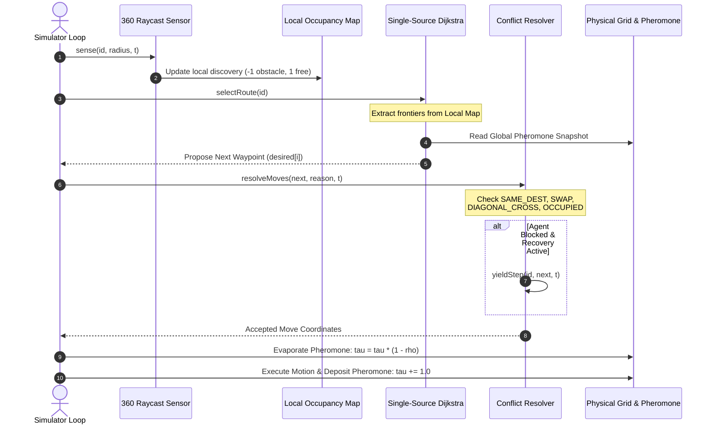
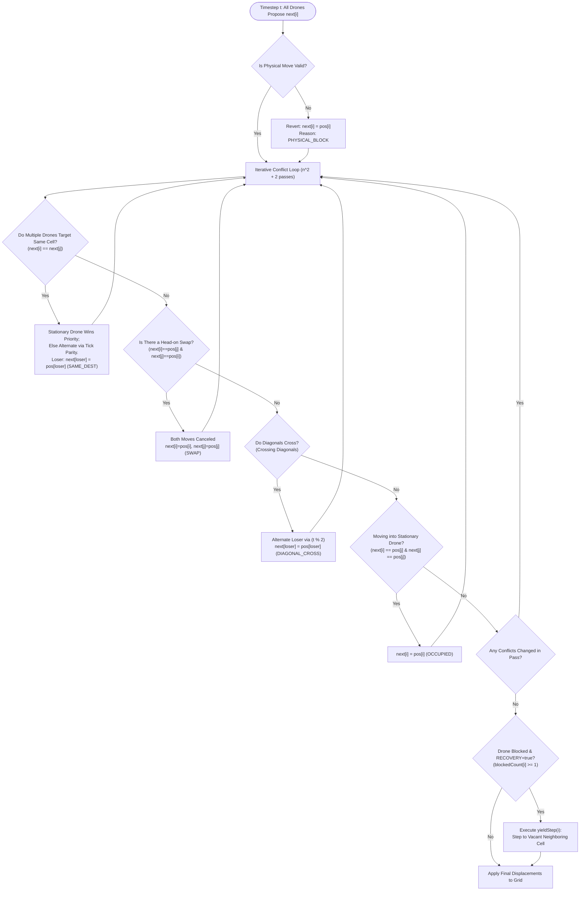
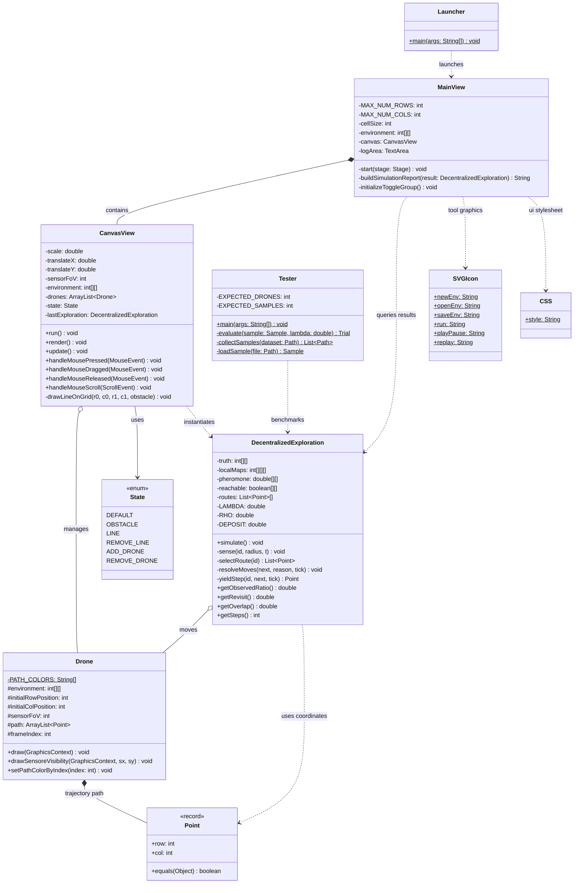
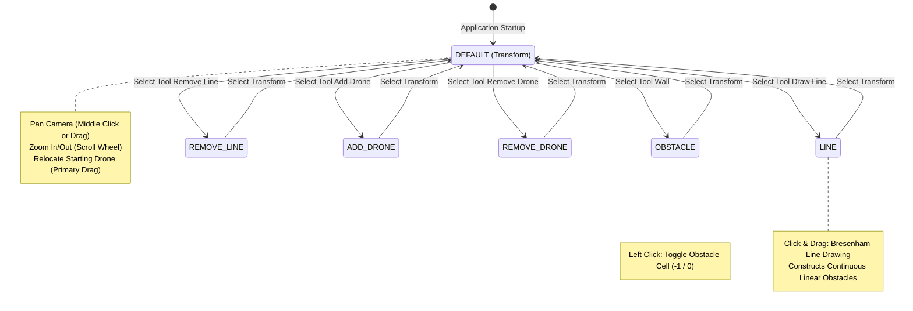

# Decentralized Swarm Coverage Using Frontier-Based Exploration and Repulsive Pheromone Stigmergy (FBE-RPS)
###Sugiarto Cokrowibowo

[](https://openjdk.org/)
[](https://openjfx.io/)
[](https://maven.apache.org/)
[]()
[]()

---

## Table of Contents
- [1. Executive Summary & Academic Background](#1-executive-summary--academic-background)
- [2. Mathematical Formulation & Algorithmic Model](#2-mathematical-formulation--algorithmic-model)
  - [2.1 Environment Representation & Raycasting Sensor Model](#21-environment-representation--raycasting-sensor-model)
  - [2.2 Frontier-Based Exploration (FBE)](#22-frontier-based-exploration-fbe)
  - [2.3 Repulsive Pheromone Stigmergy (RPS)](#23-repulsive-pheromone-stigmergy-rps)
  - [2.4 Route Utility Function (Single-Source Dijkstra)](#24-route-utility-function-single-source-dijkstra)
  - [2.5 Academic Evaluation Metrics](#25-academic-evaluation-metrics)
- [3. System Architecture & Workflows](#3-system-architecture--workflows)
  - [3.1 Multi-Agent Decision Cycle (Sequence Diagram)](#31-multi-agent-decision-cycle-sequence-diagram)
  - [3.2 Simultaneous Conflict Resolution & Yield Protocol (Flowchart)](#32-simultaneous-conflict-resolution--yield-protocol-flowchart)
  - [3.3 Class Relationship Diagram (UML Class Diagram)](#33-class-relationship-diagram-uml-class-diagram)
  - [3.4 UI Interaction State Diagram](#34-ui-interaction-state-diagram)
- [4. In-Depth Codebase Breakdown (Classes, Methods, & Variables)](#4-in-depth-codebase-breakdown-classes-methods--variables)
  - [4.1 DecentralizedExploration.java (Algorithmic Core)](#41-decentralizedexplorationjava-algorithmic-core)
  - [4.2 Drone.java (Drone Entity & Kinematic Visualization)](#42-dronejava-drone-entity--kinematic-visualization)
  - [4.3 CanvasView.java (Rendering Engine & Interactive Canvas)](#43-canvasviewjava-rendering-engine--interactive-canvas)
  - [4.4 MainView.java (JavaFX User Interface & Reporting)](#44-mainviewjava-javafx-user-interface--reporting)
  - [4.5 Tester.java (Headless Batch Benchmark Evaluation)](#45-testerjava-headless-batch-benchmark-evaluation)
  - [4.6 Supporting Classes (Point, State, SVGIcon, CSS, Launcher)](#46-supporting-classes-point-state-svgicon-css-launcher)
- [5. Benchmark Scenarios & Topologies](#5-benchmark-scenarios--topologies)
- [6. Getting Started & Execution Guide](#6-getting-started--execution-guide)
  - [6.1 Running the GUI Simulator](#61-running-the-gui-simulator)
  - [6.2 Running the Headless Batch Benchmark](#62-running-the-headless-batch-benchmark)
  - [6.3 Experimental Parameter Configuration (JVM System Properties)](#63-experimental-parameter-configuration-jvm-system-properties)
- [7. Citation & Academic References](#7-citation--academic-references)

---

## 1. Executive Summary & Academic Background

This repository implements a high-performance simulation and benchmarking engine for **Decentralized Multi-UAV Swarm Area Coverage and Exploration** in unknown 2D grid environments.

In multi-robot and swarm robotics literature, classic **Frontier-Based Exploration (FBE)** (pioneered by Brian Yamauchi in 1997) guides autonomous agents to boundaries separating known free space from unmapped areas. However, when deployed in decentralized swarms without a centralized global coordinator, standard FBE suffers from **severe convergence anomalies (clustering and congestion)**: multiple drones simultaneously select the same nearest frontier, resulting in:
1. **High Exploration Redundancy (Excessive Overlap)**: Swarm members clump together and repeatedly scan the same regions.
2. **Excessive Path Revisitation**: Agents oscillate locally without dispersing into distinct partitions.
3. **Deadlocks and Bottleneck Contention**: Severe movement conflicts arise in narrow corridors and chokepoints.

To address these limitations without requiring complex, high-bandwidth peer-to-peer negotiation or single-point-of-failure centralized coordinators, this framework integrates **Repulsive Pheromone Stigmergy (RPS)**. Inspired by biological indirect communication in social insects, an evaporating, globally shared virtual repulsive pheromone field serves as a spatial collective memory. Each drone plans its path using **Single-Source Dijkstra** with integrated pheromone path penalties. Corridors and frontiers previously traversed or targeted by other agents accumulate repulsive deposits, thereby naturally dispersing the swarm across distinct uncharted sectors of the environment.

### Key Framework Highlights
- **Decentralized Local Occupancy Maps**: Each drone maintains an independent local occupancy grid $\mathcal{M}_i$, strictly insulated from ground-truth oracle leakage.
- **Realistic 360° Raycasting Sensor**: Radial beam sensor with physical obstacle occlusion and fine sub-cell resolution ($0.125$ cell steps).
- **Stigmergic Dispersion ($\lambda$-Repulsion)**: Integrated path-accumulated pheromone penalties that drive spatial diversification without explicit task assignment.
- **Simultaneous Conflict Resolution**: Deterministic, decentralized collision arbitration handling target conflicts (*same destination*), head-on swaps (*swap*), crossing paths (*diagonal cross*), and static obstacle blocks (*occupied cell*).
- **Deadlock Recovery & Yield Protocol**: Local yield maneuvers and frontier exhaustion tracking prevent persistent oscillations when agents encounter spatial bottlenecks.
- **Dual Execution Modes**: Interactive JavaFX GUI with smooth camera pan/zoom, synchronized multi-agent replay, and environment editing tools, alongside a high-throughput headless batch tester for 100 benchmark topologies.

---

## 2. Mathematical Formulation & Algorithmic Model

```
+------------------------------------------------------------------------------------------------+
|                                    ALGORITHM WORKFLOW (v1.1)                                   |
|                                                                                                |
|   +--------------------+       +-----------------------+       +---------------------------+   |
|   | 360-deg Raycasting | ----> | Local Occupancy Map   | ----> | Frontier Extraction (N8)  |   |
|   | Sensor Model       |       | M_i in {-1, 0, 1}     |       | Free cells bordering unk. |   |
|   +--------------------+       +-----------------------+       +---------------------------+   |
|                                                                              |                 |
|                                                                              v                 |
|   +--------------------+       +-----------------------+       +---------------------------+   |
|   | Simultaneous Move  | <---- | Deterministic Move    | <---- | Single-Source Dijkstra    |   |
|   | & Pheromone Update |       | Conflict Resolution   |       | Cost = Dist + Lambda * Tau|   |
|   +--------------------+       +-----------------------+       +---------------------------+   |
+------------------------------------------------------------------------------------------------+
```

### 2.1 Environment Representation & Raycasting Sensor Model

The ground-truth physical environment is defined as a discrete grid $\mathcal{M}_{\text{truth}} \in \{-1, 0\}^{H \times W}$, where $H$ (`rows`) and $W$ (`cols`):
- $-1$ represents an impassable obstacle/wall.
- $0$ represents traversable free space.

Each individual drone $i \in \{1, \dots, n\}$ maintains its own local occupancy map $\mathcal{M}_i \in \{-1, 0, 1\}^{H \times W}$:
- $0$: Unknown / unexplored cell.
- $1$: Known traversable free cell.
- $-1$: Known obstacle cell.

At each simulation timestep $t$, drone $i$ positioned at grid coordinate $(r_i, c_i)$ emits 360 radial rays ($\theta = 0^\circ, 1^\circ, \dots, 359^\circ$) up to a maximum sensing radius $R_{\text{max}} = \text{sensorFoV} + 0.5$ (default $\text{sensorFoV} = 4$ cells):

$$\vec{u}(\theta) = (\sin\theta, \cos\theta)$$

Ray sample coordinates at continuous distance $d \in [0.125, R_{\text{max}}]$ with step size $\Delta d = 0.125$:

$$r(d) = \lfloor (r_i + 0.5) + d \cdot \sin\theta \rfloor, \quad c(d) = \lfloor (c_i + 0.5) + d \cdot \cos\theta \rfloor$$

If $\mathcal{M}_{\text{truth}}(r(d), c(d)) = -1$, the cell is marked as an obstacle in $\mathcal{M}_i$ and ray advancement terminates immediately, simulating line-of-sight visual occlusion.

---

### 2.2 Frontier-Based Exploration (FBE)

A cell $(r, c)$ is classified as a **frontier cell** for drone $i$ if and only if it is confirmed free in $\mathcal{M}_i$, but is adjacent to at least one unexplored cell within its 8-connected neighborhood ($\mathcal{N}_8$):

$$\mathcal{F}_i^{(t)} = \lbrace (r, c) \in \mathbb{Z}^2 \mid \mathcal{M}_i^{(t)}(r, c) = 1 \land \exists (dr, dc) \in \mathcal{N}_8 \text{ s.t. } \mathcal{M}_i^{(t)}(r+dr, c+dc) = 0 \rbrace$$

where the 8-connected neighborhood displacement set $\mathcal{N}_8$ is deterministically ordered:

$$\mathcal{N}_8 = \lbrace (0, 1), (1, 1), (1, 0), (1, -1), (0, -1), (-1, -1), (-1, 0), (-1, 1) \rbrace$$

---

### 2.3 Repulsive Pheromone Stigmergy (RPS)

The global repulsive pheromone field $\tau(r, c) \in \mathbb{R}_{\ge 0}$ evolves at each simulation timestep via two discrete phases:

1. **Global Evaporation Phase**:
   All cells undergo uniform exponential decay governed by evaporation rate $\rho \in [0, 1]$ (default $\rho = 0.05$):
   $$\tau^{(t+1/2)}(r, c) = (1 - \rho) \cdot \tau^{(t)}(r, c)$$

2. **Movement-Based Deposition Phase**:
   Only drones that successfully traverse to a new cell $(nr, nc) \neq (r, c)$ deposit repulsive pheromone $\Delta \tau$ (default $\Delta \tau = 1.0$):
   $$\tau^{(t+1)}(nr, nc) = \tau^{(t+1/2)}(nr, nc) + \Delta \tau$$

> [!NOTE]
> Stationary or blocked drones do **not** deposit pheromone. This prevents artificial runaway pheromone accumulation caused by agents queuing or stalling in bottlenecks.

---

### 2.4 Route Utility Function (Single-Source Dijkstra)

Drone $i$ executes a Single-Source Dijkstra search starting from its current coordinate $(sr, sc)$ across all known free cells $\mathcal{M}_i(r, c) = 1$. The step cost is $1.0$ for orthogonal transitions and $\sqrt{2} \approx 1.41421356$ for diagonal transitions, enforced with strict corner clearance:

$$\text{LegalDiagonal}((r, c) \to (r+dr, c+dc)) \iff \mathcal{M}_i(r, c+dc) = 1 \land \mathcal{M}_i(r+dr, c) = 1$$

For every reachable candidate frontier $f \in \mathcal{F}_i^{(t)}$, total path cost is evaluated by integrating the pheromone trail accumulated along the shortest path $\Pi(sr \to f)$:

$$\mathcal{J}(f) = \mathcal{D}(sr, f) + \lambda \sum_{k \in \Pi(sr \to f)} \tau^{(t)}(k)$$

```
                                    +----------------------------------+
                                    |    FBE-RPS Objective Function    |
                                    |                                  |
                                    |  J(f) = D(sr, f) + lambda * P(f) |
                                    +----------------------------------+
                                                     |
                    +--------------------------------+-------------------------------+
                    |                                                                |
                    v                                                                v
        +-----------------------+                                        +-----------------------+
        |      lambda = 0       |                                        |      lambda > 0       |
        |  Pure Greedy Frontier |                                        | Repulsive Stigmergy   |
        |  Minimizes path dist. |                                        | Penalizes congested,  |
        |  High swarm overlap   |                                        | previously-visited    |
        +-----------------------+                                        | corridors & frontiers |
                                                                         +-----------------------+
```

The optimal frontier $f^*$ is selected as:

$$f^* = \arg\min_{f \in \mathcal{F}_i^{(t)}} \mathcal{J}(f)$$

**Deterministic Tie-Breaking Rules**:
If two candidate frontiers yield identical cost $\mathcal{J}(f)$ within floating-point tolerance $\epsilon = 10^{-9}$:
1. Select the frontier with the strictly smaller path distance $\mathcal{D}(sr, f)$.
2. If distances are identical, select the smaller row index (`row`).
3. If row indices are identical, select the smaller column index (`col`).
*These deterministic rules ensure 100% scientific reproducibility across experimental runs.*

---

### 2.5 Academic Evaluation Metrics

Quantitative performance is evaluated using four primary benchmark metrics:

| Symbol | Metric Name | Mathematical Formula | Physical Meaning |
| :---: | :--- | :--- | :--- |
| $\mathcal{C}$ | **Observed Coverage** | $\frac{\lvert \mathcal{M}_{\text{observed}} \cap \mathcal{M}_{\text{reachable}} \rvert}{\lvert \mathcal{M}_{\text{reachable}} \rvert} \times 100\%$ | Percentage of reachable free cells successfully swept by the swarm's sensors. |
| $\mathcal{R}$ | **Revisit Ratio** | $\frac{V_{\text{total}} - V_{\text{unique}}}{V_{\text{total}}} \times 100\%$ | Exploration inefficiency metric; proportion of physical footsteps that re-enter previously visited cells. |
| $\mathcal{O}$ | **Overlap Ratio** | $\frac{\lvert \lbrace c \in \mathcal{V}_{\text{unique}} \colon \lvert \text{Visitors}(c) \rvert > 1 \rbrace \rvert}{\lvert \mathcal{V}_{\text{unique}} \rvert} \times 100\%$ | Spatial redundancy; percentage of visited cells traversed by more than one distinct drone. |
| $\mathcal{S}$ | **Completion Steps** | $\min \lbrace t \ge 0 \colon \mathcal{C}(t) = 100\% \rbrace$ | Number of timesteps required to achieve full 100% coverage. Evaluates to `N/A` if premature termination occurs. |

---

## 3. System Architecture & Workflows

### 3.1 Multi-Agent Decision Cycle (Sequence Diagram)

The following sequence diagram illustrates the synchronized execution cycle per simulation tick:



---

### 3.2 Simultaneous Conflict Resolution & Yield Protocol (Flowchart)

Decentralized multi-agent collision arbitration workflow without a central controller:



---

### 3.3 Class Relationship Diagram (UML Class Diagram)



---

### 3.4 UI Interaction State Diagram



---

## 4. In-Depth Codebase Breakdown (Classes, Methods, & Variables)

### 4.1 `DecentralizedExploration.java` (Algorithmic Core)

This `final` class serves as the computational engine of the exploration algorithm. It executes the entire multi-agent simulation run upon instantiation without any dependencies on UI libraries, making it fully headless-ready.

#### Key Variables & Constants:
- `private static final int[][] N8`: Deterministic 8-connected neighborhood displacement matrix.
- `private final double LAMBDA`: Pheromone repulsion weight factor (parsed from `-Dswarm.lambda`, default `1.0`).
- `private final double RHO`: Evaporation rate per simulation tick (parsed from `-Dswarm.rho`, default `0.05`).
- `private final double DEPOSIT`: Pheromone deposited per step (parsed from `-Dswarm.deposit`, default `1.0`).
- `private final int MAX_STEPS`: Upper bound on simulation timesteps (default `2500`).
- `private final int STALL_LIMIT`: Threshold for consecutive non-movement steps before terminating with `STALL` (default `30` steps).
- `private final int[][][] localMaps`: Individual occupancy map per agent `[droneIndex][row][col]`. Values: `0` (unknown), `1` (free), `-1` (obstacle).
- `private final double[][] pheromone`: Globally shared repulsive pheromone field `[row][col]`.
- `private final boolean[][] reachable`: Reachability mask identified by initial flood-fill.
- `private final int[][] firstObservedAt`: Matrix storing the exact timestep $t$ when cell $(r, c)$ was first sensed.
- `private final int[][][] exhaustedAtVersion`: Tabu memory tracking contested or unreachable frontiers for a given local map version to prevent oscillation loops.

#### Core Methods:
- `public DecentralizedExploration(int[][] environment, ArrayList<Drone> agents)`:
  Main constructor. Validates starting positions, executes `markReachable()`, runs `simulate()`, and calculates final performance metrics ($\mathcal{C}, \mathcal{R}, \mathcal{O}, \mathcal{S}$).
- `private int markReachable()`:
  Executes an 8-connected BFS queue from all initial drone coordinates to discover all physically reachable free space (`reachableFree`).
- `private void sense(int id, int radius, int t)`:
  Performs 360-degree radial raycasting with an interval step of $0.125$ cells. Discovered cells are written strictly to `localMaps[id]`.
- `private List<Point> selectRoute(int id)`:
  Runs Single-Source Dijkstra across known free space from the drone's position. Calculates accumulated path pheromone penalties to each candidate frontier, evaluates $\mathcal{J}(f) = \text{dist} + \lambda \cdot \text{penalty}$, and reconstructs the waypoints via predecessor tracking.
- `private void resolveMoves(Point[] next, String[] reason, int tick)`:
  Deterministically resolves simultaneous multi-agent motion conflicts:
  1. `SAME_DEST`: Multiple drones claim the same destination cell. Stationary occupants win priority; otherwise, winners alternate based on parity `tick % 2`.
  2. `SWAP`: Two drones attempt to exchange positions across an edge. Both moves are canceled.
  3. `DIAGONAL_CROSS`: Crossing diagonal trajectories are detected. One agent is commanded to stay.
  4. `OCCUPIED`: A drone attempts to move into a cell occupied by a stationary drone.
- `private Point yieldStep(int id, Point[] next, int tick)`:
  Deadlock recovery procedure. If a drone is blocked (`blockedCount >= 1`), it inspects its 8-connected neighborhood for an adjacent unoccupied free cell to yield and relieve spatial congestion.
- `private void simulate()`:
  Main discrete-time simulation loop from timestep $t = 0$ up to `MAX_STEPS - 1`. Coordinates sensing, route planning, conflict arbitration, pheromone evaporation, pheromone deposition, and completion checks.

---

### 4.2 `Drone.java` (Drone Entity & Kinematic Visualization)

Represents the physical and visual attributes of each unmanned aerial vehicle in the swarm.

#### Features & Variables:
- `private static final String[] PATH_COLORS`: Curated palette of 30 distinct high-contrast hex color codes (`#FF204E`, `#00C2FF`, `#FFB000`, etc.) ensuring visual distinctness for individual trajectories.
- `protected ArrayList<Point> path`: Complete trajectory history recording discrete coordinates $(r, c)$ at every simulation step (used for synchronized replay).
- `protected int frameIndex`: Active playback frame index during visualization replay.
- `protected int sensorFoV`: Sensor field-of-view radius ($4$ cells).
- `draw(GraphicsContext gc)`: Renders drone chassis components (central fuselage, diagonal crossarms, 4 rotating circular propellers, and name/coordinate labels).
- `drawSensoreVisibility(GraphicsContext gc, double sx, double sy)`: Renders the 360° semi-transparent orange (`#FF7D29`, alpha $0.3$) radial sensor footprint bounded by obstacle contours.

---

### 4.3 `CanvasView.java` (Rendering Engine & Interactive Canvas)

A subclass of `javafx.scene.canvas.Canvas` responsible for real-time graphics rendering, camera manipulation, and environment authoring.

#### Features & Core Mechanics:
- **Virtual Camera & Transformations**:
  Supports smooth camera panning (via middle mouse drag or free transform) and continuous zooming ($0.1\times$ to $20.0\times$) anchored to the cursor position through `screenToWorldX/Y` coordinate transformations.
- **Environment Editing Tools**:
  - `drawLineOnGrid(r0, c0, r1, c1, addObstacle)`: High-performance **Bresenham line algorithm** for rasterizing continuous linear walls between two points.
  - `checkWallType()`: 4-directional neighborhood analysis (East, South, West, North) for rendering architectural cross-hatchings on obstacle boundaries.
- **Layered Visual Rendering**:
  1. *Background & Grid*: Base canvas with distinct major guidelines at 10-cell intervals.
  2. *Obstacles & Shadows*: Teal wall blocks `#03A6A1` complemented by 3px offset drop shadows `#505050`.
  3. *Fog-of-War*: Dark semi-transparent overlay `#263241` concealing unobserved cells for the active replay frame.
  4. *Visitation Heatmap Footprint*: Faint mint green `#79CDB2` overlay indicating areas previously explored.
  5. *Trajectories*: Color-coded path polylines matching each drone's assigned palette.
  6. *Drone Avatars*: Physical drone hulls and active sensor visibility cones.
- **Synchronized Playback Engine**:
  Leverages JavaFX `AnimationTimer` with a calibrated tick interval of $95 \text{ ms}$ (~$10.5 \text{ steps/sec}$) for multi-agent replay.

---

### 4.4 `MainView.java` (JavaFX User Interface & Reporting)

The primary JavaFX application shell orchestrating menu bars, SVG-based toolbars, the central canvas view, and simulation diagnostics.

#### Key Features & Methods:
- `start(Stage stage)`: Initializes a full-window split layout separating the interactive exploration canvas from the simulation report console.
- `buildSimulationReport(DecentralizedExploration result)`: Generates an exhaustive academic report displaying:
  - Termination status (`ALL_REACHABLE_FREE_CELLS_OBSERVED`, `MAX_STEPS`, `STALL`).
  - Four primary benchmark metrics ($\mathcal{C}, \mathcal{R}, \mathcal{O}, \mathcal{S}$).
  - Bounding box dimensions of the explored territory (`MIN/MAX Row & Col`).
  - Trajectory logs listing discrete $(r, c)$ coordinates for each drone.
- *SVG Toolbar Actions*:
  Interactive buttons for *New Environment, Open, Save, Free Transform, Add Drone, Remove Drone, Wall, Draw Line, Remove Line, Run Simulation, Play/Pause Replay, and Replay Reset*.

---

### 4.5 `Tester.java` (Headless Batch Benchmark Evaluation)

A standalone batch testing harness for rigorous empirical evaluation across large sample collections without launching JavaFX.

#### Protocol & Validation:
- Validates experimental JVM system properties (`swarm.lambda`, `swarm.rho`, `swarm.deposit`, etc.).
- Evaluates 100 paired benchmark scenarios systematically:
  - Baseline Condition: $\lambda = 0.0$ (Pure Greedy FBE).
  - Proposed Stigmergic Condition: $\lambda = 1.0$ (FBE with Repulsive Pheromones).
- Conducts internal mathematical consistency cross-checks ensuring headless metrics match GUI outputs identically.
- Exports results to structured CSV tables with semicolon (`;`) or comma (`,`) delimiters and logs individual sample termination reasons.

---

### 4.6 Supporting Classes (`Point`, `State`, `SVGIcon`, `CSS`, `Launcher`)

- **`Point.java`**: Immutable Java record `record Point(int row, int col)` optimized for fast hashing and equality comparison.
- **`State.java`**: Enumeration of editor interaction states (`DEFAULT`, `OBSTACLE`, `LINE`, `REMOVE_LINE`, `ADD_DRONE`, `REMOVE_DRONE`).
- **`SVGIcon.java`**: Compact repository of raw SVG path geometry strings providing crisp resolution-independent icons.
- **`CSS.java`**: Integrated stylesheet definitions for JavaFX UI theming.
- **`Launcher.java`**: Bootstrap entry point (`main`) for launching the JavaFX runtime cleanly across varied JDK packaging configurations.

---

## 5. Benchmark Scenarios & Topologies

The repository includes **100 standardized benchmark environment files** located within the `dataset/` directory, categorized into 5 challenging spatial topologies:

<p align="center">
  
  <br/>
  <em>Figure 1: Comprehensive benchmark dataset overview comprising 100 environment samples across five distinct spatial topologies (S01 to S05) with Centered (C) and Dispersed (D) initial swarm configurations.</em>
</p>

```
src/main/java/drone/decentralizedswarmcoverage_fbe_rps/dataset/
├── S01_Open_Space/            # 20 Files: S01_G01_C.sc to S01_G10_D.sc
├── S02_Partitioned_Rooms/     # 20 Files: S02_G01_C.sc to S02_G10_D.sc
├── S03_Branching_Corridors/   # 20 Files: S03_G01_C.sc to S03_G10_D.sc
├── S04_Serpentine/            # 20 Files: S04_G01_C.sc to S04_G10_D.sc
└── S05_Bottleneck/            # 20 Files: S05_G01_C.sc to S05_G10_D.sc
```

| Code | Topology Name | Environmental Characteristics | Swarm Exploration Challenges |
| :---: | :--- | :--- | :--- |
| **S01** | `Open_Space` | Expansive open fields with minimal internal obstacles. | High risk of redundant perimeter following and diffuse dispersion. |
| **S02** | `Partitioned_Rooms` | Layouts mimicking office buildings with multiple doorways. | Agents tend to trap themselves within the same room without repulsion. |
| **S03** | `Branching_Corridors` | Labyrinthine networks featuring repeated $T$-junctions and cross-intersections. | Branch selection dilemmas; preventing duplicate exploration of dead ends. |
| **S04** | `Serpentine` | Elongated, winding spiral corridors with sharp turns. | Susceptible to convoy queuing and lengthy backtrack latency. |
| **S05** | `Bottleneck` | Broad chambers linked exclusively through narrow bottlenecks. | Extreme deadlock risk and head-on contention in single-cell doorways. |

### Paired Initial Configurations:
Each geometry (G01 through G10) provides two distinct starting placement paradigms:
1. **`_C` (Centered Start)**:
   All 4 drones begin in adjacent grid cells at the center of the map (e.g., $(43,41), (43,42), (44,41), (44,42)$). Represents a severe congestion stress-test for initial repulsive dispersion and collision avoidance.
2. **`_D` (Dispersed Start)**:
   The 4 drones are initialized far apart at opposing boundary corners. Evaluates the swarm's ability to merge partial map discoveries without wasteful overlap upon meeting.

---

## 6. Getting Started & Execution Guide

### Prerequisites
- **Java Development Kit (JDK)**: Version 21 or newer (JDK 24 recommended).
- **Apache Maven**: Version 3.9+.
- **Operating System**: Windows, Linux, or macOS.

---

### 6.1 Running the GUI Simulator

To launch the interactive graphical application:

```bash
# Using Maven JavaFX Plugin
mvn clean javafx:run
```

Or via IntelliJ IDEA:
1. Open the project in IntelliJ IDEA.
2. Navigate to `src/main/java/drone/decentralizedswarmcoverage_fbe_rps/Launcher.java`.
3. Right-click $\rightarrow$ **Run 'Launcher.main()'**.

#### Graphical Interface Workflow:
1. Click **Open Environment** to load any `.sc` scenario file from the `dataset/` directory.
2. Click **Run** to execute the FBE-RPS multi-agent simulation.
3. Use the **Play / Pause** controls to inspect the step-by-step exploration animation.
4. Review the generated metrics report in the right-hand console pane.

---

### 6.2 Running the Headless Batch Benchmark

To execute the automated evaluation over all 100 benchmark samples (comparing $\lambda=0$ vs $\lambda=1$):

```bash
# Compile project
mvn test-compile

# Execute Tester directly
java -cp target/classes drone.decentralizedswarmcoverage_fbe_rps.Tester
```

Benchmark output tables are automatically persisted to `results/ExplorationResults<timestamp>.csv`.

---

### 6.3 Experimental Parameter Configuration (JVM System Properties)

All core algorithmic parameters can be tuned dynamically at launch via Java `-D` flags:

| JVM Property | Type | Default Value | Description |
| :--- | :---: | :---: | :--- |
| `swarm.lambda` | `double` | `1.0` | Pheromone repulsion weight factor ($\lambda$). Set to `0.0` for pure baseline FBE. |
| `swarm.rho` | `double` | `0.05` | Pheromone evaporation rate per tick ($\rho \in [0, 1]$). |
| `swarm.deposit` | `double` | `1.0` | Quantity of pheromone deposited upon cell transition ($\Delta\tau$). |
| `swarm.recovery` | `boolean` | `true` | Enables deadlock avoidance and local yielding maneuvers. |
| `swarm.maxSteps` | `int` | `2500` | Maximum allowable simulation timesteps before forced termination. |
| `swarm.stallLimit` | `int` | `30` | Maximum consecutive stagnant steps without movement before `STALL` termination. |
| `swarm.trace` | `String` | `""` | File path for exporting microscopic per-tick agent telemetry logs. |

Example launching with elevated repulsion:
```bash
java -Dswarm.lambda=2.5 -Dswarm.rho=0.02 -cp target/classes drone.decentralizedswarmcoverage_fbe_rps.Tester
```

---

## 7. Citation & Academic References

If you utilize this source code, algorithmic model, or benchmark dataset in your academic research, please cite this work as follows:

```bibtex
@software{fossalgo_fbe_rps_2026,
  author       = {FOSSALGO and Sugiarto Cokrowibowo},
  title        = {Decentralized Swarm Coverage Using Frontier-Based Exploration and Repulsive Pheromone Stigmergy (FBE-RPS)},
  year         = {2026},
  publisher    = {GitHub},
  journal      = {GitHub repository},
  howpublished = {\url{https://github.com/FOSSALGO/DecentralizedSwarmCoverage_FBE_RPS}}
}
```

### References
1. P. C. Shih, Y. C. Chiang, J. J. Hu, K. T. Lin, and L. C. Fu, “Autonomous exploration of mobile robot equipped with LiDAR for high-quality reconstruction in large-scale indoor environments,” Mechatronics, vol. 112, no. August, p. 103409, 2025, doi: 10.1016/j.mechatronics.2025.103409.
2. S. N. L. K. N. Azmi, N. I. A. Apandi, M. Rafique, and N. A. Muhammad, “Autonomous Mobile Robots Path Planning with Integrative Edge Cloud-Based Ant Colony Optimization,” Int. J. Robot. Control Syst., vol. 5, no. 3, pp. 1866–1885, 2025, doi: 10.31763/ijrcs.v5i3.1884.
3. G. Airlangga, J. Bata, O. I. A. Nugroho, L. F. Sugianto, P. H. Saputro, S. J. Makin, and A. Alamsyah, “Enhanced Advanced Multi-Objective Path Planning (EAMOPP) for UAV Navigation in Complex Dynamic 3D Environments,” Int. J. Robot. Control Syst., vol. 5, no. 2, pp. 713–729, Feb. 2025, doi: 10.31763/ijrcs.v5i2.1759.
4. C. Gao, X. Wang, R. Wang, Z. Zhao, Y. Zhai, X. Chen, and B. M. Chen, “A UAV-based explore-then-exploit system for autonomous indoor facility inspection and scene reconstruction,” Autom. Constr., vol. 148, no. January, p. 104753, 2023, doi: 10.1016/j.autcon.2023.104753.
5. H. Azpúrua, M. Saboia, G. M. Freitas, L. Clark, A. akbar Agha-mohammadi, G. Pessin, M. F. M. Campos, and D. G. Macharet, “A Survey on the autonomous exploration of confined subterranean spaces: Perspectives from real-word and industrial robotic deployments,” Rob. Auton. Syst., vol. 160, p. 104304, 2023, doi: 10.1016/j.robot.2022.104304.
6. V. P. Tran, M. A. Garratt, K. Kasmarik, S. G. Anavatti, and S. Abpeikar, “Frontier-led swarming: Robust multi-robot coverage of unknown environments,” Swarm Evol. Comput., vol. 75, no. August, p. 101171, 2022, doi: 10.1016/j.swevo.2022.101171.
7. K. Pongsirijinda, Z. Cao, K. Bhowmik, M. Shalihan, B. P. L. Lau, R. Liu, C. Yuen, and U. X. Tan, “Distributed multi-robot potential-field-based exploration with submap-based mapping and noise-augmented strategy,” Rob. Auton. Syst., vol. 179, no. November 2023, p. 104752, 2024, doi: 10.1016/j.robot.2024.104752.
8. M. Zhu, Z. Liu, W. Li, S. Wang, and Q. Zhang, “Improved wavefront frontier detection-utility value task allocation for multi-robot collaborative environmental exploration,” Autom. Constr., vol. 182, no. June 2025, p. 106740, 2026, doi: 10.1016/j.autcon.2025.106740.
9. M. Sardar, D. Das, and S. Mukhopadhyaya, “Grid exploration by a swarm of autonomous robots with minimum repetitions,” Theor. Comput. Sci., vol. 933, pp. 67–87, 2022, doi: 10.1016/j.tcs.2022.08.029.
10. Z. Shang, J. Qi, Y. Peng, M. Wang, C. Wu, Y. Ping, H. Huang, and X. Ren, “DEBS: Decentralized Exploration planning for multi-UAV systems using Bio-inspired Self-aggregation mechanism,” Phys. Commun., vol. 73, no. July, p. 102898, 2025, doi: 10.1016/j.phycom.2025.102898.
11. P. Quin, D. D. K. Nguyen, T. L. Vu, A. Alempijevic, and G. Paul, “Approaches for Efficiently Detecting Frontier Cells in Robotics Exploration,” Front. Robot. AI, vol. 8, no. February, pp. 1–15, 2021, doi: 10.3389/frobt.2021.616470.
12. R. Wang, J. Zhang, M. Lyu, C. Yan, and Y. Chen, “An improved frontier-based robot exploration strategy combined with deep reinforcement learning,” Rob. Auton. Syst., vol. 181, no. April 2023, p. 104783, 2024, doi: 10.1016/j.robot.2024.104783.
13. M. Zhao, H. Lu, S. Cheng, S. Yang, and Y. Shi, “A multi-robot cooperative exploration algorithm considering working efficiency and working load,” Appl. Soft Comput., vol. 128, p. 109482, 2022, doi: 10.1016/j.asoc.2022.109482.
14. İ. Güven and E. Yanmaz, “Multi-objective path planning for multi-UAV connectivity and area coverage,” Ad Hoc Networks, vol. 160, no. April, 2024, doi: 10.1016/j.adhoc.2024.103520.
15. A. Boldini, M. Civitella, and M. Porfiri, “Stigmergy: from mathematical modelling to control,” R. Soc. Open Sci., vol. 11, no. 9, 2024, doi: 10.1098/rsos.240845.
16. C. R. Tinoco, L. G. A. Martins, and G. M. B. Oliveira, “PheroCom: Decentralised and asynchronous robot swarm coordination framework based on virtual pheromone and vibroacoustic communication,” Swarm Evol. Comput., vol. 99, no. September, p. 102083, 2025, doi: 10.1016/j.swevo.2025.102083.
17. V. P. Tran, M. A. Garratt, K. Kasmarik, and S. G. Anavatti, “Dynamic Frontier-Led Swarming: Multi-Robot Repeated Coverage in Dynamic Environments,” IEEE/CAA J. Autom. Sin., vol. 10, no. 3, pp. 646–661, 2023, doi: 10.1109/JAS.2023.123087.
18. H. Ardiny and A. M. Beigzadeh, “Enhancing radioactive environment exploration with bio-inspired swarm robotics: A comparative analysis of Lévy flight and stigmergy methods,” Rob. Auton. Syst., vol. 181, no. August, p. 104794, 2024, doi: 10.1016/j.robot.2024.104794.
19. M. Salman, D. Garzón Ramos, and M. Birattari, “Automatic design of stigmergy-based behaviours for robot swarms,” Commun. Eng., vol. 3, no. 1, pp. 1–13, 2024, doi: 10.1038/s44172-024-00175-7.
20. R. De Nicola, L. Di Stefano, and O. Inverso, “Multi-agent systems with virtual stigmergy,” Sci. Comput. Program., vol. 187, p. 102345, 2020, doi: 10.1016/j.scico.2019.102345.
21. I. B. Ghiloubi, L. Abdou, and O. Lahmar, “Anti-Collision Formation Control for Drone Swarms Tracking Aerial Targets Under Wind Disturbance,” Int. J. Robot. Control Syst., vol. 5, no. 6, pp. 2831–2852, 2025, doi: 10.31763/ijrcs.v5i6.1994.
22. J. Fan, X. Zhang, and Y. Zou, “Hierarchical path planner for unknown space exploration using reinforcement learning-based intelligent frontier selection,” Expert Syst. Appl., vol. 230, no. February, p. 120630, 2023, doi: 10.1016/j.eswa.2023.120630.
23. Q. Zou, J. Liu, M. Lin, Y. Wang, and F. Wang, “MCVP: Multi-channel viewpoint planner for efficient exploration and mapping of complex 3D environments,” Biomim. Intell. Robot., vol. 6, no. 2, p. 100303, 2026, doi: 10.1016/j.birob.2026.100303.
24. Y. Zhou, L. Yan, H. Wu, L. Zhu, Y. Han, Y. Liu, and H. Xie, “HALE: a hierarchical autonomous exploration framework for UAVs with limited field-of-view in large-span environments,” Expert Syst. Appl., vol. 329, no. January, p. 132979, 2026, doi: 10.1016/j.eswa.2026.132979.
25. Y. Zhou, L. Yan, Y. Han, L. Zhu, Y. Zhao, and H. Xie, “HFCH: Hybrid frontier guided fast UAV autonomous exploration for complete and high-quality mapping in unknown environment,” Adv. Eng. Informatics, vol. 69, no. PA, p. 103834, 2026, doi: 10.1016/j.aei.2025.103834.
26. H. Zhao, Y. Guo, Y. Liu, and J. Jin, “Multirobot unknown environment exploration and obstacle avoidance based on a Voronoi diagram and reinforcement learning,” Expert Syst. Appl., vol. 264, no. November 2024, p. 125900, 2025, doi: 10.1016/j.eswa.2024.125900.
27. X. Sun, S. Deng, B. Tong, S. Wang, C. Zhang, and Y. Jiang, “Hierarchical framework for mobile robots to effectively and autonomously explore unknown environments,” ISA Trans., vol. 134, pp. 1–15, 2023, doi: 10.1016/j.isatra.2022.09.005.
28. Y. Wang, H. Liu, X. Shao, W. Yao, and Y. Chen, “GA-FMP: An efficient greedy-accelerated fast marching planner for autonomous UGV exploration,” Inf. Sci. (Ny)., vol. 729, no. July 2025, p. 122873, 2026, doi: 10.1016/j.ins.2025.122873.
29. J. Zheng, A. Wang, C. Jia, F. Shi, X. Cheng, and M. Zhao, “DTORS: Fast autonomous exploration based on Dynamic Trajectory Optimization and Revisitable Strategy,” Rob. Auton. Syst., vol. 204, no. June, 2026, doi: 10.1016/j.robot.2026.105564.
30. Y. Zhou, L. Yan, Y. Zhao, S. Shu, Y. Han, and H. Xie, “EAME: Element-Aware Multi-UAV distributed autonomous exploration for efficient and complete under-canopy measurements,” ISPRS J. Photogramm. Remote Sens., vol. 231, pp. 664–678, Jan. 2026, doi: 10.1016/j.isprsjprs.2025.11.016.
31. Y. Jiao and G. Wang, “Firefly-Pareto clustering-based frontier exploration (FPCFE) for multi-Mobile robot systems,” Appl. Soft Comput., vol. 202, no. PC, p. 115969, 2026, doi: 10.1016/j.asoc.2026.115969.
32. Y. Ning, T. Li, C. Yao, W. Du, and Y. Zhang, “HMS-RRT: A novel hybrid multi-strategy rapidly-exploring random tree algorithm for multi-robot collaborative exploration in unknown environments,” Expert Syst. Appl., vol. 247, no. July 2023, p. 123238, 2024, doi: 10.1016/j.eswa.2024.123238.
33. M. Luperto, M. Tellaroli, M. Antonazzi, and N. Basilico, “Multi-robot rendezvous in communication-restricted unknown environments via backtracking and semantic frontier-based exploration,” Rob. Auton. Syst., vol. 194, no. July, p. 105137, 2025, doi: 10.1016/j.robot.2025.105137.
34. J. Bayer and J. Faigl, “Decentralized multi-robot exploration under low-bandwidth communications,” pp. 1–27, 2026.
35. K. Kim and J. Kim, “Efficient graph-based area partitioning for balanced multi-robot coverage path planning,” Rob. Auton. Syst., vol. 201, no. January, 2026, doi: 10.1016/j.robot.2026.105445.
36. Y. Xue, C. K. Tan, and W. P. Wong, “Energy-aware multi-robot exploration and coverage in fragmented unknown environments using collaborative reinforcement learning,” Results Eng., vol. 29, no. January, p. 109171, 2026, doi: 10.1016/j.rineng.2026.109171.
37. K. A. rahman Youssefi and W. Elmenreich, “Coverage exploration of unknown obstacle-cluttered environments using a swarm of ground robots,” Appl. Soft Comput., vol. 185, no. PA, p. 113964, 2025, doi: 10.1016/j.asoc.2025.113964.
38. Q. Wei, X. Yao, W. Zhang, R. Zhang, and Y. Ren, “On-line exploration of rectangular cellular environments with a rectangular hole,” Inf. Process. Lett., vol. 185, no. December 2023, p. 106470, 2024, doi: 10.1016/j.ipl.2023.106470.
39. Q. Bramas, S. Devismes, A. Durand, P. Lafourcade, and A. Lamani, “Optimal asynchronous perpetual finite grid exploration,” Theor. Comput. Sci., vol. 1082, no. May, p. 116072, 2026, doi: 10.1016/j.tcs.2026.116072.
40. Q. Wei, X. Tan, H. Wu, X. Yao, and Y. Ren, “On-line exploration of an unbounded region with one obstacle,” Theor. Comput. Sci., vol. 1048, no. May, p. 115359, 2025, doi: 10.1016/j.tcs.2025.115359.
41. L. Chang, L. Shan, W. Zhang, and Y. Dai, “Hierarchical multi-robot navigation and formation in unknown environments via deep reinforcement learning and distributed optimization,” Robot. Comput. Integr. Manuf., vol. 83, no. January, p. 102570, 2023, doi: 10.1016/j.rcim.2023.102570.
42. F. Zhang, J. Chen, and H. Ren, “Path planning and task allocation based on community detection in Voronoi diagrams,” Inf. Sci. (Ny)., vol. 733, no. May 2025, p. 122991, 2026, doi: 10.1016/j.ins.2025.122991.
43. J. Yu, H. Zhang, and Y. Zhang, “Distributed UAV swarms for 3D urban area coverage with incomplete information using event-triggered hierarchical reinforcement learning,” Comput. Ind. Eng., vol. 199, no. September 2024, p. 110734, 2025, doi: 10.1016/j.cie.2024.110734.
44. J. Zhao, S. Chen, P. Chi, and Y. Wang, “Dynamic merging and splitting for large-scale swarm navigation of UAVs and UGVs in unknown area,” Rob. Auton. Syst., vol. 198, no. April 2025, p. 105337, 2026, doi: 10.1016/j.robot.2026.105337.
45. Y. Zhou, Y. Tao, X. Lei, and X. Peng, “Self-organized swarm robot for multi-target trapping based on self-regulated density interaction,” Inf. Sci. (Ny)., vol. 661, no. September 2023, p. 120119, 2024, doi: 10.1016/j.ins.2024.120119.
46. R. Ghanem, I. M. Ali, S. Abpeikar, K. Kasmarik, and M. Garratt, “Optimizing and predicting swarming collective motion performance for coverage problems solving: A simulation-optimization approach,” Eng. Appl. Artif. Intell., vol. 139, no. PA, p. 109522, 2025, doi: 10.1016/j.engappai.2024.109522.
47. Y. T. dos Passos, X. Duquesne, and L. S. Marcolino, “Congestion control algorithms for robotic swarms with a common target based on the throughput of the target area,” Rob. Auton. Syst., vol. 159, p. 104284, 2023, doi: 10.1016/j.robot.2022.104284.
48. M. Boldrer, L. Palopoli, and D. Fontanelli, “A unified Lloyd-based framework for multi-agent collective behaviours,” Rob. Auton. Syst., vol. 156, p. 104207, 2022, doi: 10.1016/j.robot.2022.104207.
49. Q. Sun, M. Chi, Z. W. Liu, and D. He, “Observer-Based coverage control of unicycle mobile robot network in dynamic environment,” J. Franklin Inst., vol. 360, no. 12, pp. 9015–9027, 2023, doi: 10.1016/j.jfranklin.2022.06.050.
50. P. Ghassemi and S. Chowdhury, “Multi-robot task allocation in disaster response: Addressing dynamic tasks with deadlines and robots with range and payload constraints,” Rob. Auton. Syst., vol. 147, p. 103905, 2022, doi: 10.1016/j.robot.2021.103905.
51. H. Zhang, H. Ma, B. W. Mersha, X. Zhang, and Y. Jin, “Distributed cooperative search method for multi-UAV with unstable communications,” Appl. Soft Comput., vol. 148, no. February, p. 110592, 2023, doi: 10.1016/j.asoc.2023.110592.
52. W. L. Leong, J. Cao, and R. Teo, Scalable Task Allocation with Communications Connectivity for Flying Ad-Hoc Networks, vol. 110, no. 1. 2024. doi: 10.1007/s10846-024-02059-6.
53. Y. Li, Z. Zhang, Q. Sun, and Y. Huang, “A distributed framework for multiple UAV cooperative target search under dynamic environment,” J. Franklin Inst., vol. 361, no. 8, p. 106810, 2024, doi: 10.1016/j.jfranklin.2024.106810.
54. M. Salman, D. Garzón Ramos, K. Hasselmann, and M. Birattari, “Phormica: Photochromic Pheromone Release and Detection System for Stigmergic Coordination in Robot Swarms,” Front. Robot. AI, vol. 7, no. December, pp. 1–15, 2020, doi: 10.3389/frobt.2020.591402.
55. J. P. L. S. de Almeida, R. T. Nakashima, F. Neves-Jr, and L. V. R. de Arruda, “Bio-inspired on-line path planner for cooperative exploration of unknown environment by a Multi-Robot System,” Rob. Auton. Syst., vol. 112, pp. 32–48, 2019, doi: 10.1016/j.robot.2018.11.005.
56. H. J. M. Lopes and D. A. Lima, “Surveillance task optimized by Evolutionary shared Tabu Inverted Ant Cellular Automata Model for swarm robotics navigation control,” Results Control Optim., vol. 8, no. June, p. 100141, 2022, doi: 10.1016/j.rico.2022.100141.
57. N. Rahmoune and A. Rahmoune, “Efficient multi-robot exploration of unknown environments using inverted ant colony optimization and reinforcement learning,” Appl. Comput. Sci., vol. 22, no. 1, pp. 140–153, 2026, doi: 10.35784/acs_7891.
58. X. Wang, H. Wang, Z. Lv, and J. Tang, “PISC: Pheromone-inspired Self-organized Collective Cooperation,” Chaos, Solitons and Fractals, vol. 208, no. P3, p. 118219, 2026, doi: 10.1016/j.chaos.2026.118219.
59. H. Duan, M. Huo, and Y. Fan, “From animal collective behaviors to swarm robotic cooperation,” Natl. Sci. Rev., vol. 10, no. 5, 2023, doi: 10.1093/nsr/nwad040.
60. W. Ran, S. Nantogma, S. Zhang, and Y. Xu, “Bio-inspired UAV swarm operation approach towards decentralized aerial electronic defense,” Appl. Soft Comput., vol. 177, no. January 2024, p. 113136, 2025, doi: 10.1016/j.asoc.2025.113136.
61. C. Jimenez Romero, A. Yegenoglu, A. Pérez Martín, S. Diaz-Pier, and A. Morrison, “Emergent communication enhances foraging behavior in evolved swarms controlled by spiking neural networks,” Swarm Intell., vol. 18, no. 1, pp. 1–29, 2024, doi: 10.1007/s11721-023-00231-6.
62. Y. Tsunoda, S. Otsuka, K. Ito, R. Xiao, K. Naniwa, Y. Sueoka, and K. Osuka, “Power in numbers: Primitive algorithm for swarm robot navigation in unknown environments,” Rob. Auton. Syst., vol. 198, no. January, p. 105329, 2026, doi: 10.1016/j.robot.2026.105329.
63. B. Cetinsaya, D. Reiners, and C. Cruz-Neira, “From PID to swarms: A decade of advancements in drone control and path planning - A systematic review (2013–2023),” Swarm Evol. Comput., vol. 89, no. April, 2024, doi: 10.1016/j.swevo.2024.101626.
64. D. Lei, Z. Cui, and M. Li, “A dynamical artificial bee colony for vehicle routing problem with drones,” Eng. Appl. Artif. Intell., vol. 107, no. March 2021, p. 104510, 2022, doi: 10.1016/j.engappai.2021.104510.
65. M. H. Harun, S. S. Abdullah, M. S. M. Aras, M. B. Bahar, and F. Aliibrahim, “Recent Developments and Future Prospects in Collision Avoidance Control for Unmanned Aerial Vehicles (UAVS): A Review,” Int. J. Robot. Control Syst., vol. 4, no. 3, pp. 1207–1242, 2024, doi: 10.31763/ijrcs.v4i3.1482.
66. G. Airlangga, J. Bata, O. I. A. Nugroho, and L. F. Sugianto, “Neural Network Architectures for UAV Path Planning: A Comparative Study with A* Algorithm as Benchmark,” Int. J. Robot. Control Syst., vol. 5, no. 1, pp. 625–639, 2025, doi: 10.31763/ijrcs.v5i1.1757.
67. M. A. Haddad and D. R. Khudher, “Dual-Memory Architecture for Robust UAV: Navigation Integrating LSTM and Transformer within a PPO Framework,” Int. J. Robot. Control Syst., vol. 5, no. 5, pp. 2522–2545, 2025, doi: 10.31763/ijrcs.v5i5.2208.
68. P. A. Darwito, N. P. Agustina, D. Y. Pratama, M. N. Al Farros, I. C. Setiadi, T. R. Biyanto, and C. Imron, “Indoor Quadcopter Localization Using Fuzzy-Sliding Mode Control for Robust Navigation,” Int. J. Robot. Control Syst., vol. 5, no. 3, pp. 2034–2052, 2025, doi: 10.31763/ijrcs.v5i3.1941.
69. D. Brugali, L. Muratore, and A. De Luca, “Mobile robots exploration strategies and requirements: A systematic mapping study,” Int. J. Rob. Res., vol. 44, no. 9, pp. 1461–1506, 2025, doi: 10.1177/02783649241313471.
70. A. Ribeiro and M. Basiri, “Efficient 3D Exploration with Distributed Multi-UAV Teams: Integrating Frontier-Based and Next-Best-View Planning,” Drones, vol. 8, no. 11, 2024, doi: 10.3390/drones8110630.
71. X. Zhang, J. Wang, S. Wang, M. Wang, T. Wang, Z. Feng, S. Zhu, and E. Zheng, “FAEM: Fast Autonomous Exploration for UAV in Large-Scale Unknown Environments Using LiDAR-Based Mapping,” Drones, vol. 9, no. 6, 2025, doi: 10.3390/drones9060423.
72. Y. Ye, X. Wang, G. Gou, H. Zhang, H. Li, and H. Sui, “Autonomous Exploration-Oriented UAV Approach for Real-Time Spatial Mapping in Unknown Environments,” Drones, vol. 9, no. 12, 2025, doi: 10.3390/drones9120844.
73. D. Shen, J. Hu, S. Chen, C. Zheng, S. Tian, and C. Wei, “Decentralized Multi-Robot Cooperative Exploration with Convex Polygon Expansion and Hierarchical Frontier Selection,” Appl. Sci., vol. 16, no. 7, pp. 1–18, 2026, doi: 10.3390/app16073600.
74. Y. Lei, J. Hou, P. Ma, and M. Ma, “Voronoi-GRU-Based Multi-Robot Collaborative Exploration in Unknown Environments,” Appl. Sci., vol. 15, no. 6, pp. 1–19, 2025, doi: 10.3390/app15063313.
75. F. Gul, I. Mir, M. Abbas, and A. Forestiero, “Efficient multi-robot exploration using deterministic and metaheuristic methods,” Front. Robot. AI, vol. 13, no. September, pp. 1–24, Sep. 2026, doi: 10.3389/frobt.2026.1781310.
76. K. Dimitrov and V. Hristov, “Robustness and Scalability of Incomplete Virtual Pheromone Maps for Stigmergic Collective Exploration,” Processes, vol. 12, no. 10, 2024, doi: 10.3390/pr12102122.
77. K. O. Aina and S. Ha, “Deep reinforcement learning for multi-agent coordination,” Artif. Life Robot., vol. 31, no. 2, pp. 484–494, 2026, doi: 10.1007/s10015-025-01089-z.
78. C. Sheikder, W. Zhang, X. Chen, F. Li, X. He, H. He, S. Fan, and X. Tan, “Bio-Inspired Swarm Navigation on Resource-Constrained Robots for GPS-Denied Environments,” Sensors, vol. 26, no. 11, 2026, doi: 10.3390/s26113525.
79. A. Hafid, R. Hocine, and L. Guezouli, “Path planning in swarm robotics exploration using SARSA and ACO algorithms,” Appl. Comput. Sci., vol. 22, no. 2, pp. 1–15, 2026, doi: 10.35784/acs_8814.
80. G. Yang, L. An, and C. Zhao, “Collision/Obstacle Avoidance Coordination of Multi-Robot Systems: A Survey,” Actuators, vol. 14, no. 2, pp. 1–18, 2025, doi: 10.3390/act14020085.
81. M. Karahan and C. Kasnakoglu, “Path planning and obstacle avoidance with ISS framework for a UAV swarm under unified wind, sensor noise and delay disturbances,” PLoS One, vol. 21, no. 7, p. e0352858, Jul. 2026, doi: 10.1371/journal.pone.0352858.
82. A. Ijaz, H. Haghbayan, E. Nigussie, and J. Plosila, “Optimization of Communication Tasks in an Energy-Efficient Swarm and the Spatial Distribution of Robots,” Sensors, vol. 26, no. 15, pp. 1–23, 2026, doi: 10.3390/s26154742.
83. X. Wei, S. Peng, and B. Zhao, “Robot Performance Evaluation for Engineering Applications: A Systematic Review of Metrics, Methods and Practices,” Technologies, vol. 14, no. 5, pp. 1–36, 2026, doi: 10.3390/technologies14050297.
84. P. Karakose, C. Bal, and H. Yetkin, “Balancing Exploration and Exploitation in Robotics: Path Optimization and Uncertainty Management in Complex Environments,” J. Intell. Robot. Syst. Theory Appl., vol. 112, no. 1, 2026, doi: 10.1007/s10846-025-02339-9.
85. T. Lu, D. Sobti, D. Talwar, and W. Wu, “Reinforcement learning-based dynamic field exploration and reconstruction using multi-robot systems for environmental monitoring,” Front. Robot. AI, vol. 12, no. March, pp. 1–17, 2025, doi: 10.3389/frobt.2025.1492526.
---
*Developed with dedication to advancing research in Multi-Agent Systems and Swarm Robotics.*
