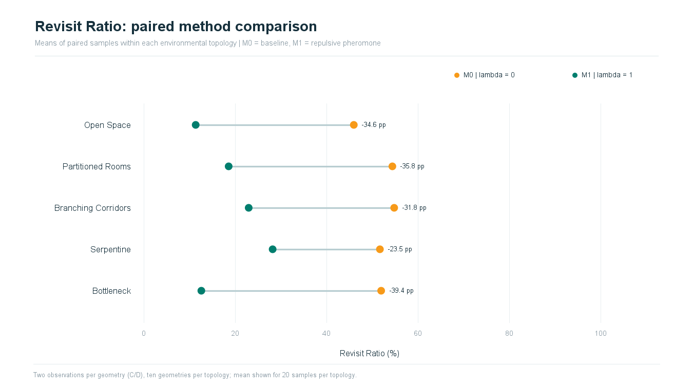
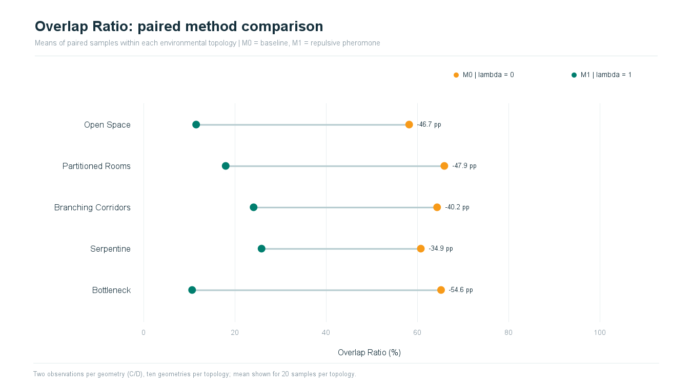
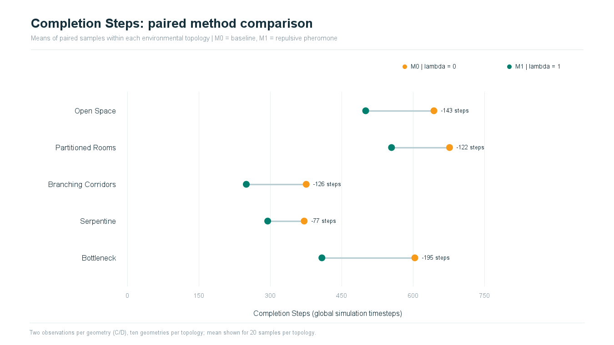
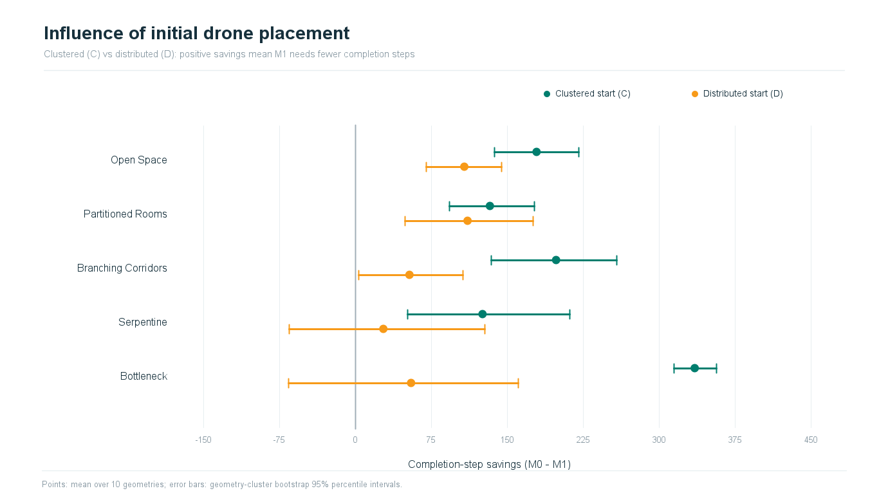
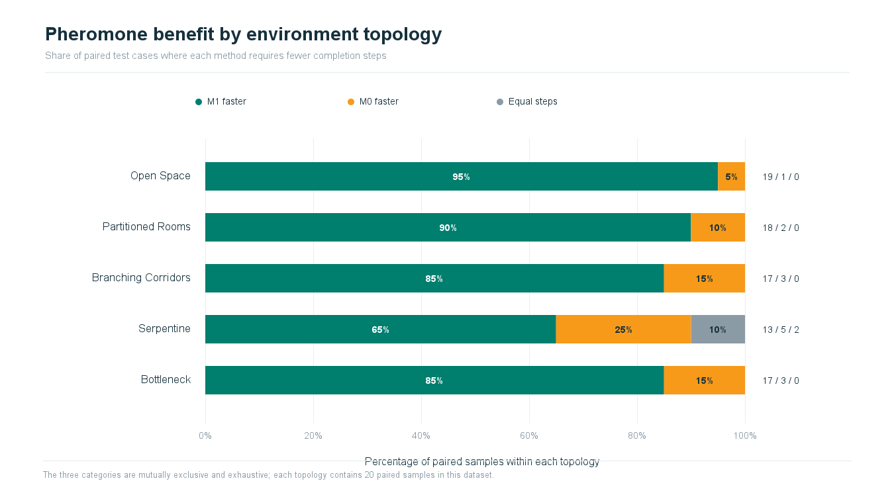
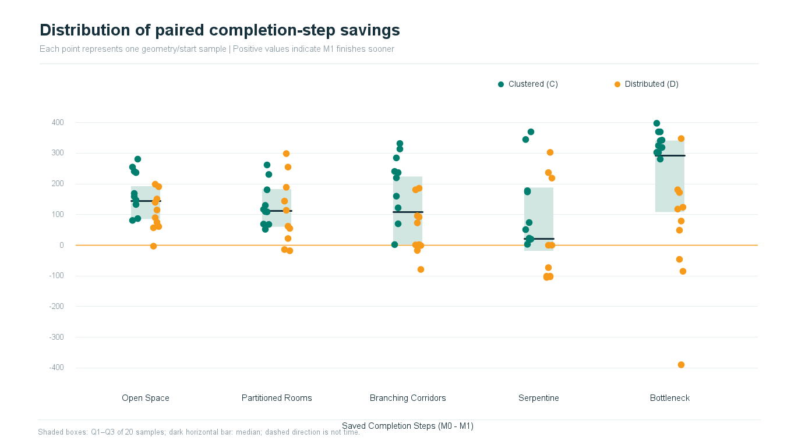
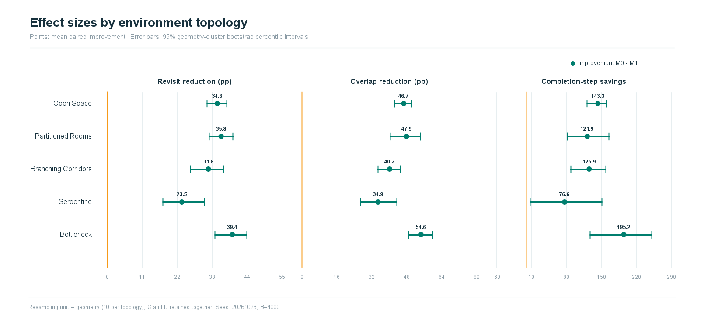
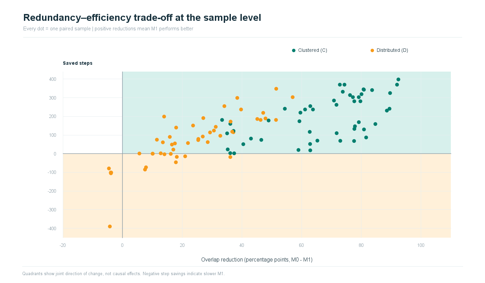
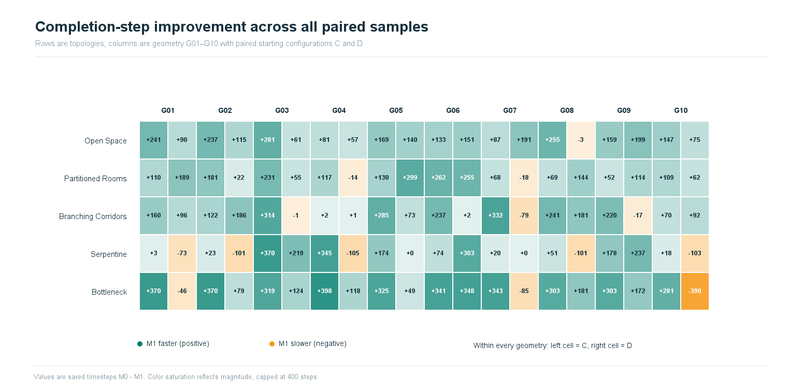
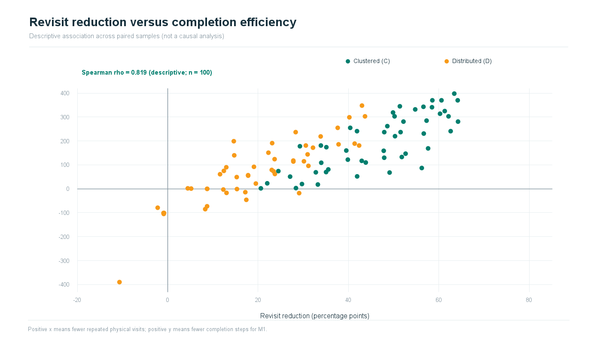

# Research Results — Reproducible Tables and Figures

**Decentralized Swarm Coverage Using Frontier-Based Exploration and Repulsive Pheromone Stigmergy**

Generated by `ResearchResultsGenerator.java` on 2026-10-25 16:58:08 (local computer time). This generator is **independent of JavaFX and the simulation source**.

## Inputs and reproducibility

- Input CSV: `ExplorationResults20261023105835.csv` (configurable using `INPUT_CSV` or command-line argument).
- Input SHA-256: `d9d96fdaf906869f14a713c976a887f67445015d4d5812e55f0c8737e965e780`.
- Rows read: **100** paired sample IDs; completed pairs: **100**.
- Methods: M0 = lambda 0; M1 = lambda 1. CSV stores M0 and M1 in the same row for each Sample ID.
- Colors: M1 / positive = **teal `#007E6E`**; M0 / negative = **orange `#F79A19`**; gray = ties. In scatterplots, teal = clustered C and orange = distributed D.
- Bootstrap: geometry-resampling, B=4000, seed=20261023; 2.5th/97.5th percentiles.
- Result code inherited from the source file: **`20261023105835`**.
- Output directory: `D:\ProjectDrone\DecentralizedSwarmCoverage_FBE_RPS\analysis`.
- Files: `Research_Tables_20261023105835.xlsx` (9 worksheets), `tables/*_20261023105835.csv`, `figures/*_20261023105835.png`/`.svg`, and `README_20261023105835.md`.

## IntelliJ IDEA — compile and run

Place **only this class** at `src/main/java/drone/decentralizedswarmcoverage_fbe_rps/ResearchResultsGenerator.java`.

IntelliJ: right-click `ResearchResultsGenerator.java` and select **Run 'ResearchResultsGenerator.main()'**. Under Run > Edit Configurations, ensure **Working directory = `$PROJECT_DIR$`**.

Since this is a **named JPMS module**, graphics output with Java2D/ImageIO requires **one line** in `src/main/java/module-info.java`: `requires java.desktop;`. This is a module dependency, not an algorithm/source-logic change.

Default file layout:

```text
<PROJECT ROOT>/
  results/ExplorationResults<CODE>.csv
  src/main/java/drone/decentralizedswarmcoverage_fbe_rps/ResearchResultsGenerator.java
  analysis/Research_Tables_<CODE>.xlsx
  analysis/README_<CODE>.md
  analysis/tables/<TABLE>_<CODE>.csv
  analysis/figures/<FIGURE>_<CODE>.png and .svg
```

Edit the class fields to select another existing `ExplorationResults<CODE>.csv` in `results/`: `INPUT_CSV`, `OUTPUT_DIRECTORY = "analysis"`, `CSV_DELIMITER = ";"`.

You may also supply two **optional program arguments**: `inputCsvPath outputDirectory`. Relative output directories resolve from the project root, and the code always comes from the input filename. The input delimiter is auto-detected (`;` or `,`).

## Original attachment inventory and generated equivalents

The reference archive contained **10 different figures** (each PNG and SVG), 5 summary CSV tables, and 1 supplemental paired-differences CSV. The following figures are regenerated from the input, not copied from the reference images.

| # | Original / recreated figure | Excel worksheet giving the underlying numbers |
|---|---|---|
| 1 | [Fig_Revisit_Ratio](figures/Fig_Revisit_Ratio_20261023105835.png) | [01_Method_Means](tables/01_Method_Means_20261023105835.csv) |
| 2 | [Fig_Overlap_Ratio](figures/Fig_Overlap_Ratio_20261023105835.png) | [01_Method_Means](tables/01_Method_Means_20261023105835.csv) |
| 3 | [Fig_Completion_Steps](figures/Fig_Completion_Steps_20261023105835.png) | [01_Method_Means](tables/01_Method_Means_20261023105835.csv) |
| 4 | [Fig_Starting_Position_Effects](figures/Fig_Starting_Position_Effects_20261023105835.png) | [02_Starting_Placement](tables/02_Starting_Placement_20261023105835.csv) |
| 5 | [Fig_100_Percent_Stacked_Bar_Topology](figures/Fig_100_Percent_Stacked_Bar_Topology_20261023105835.png) | [03_Outcome_By_Topology](tables/03_Outcome_By_Topology_20261023105835.csv) |
| 6 | [Fig_A_Paired_Step_Difference_Distribution](figures/Fig_A_Paired_Step_Difference_Distribution_20261023105835.png) | [04_Improvement_Consistency](tables/04_Improvement_Consistency_20261023105835.csv) |
| 7 | [Fig_B_Topology_Effect_Forest](figures/Fig_B_Topology_Effect_Forest_20261023105835.png) | [05_Topology_Bootstrap_CI](tables/05_Topology_Bootstrap_CI_20261023105835.csv) |
| 8 | [Fig_C_Overlap_vs_Step_Tradeoff](figures/Fig_C_Overlap_vs_Step_Tradeoff_20261023105835.png) | [06_Overlap_Steps_Joint](tables/06_Overlap_Steps_Joint_20261023105835.csv) |
| 9 | [Fig_Per_Sample_Step_Heatmap](figures/Fig_Per_Sample_Step_Heatmap_20261023105835.png) | [08_Paired_100](tables/08_Paired_100_20261023105835.csv) |
| 10 | [Fig_Revisit_vs_Steps_Exploratory](figures/Fig_Revisit_vs_Steps_Exploratory_20261023105835.png) | [08_Paired_100](tables/08_Paired_100_20261023105835.csv) |

**Summary tables from the reference archive:** `topology_outcome_summary.csv` → worksheet 03; `Table_A_Improvement_Consistency_by_Topology.csv` → 04; `Table_B_All_14_Slower_M1_Cases.csv` → 07; `Table_C_Speed_Redundancy_Joint_Outcome.csv` → 06; `Table_D_Topology_Cluster_Bootstrap_CI.csv` → 05; `Supplement_Paired_Differences_100_Samples.csv` → 08. Two additional tables (01 method means and 02 starting placement) were created to expose the data behind the corresponding original figures. Raw input with Excel formulas is worksheet 09.

## Formula definitions and interpretation

For each sample i, M0 and M1 are the two runs on the **same .sc map and the same four starting positions**.

- **Revisit reduction (percentage points):** `R0_i - R1_i`; R denotes Revisit Ratio (%).
- **Overlap reduction (percentage points):** `O0_i - O1_i`; O denotes Overlap Ratio (%).
- **Saved completion steps:** `S0_i - S1_i`; positive = M1 faster, negative = M1 slower, zero = tie.
- **Relative mean step reduction (%):** `100 × (mean(S0) - mean(S1)) / mean(S0)`. This is a **ratio of means**, not the mean of per-sample percentages.
- **Topology mean (metric):** arithmetic mean of sample values within that topology; for this dataset 10 geometries × 2 start placements = 20 sample pairs.
- **Median and Q1/Q3:** linear-interpolated quantile at p=0.50, p=0.25, p=0.75, using rank position `(n-1)×p`.
- **Outcome percentage:** `100 × category_count / complete_sample_count` within topology.
- **Geometry-cluster bootstrap CI:** average C and D improvements within each geometry, sample the 10 geometry means with replacement, and take the 2.5% and 97.5% empirical quantiles across 4000 resamples. For starting-position analysis, C and D are bootstrapped separately over geometry IDs.
- **Spearman rho:** Pearson correlation of the midranks of sample-level revisit reductions and saved steps; tied values receive average rank.
- **Explored coverage:** preserved from the original CSV. If the final coverage is 100% for all runs, it is a completion prerequisite rather than an observed difference between methods.
- **Missing/incomplete runs:** the original `N/A` steps are preserved; paired step comparisons and step CIs exclude nonnumeric pairs. Coverage/Revisit/Overlap descriptive summaries still use available valid input values.

**Statistical limitations.** Bootstrap intervals summarize variability across the designed geometries. They do not establish external validity for arbitrary real environments. The generator does not compute or claim p-values, temporal exploration curves, runtime seconds, or energy. A distinct Wilcoxon/permutation analysis would need to be reported separately.

## Figures with their corresponding tables

### Figure 1 — Revisit Ratio — paired M0/M1 mean comparison

**Source Table — `01_Method_Means`** ([Excel worksheet](Research_Tables_20261023105835.xlsx) · [CSV](tables/01_Method_Means_20261023105835.csv))


| Topology | Samples | M0 Coverage % | M1 Coverage % | M0 Revisit % | M1 Revisit % | M0 Overlap % | M1 Overlap % | M0 Steps | M1 Steps | Revisit reduced pp | Overlap reduced pp | Steps saved | Steps reduction % | 
|---|---|---|---|---|---|---|---|---|---|---|---|---|---|
| Open Space | 20 | 100.00 | 100.00 | 45.98 | 11.37 | 58.23 | 11.53 | 643.75 | 500.45 | 34.61 | 46.69 | 143.30 | 22.26 |
| Partitioned Rooms | 20 | 100.00 | 100.00 | 54.42 | 18.59 | 65.94 | 18.01 | 676.60 | 554.75 | 35.83 | 47.93 | 121.85 | 18.01 |
| Branching Corridors | 20 | 100.00 | 100.00 | 54.82 | 22.97 | 64.35 | 24.13 | 375.60 | 249.75 | 31.85 | 40.22 | 125.85 | 33.51 |
| Serpentine | 20 | 100.00 | 100.00 | 51.70 | 28.22 | 60.78 | 25.87 | 371.30 | 294.70 | 23.48 | 34.91 | 76.60 | 20.63 |
| Bottleneck | 20 | 100.00 | 100.00 | 51.97 | 12.61 | 65.22 | 10.65 | 603.65 | 408.50 | 39.36 | 54.57 | 195.15 | 32.33 |
| Overall | 100 | 100.00 | 100.00 | 51.78 | 18.75 | 62.90 | 18.04 | 534.18 | 401.63 | 33.03 | 44.86 | 132.55 | 24.81 |



[Vector SVG](figures/Fig_Revisit_Ratio_20261023105835.svg) · [Data table CSV](tables/01_Method_Means_20261023105835.csv)

Dumbbell plot of **mean physical revisit ratio (%)** for M0 and M1 in each topology. Dots are topology-level means; the connecting segment is the paired-method mean difference. Lower values are desirable at equal coverage.

### Figure 2 — Overlap Ratio — paired M0/M1 mean comparison

Underlying numbers: [01_Method_Means](tables/01_Method_Means_20261023105835.csv) (shown earlier).



[Vector SVG](figures/Fig_Overlap_Ratio_20261023105835.svg) · [Data table CSV](tables/01_Method_Means_20261023105835.csv)

Dumbbell plot of **mean inter-drone overlap ratio (%)** for M0 and M1. Overlap is the share of unique visited cells reached by at least two distinct drones. It is not sensing overlap.

### Figure 3 — Completion Steps — paired M0/M1 mean comparison

Underlying numbers: [01_Method_Means](tables/01_Method_Means_20261023105835.csv) (shown earlier).



[Vector SVG](figures/Fig_Completion_Steps_20261023105835.svg) · [Data table CSV](tables/01_Method_Means_20261023105835.csv)

Dumbbell plot of **mean completion steps** (global simulation timesteps) for completed runs. Differences use M0 minus M1; these are not wall-clock seconds.

### Figure 4 — Influence of initial drone placement (C vs D)

**Source Table — `02_Starting_Placement`** ([Excel worksheet](Research_Tables_20261023105835.xlsx) · [CSV](tables/02_Starting_Placement_20261023105835.csv))


| Topology | Start | Samples | M0 Steps | M1 Steps | Steps saved | 95% CI low | 95% CI high | Revisit reduced pp | Overlap reduced pp | M1 faster | M0 faster | Tie | 
|---|---|---|---|---|---|---|---|---|---|---|---|---|
| Open Space | C | 10 | 659.30 | 480.30 | 179.00 | 137.20 | 221.00 | 52.03 | 73.73 | 10 | 0 | 0 |
| Open Space | D | 10 | 628.20 | 520.60 | 107.60 | 70.30 | 144.60 | 17.19 | 19.66 | 9 | 1 | 0 |
| Partitioned Rooms | C | 10 | 704.20 | 571.30 | 132.90 | 93.00 | 177.00 | 43.15 | 65.74 | 10 | 0 | 0 |
| Partitioned Rooms | D | 10 | 649.00 | 538.20 | 110.80 | 49.20 | 175.51 | 28.52 | 30.12 | 8 | 2 | 0 |
| Branching Corridors | C | 10 | 482.20 | 283.90 | 198.30 | 134.10 | 258.21 | 44.74 | 57.46 | 10 | 0 | 0 |
| Branching Corridors | D | 10 | 269.00 | 215.60 | 53.40 | 3.50 | 106.20 | 18.95 | 22.98 | 7 | 3 | 0 |
| Serpentine | C | 10 | 444.80 | 319.20 | 125.60 | 51.40 | 212.11 | 34.11 | 54.19 | 10 | 0 | 0 |
| Serpentine | D | 10 | 297.80 | 270.20 | 27.60 | -65.50 | 128.10 | 12.85 | 15.63 | 3 | 5 | 2 |
| Bottleneck | C | 10 | 748.70 | 413.40 | 335.30 | 314.70 | 356.60 | 57.68 | 82.69 | 10 | 0 | 0 |
| Bottleneck | D | 10 | 458.60 | 403.60 | 55.00 | -66.30 | 161.30 | 21.04 | 26.44 | 7 | 3 | 0 |



[Vector SVG](figures/Fig_Starting_Position_Effects_20261023105835.svg) · [Data table CSV](tables/02_Starting_Placement_20261023105835.csv)

Geometry-cluster bootstrap intervals for mean saved steps, independently within Clustered (C) and Distributed (D) starts. Their difference describes a possible modification of effect by start arrangement.

### Figure 5 — 100% stacked bar — faster method by topology

**Source Table — `03_Outcome_By_Topology`** ([Excel worksheet](Research_Tables_20261023105835.xlsx) · [CSV](tables/03_Outcome_By_Topology_20261023105835.csv))


| Topology | Samples | M1 faster | M0 faster | Tie | M1 faster % | M0 faster % | Tie % | 
|---|---|---|---|---|---|---|---|
| Open Space | 20 | 19 | 1 | 0 | 95.00 | 5.00 | 0.00 |
| Partitioned Rooms | 20 | 18 | 2 | 0 | 90.00 | 10.00 | 0.00 |
| Branching Corridors | 20 | 17 | 3 | 0 | 85.00 | 15.00 | 0.00 |
| Serpentine | 20 | 13 | 5 | 2 | 65.00 | 25.00 | 10.00 |
| Bottleneck | 20 | 17 | 3 | 0 | 85.00 | 15.00 | 0.00 |



[Vector SVG](figures/Fig_100_Percent_Stacked_Bar_Topology_20261023105835.svg) · [Data table CSV](tables/03_Outcome_By_Topology_20261023105835.csv)

Outcome share from mutually exclusive M1 faster, M0 faster, or tie categories based on paired completion steps. Topology is categorical; stacked bars are preferable to stacked area plots.

### Figure 6 — Paired completion-step savings distribution

**Source Table — `04_Improvement_Consistency`** ([Excel worksheet](Research_Tables_20261023105835.xlsx) · [CSV](tables/04_Improvement_Consistency_20261023105835.csv))


| Topology | Samples | M1 faster | Tie | M1 slower | Mean saved steps | Median saved steps | IQR Q1 | IQR Q3 | Worst saved steps | Best saved steps | Mean revisit reduction pp | Mean overlap reduction pp | 
|---|---|---|---|---|---|---|---|---|---|---|---|---|
| Open Space | 20 | 19 | 0 | 1 | 143.30 | 143.50 | 85.50 | 193.00 | -3.00 | 281.00 | 34.61 | 46.69 |
| Partitioned Rooms | 20 | 18 | 0 | 2 | 121.85 | 112.00 | 60.25 | 183.00 | -18.00 | 299.00 | 35.83 | 47.93 |
| Branching Corridors | 20 | 17 | 0 | 3 | 125.85 | 109.00 | 2.00 | 224.25 | -79.00 | 332.00 | 31.85 | 40.22 |
| Serpentine | 20 | 13 | 2 | 5 | 76.60 | 21.50 | -18.25 | 188.25 | -105.00 | 370.00 | 23.48 | 34.91 |
| Bottleneck | 20 | 17 | 0 | 3 | 195.15 | 292.00 | 108.25 | 341.50 | -390.00 | 398.00 | 39.36 | 54.57 |
| Overall | 100 | 84 | 2 | 14 | 132.55 | 123.00 | 50.50 | 237.00 | -390.00 | 398.00 | 33.03 | 44.86 |



[Vector SVG](figures/Fig_A_Paired_Step_Difference_Distribution_20261023105835.svg) · [Data table CSV](tables/04_Improvement_Consistency_20261023105835.csv)

All sample-level paired step differences displayed by environment topology and starting configuration. The center line is the median; the pale box spans Q1–Q3. Negative values explicitly show worse M1 outcomes.

### Figure 7 — Forest plot — 95% CI for three performance effects

**Source Table — `05_Topology_Bootstrap_CI`** ([Excel worksheet](Research_Tables_20261023105835.xlsx) · [CSV](tables/05_Topology_Bootstrap_CI_20261023105835.csv))


| Topology | Revisit reduction mean pp | Revisit CI low | Revisit CI high | Overlap reduction mean pp | Overlap CI low | Overlap CI high | Saved steps mean | Saved steps CI low | Saved steps CI high | 
|---|---|---|---|---|---|---|---|---|---|
| Open Space | 34.61 | 31.44 | 37.56 | 46.69 | 42.46 | 50.27 | 143.30 | 121.85 | 161.35 |
| Partitioned Rooms | 35.83 | 32.10 | 39.53 | 47.93 | 40.57 | 54.22 | 121.85 | 82.15 | 165.40 |
| Branching Corridors | 31.85 | 26.13 | 36.71 | 40.22 | 34.91 | 45.06 | 125.85 | 89.15 | 158.96 |
| Serpentine | 23.48 | 17.57 | 30.63 | 34.91 | 26.81 | 43.45 | 76.60 | 7.40 | 151.05 |
| Bottleneck | 39.36 | 33.87 | 43.99 | 54.57 | 48.97 | 59.91 | 195.15 | 127.59 | 250.65 |



[Vector SVG](figures/Fig_B_Topology_Effect_Forest_20261023105835.svg) · [Data table CSV](tables/05_Topology_Bootstrap_CI_20261023105835.csv)

Three-panel forest plot showing geometry-cluster bootstrap 95% confidence intervals for mean revisit reduction, overlap reduction, and step savings. This is descriptive uncertainty for designed simulation maps.

### Figure 8 — Overlap reduction vs saved steps — trade-off

**Source Table — `06_Overlap_Steps_Joint`** ([Excel worksheet](Research_Tables_20261023105835.xlsx) · [CSV](tables/06_Overlap_Steps_Joint_20261023105835.csv))


| Steps outcome | Overlap reduced | Overlap increased | Overlap equal | Total | 
|---|---|---|---|---|
| M1 faster | 84 | 0 | 0 | 84 |
| Tie | 2 | 0 | 0 | 2 |
| M0 faster | 8 | 6 | 0 | 14 |
| TOTAL | 94 | 6 | 0 | 100 |

**Related diagnostic table — every sample where M1 is slower**


| Environment | Sample ID | Must Explored | M0 Steps | M1 Steps | Saved steps M0-M1 | Revisit reduction pp | Overlap reduction pp | 
|---|---|---|---|---|---|---|---|
| S05_Bottleneck | S05_G10_D | 3800 | 306 | 696 | -390 | -10.67 | -4.25 |
| S04_Serpentine | S04_G04_D | 1720 | 296 | 401 | -105 | -0.88 | -3.89 |
| S04_Serpentine | S04_G10_D | 1720 | 296 | 399 | -103 | -0.89 | -3.92 |
| S04_Serpentine | S04_G02_D | 1690 | 291 | 392 | -101 | -0.93 | -3.95 |
| S04_Serpentine | S04_G08_D | 1660 | 286 | 387 | -101 | -0.81 | -3.80 |
| S05_Bottleneck | S05_G07_D | 3834 | 324 | 409 | -85 | 8.30 | 7.53 |
| S03_Branching_Corridors | S03_G07_D | 1570 | 266 | 345 | -79 | -2.22 | -4.56 |
| S04_Serpentine | S04_G01_D | 1440 | 122 | 195 | -73 | 8.71 | 7.86 |
| S05_Bottleneck | S05_G01_D | 3834 | 349 | 395 | -46 | 17.39 | 17.87 |
| S02_Partitioned_Rooms | S02_G07_D | 3960 | 586 | 604 | -18 | 29.08 | 36.11 |
| S03_Branching_Corridors | S03_G09_D | 1500 | 292 | 309 | -17 | 13.01 | 18.18 |
| S02_Partitioned_Rooms | S02_G04_D | 3912 | 518 | 532 | -14 | 17.17 | 20.98 |
| S01_Open_Space | S01_G08_D | 4020 | 627 | 630 | -3 | 12.31 | 14.05 |
| S03_Branching_Corridors | S03_G03_D | 1535 | 115 | 116 | -1 | 15.32 | 16.17 |



[Vector SVG](figures/Fig_C_Overlap_vs_Step_Tradeoff_20261023105835.svg) · [Data table CSV](tables/06_Overlap_Steps_Joint_20261023105835.csv)

Scatter plot of paired overlap reduction (horizontal) versus saved steps (vertical); each marker is one sample. Four quadrants reveal that reducing overlap does not always yield faster exploration.

### Figure 9 — Heatmap — per-sample completion-step savings

**Source Table — `08_Paired_100`** ([Excel worksheet](Research_Tables_20261023105835.xlsx) · [CSV](tables/08_Paired_100_20261023105835.csv))


| Environment | Sample ID | Topology ID | Geometry ID | Start | Must Explored | Saved Revisit Ratio pp | Saved Overlap Ratio pp | Saved Completion Steps | M0 Steps | M1 Steps | Outcome | 
|---|---|---|---|---|---|---|---|---|---|---|---|
| S01_Open_Space | S01_G01_C | S01 | S01_G01 | C | 4011 | 62.60 | 89.45 | 241.00 | 699.00 | 458.00 | M1 faster |
| S01_Open_Space | S01_G01_D | S01 | S01_G01 | D | 4011 | 12.96 | 15.84 | 90.00 | 649.00 | 559.00 | M1 faster |
| S01_Open_Space | S01_G02_C | S01 | S01_G02 | C | 3985 | 51.52 | 61.16 | 237.00 | 663.00 | 426.00 | M1 faster |
| S01_Open_Space | S01_G02_D | S01 | S01_G02 | D | 3985 | 30.14 | 37.15 | 115.00 | 642.00 | 527.00 | M1 faster |
| S01_Open_Space | S01_G03_C | S01 | S01_G03 | C | 3992 | 64.23 | 79.70 | 281.00 | 655.00 | 374.00 | M1 faster |
| S01_Open_Space | S01_G03_D | S01 | S01_G03 | D | 3992 | 11.58 | 13.51 | 61.00 | 616.00 | 555.00 | M1 faster |
| S01_Open_Space | S01_G04_C | S01 | S01_G04 | C | 4040 | 35.53 | 43.03 | 81.00 | 633.00 | 552.00 | M1 faster |
| S01_Open_Space | S01_G04_D | S01 | S01_G04 | D | 4040 | 17.79 | 21.92 | 57.00 | 630.00 | 573.00 | M1 faster |
| S01_Open_Space | S01_G05_C | S01 | S01_G05 | C | 3975 | 57.61 | 79.17 | 169.00 | 695.00 | 526.00 | M1 faster |
| S01_Open_Space | S01_G05_D | S01 | S01_G05 | D | 3975 | 14.72 | 17.96 | 140.00 | 609.00 | 469.00 | M1 faster |
| S01_Open_Space | S01_G06_C | S01 | S01_G06 | C | 3985 | 51.79 | 77.68 | 133.00 | 651.00 | 518.00 | M1 faster |
| S01_Open_Space | S01_G06_D | S01 | S01_G06 | D | 3985 | 22.28 | 23.63 | 151.00 | 601.00 | 450.00 | M1 faster |
| S01_Open_Space | S01_G07_C | S01 | S01_G07 | C | 3967 | 56.21 | 81.62 | 87.00 | 641.00 | 554.00 | M1 faster |
| S01_Open_Space | S01_G07_D | S01 | S01_G07 | D | 3967 | 23.11 | 27.06 | 191.00 | 587.00 | 396.00 | M1 faster |
| S01_Open_Space | S01_G08_C | S01 | S01_G08 | C | 4020 | 40.38 | 62.91 | 255.00 | 649.00 | 394.00 | M1 faster |
| S01_Open_Space | S01_G08_D | S01 | S01_G08 | D | 4020 | 12.31 | 14.05 | -3.00 | 627.00 | 630.00 | M0 faster |
| S01_Open_Space | S01_G09_C | S01 | S01_G09 | C | 4015 | 47.79 | 84.71 | 159.00 | 658.00 | 499.00 | M1 faster |
| S01_Open_Space | S01_G09_D | S01 | S01_G09 | D | 4015 | 14.62 | 13.93 | 199.00 | 691.00 | 492.00 | M1 faster |
| S01_Open_Space | S01_G10_C | S01 | S01_G10 | C | 3990 | 52.63 | 77.87 | 147.00 | 649.00 | 502.00 | M1 faster |
| S01_Open_Space | S01_G10_D | S01 | S01_G10 | D | 3990 | 12.42 | 11.51 | 75.00 | 630.00 | 555.00 | M1 faster |
| S02_Partitioned_Rooms | S02_G01_C | S02 | S02_G01 | C | 3960 | 43.82 | 71.74 | 110.00 | 645.00 | 535.00 | M1 faster |
| S02_Partitioned_Rooms | S02_G01_D | S02 | S02_G01 | D | 3960 | 41.36 | 47.90 | 189.00 | 730.00 | 541.00 | M1 faster |
| S02_Partitioned_Rooms | S02_G02_C | S02 | S02_G02 | C | 3962 | 33.89 | 33.35 | 181.00 | 723.00 | 542.00 | M1 faster |
| S02_Partitioned_Rooms | S02_G02_D | S02 | S02_G02 | D | 3962 | 19.50 | 17.02 | 22.00 | 629.00 | 607.00 | M1 faster |
| S02_Partitioned_Rooms | S02_G03_C | S02 | S02_G03 | C | 4003 | 56.65 | 88.56 | 231.00 | 709.00 | 478.00 | M1 faster |
| S02_Partitioned_Rooms | S02_G03_D | S02 | S02_G03 | D | 4003 | 17.80 | 17.55 | 55.00 | 633.00 | 578.00 | M1 faster |
| S02_Partitioned_Rooms | S02_G04_C | S02 | S02_G04 | C | 3912 | 42.93 | 62.72 | 117.00 | 837.00 | 720.00 | M1 faster |
| S02_Partitioned_Rooms | S02_G04_D | S02 | S02_G04 | D | 3912 | 17.17 | 20.98 | -14.00 | 518.00 | 532.00 | M0 faster |
| S02_Partitioned_Rooms | S02_G05_C | S02 | S02_G05 | C | 4003 | 47.90 | 80.90 | 130.00 | 732.00 | 602.00 | M1 faster |
| S02_Partitioned_Rooms | S02_G05_D | S02 | S02_G05 | D | 4003 | 40.19 | 38.44 | 299.00 | 697.00 | 398.00 | M1 faster |
| S02_Partitioned_Rooms | S02_G06_C | S02 | S02_G06 | C | 3962 | 48.59 | 71.68 | 262.00 | 730.00 | 468.00 | M1 faster |
| S02_Partitioned_Rooms | S02_G06_D | S02 | S02_G06 | D | 3962 | 37.61 | 34.12 | 255.00 | 742.00 | 487.00 | M1 faster |
| S02_Partitioned_Rooms | S02_G07_C | S02 | S02_G07 | C | 3960 | 49.09 | 77.58 | 68.00 | 671.00 | 603.00 | M1 faster |
| S02_Partitioned_Rooms | S02_G07_D | S02 | S02_G07 | D | 3960 | 29.08 | 36.11 | -18.00 | 586.00 | 604.00 | M0 faster |
| S02_Partitioned_Rooms | S02_G08_C | S02 | S02_G08 | C | 3962 | 32.77 | 72.96 | 69.00 | 646.00 | 577.00 | M1 faster |
| S02_Partitioned_Rooms | S02_G08_D | S02 | S02_G08 | D | 3962 | 30.95 | 31.23 | 144.00 | 683.00 | 539.00 | M1 faster |
| S02_Partitioned_Rooms | S02_G09_C | S02 | S02_G09 | C | 4003 | 41.91 | 62.84 | 52.00 | 654.00 | 602.00 | M1 faster |
| S02_Partitioned_Rooms | S02_G09_D | S02 | S02_G09 | D | 4003 | 27.80 | 29.32 | 114.00 | 683.00 | 569.00 | M1 faster |
| S02_Partitioned_Rooms | S02_G10_C | S02 | S02_G10 | C | 3912 | 33.97 | 35.04 | 109.00 | 695.00 | 586.00 | M1 faster |
| S02_Partitioned_Rooms | S02_G10_D | S02 | S02_G10 | D | 3912 | 23.71 | 28.54 | 62.00 | 589.00 | 527.00 | M1 faster |
| S03_Branching_Corridors | S03_G01_C | S03 | S03_G01 | C | 1535 | 39.51 | 36.11 | 160.00 | 426.00 | 266.00 | M1 faster |
| S03_Branching_Corridors | S03_G01_D | S03 | S03_G01 | D | 1535 | 31.13 | 32.76 | 96.00 | 259.00 | 163.00 | M1 faster |
| S03_Branching_Corridors | S03_G02_C | S03 | S03_G02 | C | 1535 | 39.85 | 37.18 | 122.00 | 345.00 | 223.00 | M1 faster |
| S03_Branching_Corridors | S03_G02_D | S03 | S03_G02 | D | 1535 | 37.80 | 45.15 | 186.00 | 389.00 | 203.00 | M1 faster |
| S03_Branching_Corridors | S03_G03_C | S03 | S03_G03 | C | 1535 | 60.25 | 76.22 | 314.00 | 555.00 | 241.00 | M1 faster |
| S03_Branching_Corridors | S03_G03_D | S03 | S03_G03 | D | 1535 | 15.32 | 16.17 | -1.00 | 115.00 | 116.00 | M0 faster |
| S03_Branching_Corridors | S03_G04_C | S03 | S03_G04 | C | 1465 | 20.61 | 37.40 | 2.00 | 517.00 | 515.00 | M1 faster |
| S03_Branching_Corridors | S03_G04_D | S03 | S03_G04 | D | 1465 | 5.19 | 5.65 | 1.00 | 120.00 | 119.00 | M1 faster |
| S03_Branching_Corridors | S03_G05_C | S03 | S03_G05 | C | 1605 | 57.27 | 70.84 | 285.00 | 513.00 | 228.00 | M1 faster |
| S03_Branching_Corridors | S03_G05_D | S03 | S03_G05 | D | 1605 | 23.43 | 25.36 | 73.00 | 305.00 | 232.00 | M1 faster |
| S03_Branching_Corridors | S03_G06_C | S03 | S03_G06 | C | 1570 | 47.91 | 63.80 | 237.00 | 509.00 | 272.00 | M1 faster |
| S03_Branching_Corridors | S03_G06_D | S03 | S03_G06 | D | 1570 | 4.44 | 12.80 | 2.00 | 212.00 | 210.00 | M1 faster |
| S03_Branching_Corridors | S03_G07_C | S03 | S03_G07 | C | 1570 | 54.76 | 73.79 | 332.00 | 597.00 | 265.00 | M1 faster |
| S03_Branching_Corridors | S03_G07_D | S03 | S03_G07 | D | 1570 | -2.22 | -4.56 | -79.00 | 266.00 | 345.00 | M0 faster |
| S03_Branching_Corridors | S03_G08_C | S03 | S03_G08 | C | 1570 | 41.88 | 54.38 | 241.00 | 499.00 | 258.00 | M1 faster |
| S03_Branching_Corridors | S03_G08_D | S03 | S03_G08 | D | 1570 | 42.35 | 51.42 | 181.00 | 338.00 | 157.00 | M1 faster |
| S03_Branching_Corridors | S03_G09_C | S03 | S03_G09 | C | 1500 | 50.29 | 59.60 | 220.00 | 471.00 | 251.00 | M1 faster |
| S03_Branching_Corridors | S03_G09_D | S03 | S03_G09 | D | 1500 | 13.01 | 18.18 | -17.00 | 292.00 | 309.00 | M0 faster |
| S03_Branching_Corridors | S03_G10_C | S03 | S03_G10 | C | 1535 | 35.04 | 65.28 | 70.00 | 390.00 | 320.00 | M1 faster |
| S03_Branching_Corridors | S03_G10_D | S03 | S03_G10 | D | 1535 | 19.08 | 26.88 | 92.00 | 394.00 | 302.00 | M1 faster |
| S04_Serpentine | S04_G01_C | S04 | S04_G01 | C | 1440 | 28.37 | 36.09 | 3.00 | 219.00 | 216.00 | M1 faster |
| S04_Serpentine | S04_G01_D | S04 | S04_G01 | D | 1440 | 8.71 | 7.86 | -73.00 | 122.00 | 195.00 | M0 faster |
| S04_Serpentine | S04_G02_C | S04 | S04_G02 | C | 1690 | 22.02 | 35.24 | 23.00 | 224.00 | 201.00 | M1 faster |
| S04_Serpentine | S04_G02_D | S04 | S04_G02 | D | 1690 | -0.93 | -3.95 | -101.00 | 291.00 | 392.00 | M0 faster |
| S04_Serpentine | S04_G03_C | S04 | S04_G03 | C | 1614 | 60.57 | 72.81 | 370.00 | 546.00 | 176.00 | M1 faster |
| S04_Serpentine | S04_G03_D | S04 | S04_G03 | D | 1614 | 33.84 | 47.13 | 219.00 | 416.00 | 197.00 | M1 faster |
| S04_Serpentine | S04_G04_C | S04 | S04_G04 | C | 1720 | 51.36 | 80.75 | 345.00 | 638.00 | 293.00 | M1 faster |
| S04_Serpentine | S04_G04_D | S04 | S04_G04 | D | 1720 | -0.88 | -3.89 | -105.00 | 296.00 | 401.00 | M0 faster |
| S04_Serpentine | S04_G05_C | S04 | S04_G05 | C | 1515 | 35.10 | 59.27 | 174.00 | 554.00 | 380.00 | M1 faster |
| S04_Serpentine | S04_G05_D | S04 | S04_G05 | D | 1515 | 8.72 | 10.06 | 0.00 | 128.00 | 128.00 | Tie |
| S04_Serpentine | S04_G06_C | S04 | S04_G06 | C | 1926 | 24.48 | 46.49 | 74.00 | 606.00 | 532.00 | M1 faster |
| S04_Serpentine | S04_G06_D | S04 | S04_G06 | D | 1926 | 43.65 | 57.00 | 303.00 | 571.00 | 268.00 | M1 faster |
| S04_Serpentine | S04_G07_C | S04 | S04_G07 | C | 1440 | 29.70 | 58.94 | 20.00 | 370.00 | 350.00 | M1 faster |
| S04_Serpentine | S04_G07_D | S04 | S04_G07 | D | 1440 | 8.74 | 10.12 | 0.00 | 122.00 | 122.00 | Tie |
| S04_Serpentine | S04_G08_C | S04 | S04_G08 | C | 1660 | 27.08 | 40.46 | 51.00 | 234.00 | 183.00 | M1 faster |
| S04_Serpentine | S04_G08_D | S04 | S04_G08 | D | 1660 | -0.81 | -3.80 | -101.00 | 286.00 | 387.00 | M0 faster |
| S04_Serpentine | S04_G09_C | S04 | S04_G09 | C | 1734 | 29.25 | 48.94 | 178.00 | 593.00 | 415.00 | M1 faster |
| S04_Serpentine | S04_G09_D | S04 | S04_G09 | D | 1734 | 28.31 | 39.71 | 237.00 | 450.00 | 213.00 | M1 faster |
| S04_Serpentine | S04_G10_C | S04 | S04_G10 | C | 1720 | 33.22 | 62.90 | 18.00 | 464.00 | 446.00 | M1 faster |
| S04_Serpentine | S04_G10_D | S04 | S04_G10 | D | 1720 | -0.89 | -3.92 | -103.00 | 296.00 | 399.00 | M0 faster |
| S05_Bottleneck | S05_G01_C | S05 | S05_G01 | C | 3834 | 64.16 | 91.97 | 370.00 | 762.00 | 392.00 | M1 faster |
| S05_Bottleneck | S05_G01_D | S05 | S05_G01 | D | 3834 | 17.39 | 17.87 | -46.00 | 349.00 | 395.00 | M0 faster |
| S05_Bottleneck | S05_G02_C | S05 | S05_G02 | C | 3816 | 58.55 | 74.36 | 370.00 | 729.00 | 359.00 | M1 faster |
| S05_Bottleneck | S05_G02_D | S05 | S05_G02 | D | 3816 | 23.02 | 25.40 | 79.00 | 433.00 | 354.00 | M1 faster |
| S05_Bottleneck | S05_G03_C | S05 | S05_G03 | C | 3850 | 49.85 | 80.07 | 319.00 | 782.00 | 463.00 | M1 faster |
| S05_Bottleneck | S05_G03_D | S05 | S05_G03 | D | 3850 | 23.65 | 30.62 | 124.00 | 506.00 | 382.00 | M1 faster |
| S05_Bottleneck | S05_G04_C | S05 | S05_G04 | C | 3812 | 63.40 | 92.42 | 398.00 | 752.00 | 354.00 | M1 faster |
| S05_Bottleneck | S05_G04_D | S05 | S05_G04 | D | 3812 | 27.79 | 36.75 | 118.00 | 537.00 | 419.00 | M1 faster |
| S05_Bottleneck | S05_G05_C | S05 | S05_G05 | C | 3850 | 61.29 | 89.64 | 325.00 | 742.00 | 417.00 | M1 faster |
| S05_Bottleneck | S05_G05_D | S05 | S05_G05 | D | 3850 | 15.27 | 16.55 | 49.00 | 358.00 | 309.00 | M1 faster |
| S05_Bottleneck | S05_G06_C | S05 | S05_G06 | C | 3830 | 58.47 | 83.61 | 341.00 | 736.00 | 395.00 | M1 faster |
| S05_Bottleneck | S05_G06_D | S05 | S05_G06 | D | 3830 | 42.98 | 51.49 | 348.00 | 671.00 | 323.00 | M1 faster |
| S05_Bottleneck | S05_G07_C | S05 | S05_G07 | C | 3834 | 56.58 | 80.87 | 343.00 | 728.00 | 385.00 | M1 faster |
| S05_Bottleneck | S05_G07_D | S05 | S05_G07 | D | 3834 | 8.30 | 7.53 | -85.00 | 324.00 | 409.00 | M0 faster |
| S05_Bottleneck | S05_G08_C | S05 | S05_G08 | C | 3822 | 50.19 | 77.19 | 303.00 | 779.00 | 476.00 | M1 faster |
| S05_Bottleneck | S05_G08_D | S05 | S05_G08 | D | 3822 | 30.56 | 46.26 | 181.00 | 546.00 | 365.00 | M1 faster |
| S05_Bottleneck | S05_G09_C | S05 | S05_G09 | C | 3850 | 62.13 | 79.15 | 303.00 | 719.00 | 416.00 | M1 faster |
| S05_Bottleneck | S05_G09_D | S05 | S05_G09 | D | 3850 | 32.14 | 36.20 | 172.00 | 556.00 | 384.00 | M1 faster |
| S05_Bottleneck | S05_G10_C | S05 | S05_G10 | C | 3800 | 52.16 | 77.65 | 281.00 | 758.00 | 477.00 | M1 faster |
| S05_Bottleneck | S05_G10_D | S05 | S05_G10 | D | 3800 | -10.67 | -4.25 | -390.00 | 306.00 | 696.00 | M0 faster |



[Vector SVG](figures/Fig_Per_Sample_Step_Heatmap_20261023105835.svg) · [Data table CSV](tables/08_Paired_100_20261023105835.csv)

Five-by-twenty heatmap of sample-level saved completion steps. Within each geometry, the left square is C and the right square is D. Teal denotes positive savings; orange denotes negative savings.

### Figure 10 — Revisit reduction vs saved steps — descriptive correlation

Underlying numbers: [08_Paired_100](tables/08_Paired_100_20261023105835.csv) (shown earlier).



[Vector SVG](figures/Fig_Revisit_vs_Steps_Exploratory_20261023105835.svg) · [Data table CSV](tables/08_Paired_100_20261023105835.csv)

Scatter plot of paired revisit reduction versus saved steps, with Spearman rank correlation. Association is descriptive, not a claim that revisit reduction causes step savings.

## Additional tables and supplementary data

### 09_Source_and_Formulas

[CSV](tables/09_Source_and_Formulas_20261023105835.csv) · sheet `09_Source_and_Formulas` in the Excel workbook.

The following complete table has 100 rows and is also in the Excel workbook.


| Environment | Sample ID | Must Explored | LAMBDA_0 Explored | LAMBDA_0 Num Revisit | LAMBDA_0 Num Overlap | LAMBDA_0 Coverage(%) | LAMBDA_0 Revisit (%) | LAMBDA_0 Overlap (%) | LAMBDA_0 Steps | LAMBDA_1 Explored | LAMBDA_1 Num Revisit | LAMBDA_1 Num Overlap | LAMBDA_1 Coverage(%) | LAMBDA_1 Revisit (%) | LAMBDA_1 Overlap (%) | LAMBDA_1 Steps | Saved steps = M0-M1 | Saved revisit pp = M0-M1 | Saved overlap pp = M0-M1 | 
|---|---|---|---|---|---|---|---|---|---|---|---|---|---|---|---|---|---|---|---|
| S01_Open_Space | S01_G01_C | 4011.00 | 4011.00 | 742.00 | 742.00 | 100.00 | 73.22 | 99.20 | 699.00 | 4011.00 | 174.00 | 160.00 | 100.00 | 10.62 | 9.75 | 458.00 | 241.00 | 62.60 | 89.45 |
| S01_Open_Space | S01_G01_D | 4011.00 | 4011.00 | 589.00 | 589.00 | 100.00 | 27.04 | 31.18 | 649.00 | 4011.00 | 308.00 | 295.00 | 100.00 | 14.08 | 15.34 | 559.00 | 90.00 | 12.96 | 15.84 |
| S01_Open_Space | S01_G02_C | 3985.00 | 3985.00 | 740.00 | 735.00 | 100.00 | 60.62 | 70.40 | 663.00 | 3985.00 | 153.00 | 143.00 | 100.00 | 9.10 | 9.24 | 426.00 | 237.00 | 51.52 | 61.16 |
| S01_Open_Space | S01_G02_D | 3985.00 | 3985.00 | 732.00 | 732.00 | 100.00 | 40.34 | 47.87 | 642.00 | 3985.00 | 213.00 | 203.00 | 100.00 | 10.20 | 10.72 | 527.00 | 115.00 | 30.14 | 37.15 |
| S01_Open_Space | S01_G03_C | 3992.00 | 3992.00 | 691.00 | 687.00 | 100.00 | 68.98 | 84.61 | 655.00 | 3992.00 | 70.00 | 70.00 | 100.00 | 4.75 | 4.91 | 374.00 | 281.00 | 64.23 | 79.70 |
| S01_Open_Space | S01_G03_D | 3992.00 | 3992.00 | 535.00 | 534.00 | 100.00 | 26.50 | 29.57 | 616.00 | 3992.00 | 315.00 | 303.00 | 100.00 | 14.92 | 16.06 | 555.00 | 61.00 | 11.58 | 13.51 |
| S01_Open_Space | S01_G04_C | 4040.00 | 4040.00 | 725.00 | 725.00 | 100.00 | 46.88 | 53.90 | 633.00 | 4040.00 | 226.00 | 213.00 | 100.00 | 11.35 | 10.87 | 552.00 | 81.00 | 35.53 | 43.03 |
| S01_Open_Space | S01_G04_D | 4040.00 | 4040.00 | 634.00 | 634.00 | 100.00 | 31.98 | 37.03 | 630.00 | 4040.00 | 305.00 | 297.00 | 100.00 | 14.19 | 15.11 | 573.00 | 57.00 | 17.79 | 21.92 |
| S01_Open_Space | S01_G05_C | 3975.00 | 3975.00 | 719.00 | 718.00 | 100.00 | 72.19 | 93.01 | 695.00 | 3975.00 | 255.00 | 249.00 | 100.00 | 14.58 | 13.84 | 526.00 | 169.00 | 57.61 | 79.17 |
| S01_Open_Space | S01_G05_D | 3975.00 | 3975.00 | 536.00 | 535.00 | 100.00 | 25.58 | 29.61 | 609.00 | 3975.00 | 200.00 | 195.00 | 100.00 | 10.86 | 11.65 | 469.00 | 140.00 | 14.72 | 17.96 |
| S01_Open_Space | S01_G06_C | 3985.00 | 3985.00 | 778.00 | 778.00 | 100.00 | 67.80 | 93.29 | 651.00 | 3985.00 | 287.00 | 272.00 | 100.00 | 16.01 | 15.61 | 518.00 | 133.00 | 51.79 | 77.68 |
| S01_Open_Space | S01_G06_D | 3985.00 | 3985.00 | 502.00 | 502.00 | 100.00 | 27.50 | 28.90 | 601.00 | 3985.00 | 91.00 | 90.00 | 100.00 | 5.22 | 5.27 | 450.00 | 151.00 | 22.28 | 23.63 |
| S01_Open_Space | S01_G07_C | 3967.00 | 3967.00 | 703.00 | 703.00 | 100.00 | 72.16 | 98.46 | 641.00 | 3967.00 | 332.00 | 314.00 | 100.00 | 15.95 | 16.84 | 554.00 | 87.00 | 56.21 | 81.62 |
| S01_Open_Space | S01_G07_D | 3967.00 | 3967.00 | 540.00 | 540.00 | 100.00 | 28.09 | 32.10 | 587.00 | 3967.00 | 76.00 | 76.00 | 100.00 | 4.98 | 5.04 | 396.00 | 191.00 | 23.11 | 27.06 |
| S01_Open_Space | S01_G08_C | 4020.00 | 4020.00 | 929.00 | 929.00 | 100.00 | 51.10 | 73.50 | 649.00 | 4020.00 | 155.00 | 149.00 | 100.00 | 10.72 | 10.59 | 394.00 | 255.00 | 40.38 | 62.91 |
| S01_Open_Space | S01_G08_D | 4020.00 | 4020.00 | 576.00 | 576.00 | 100.00 | 31.92 | 33.76 | 627.00 | 4020.00 | 429.00 | 400.00 | 100.00 | 19.61 | 19.71 | 630.00 | -3.00 | 12.31 | 14.05 |
| S01_Open_Space | S01_G09_C | 4015.00 | 4015.00 | 1012.00 | 1012.00 | 100.00 | 60.35 | 97.12 | 658.00 | 4015.00 | 223.00 | 217.00 | 100.00 | 12.56 | 12.41 | 499.00 | 159.00 | 47.79 | 84.71 |
| S01_Open_Space | S01_G09_D | 4015.00 | 4015.00 | 461.00 | 459.00 | 100.00 | 22.26 | 21.37 | 691.00 | 4015.00 | 143.00 | 135.00 | 100.00 | 7.64 | 7.44 | 492.00 | 199.00 | 14.62 | 13.93 |
| S01_Open_Space | S01_G10_C | 3990.00 | 3990.00 | 869.00 | 869.00 | 100.00 | 61.45 | 86.73 | 649.00 | 3990.00 | 163.00 | 162.00 | 100.00 | 8.82 | 8.86 | 502.00 | 147.00 | 52.63 | 77.87 |
| S01_Open_Space | S01_G10_D | 3990.00 | 3990.00 | 444.00 | 439.00 | 100.00 | 23.67 | 22.92 | 630.00 | 3990.00 | 238.00 | 225.00 | 100.00 | 11.25 | 11.41 | 555.00 | 75.00 | 12.42 | 11.51 |
| S02_Partitioned_Rooms | S02_G01_C | 3960.00 | 3960.00 | 854.00 | 853.00 | 100.00 | 63.52 | 90.74 | 645.00 | 3960.00 | 354.00 | 326.00 | 100.00 | 19.70 | 19.00 | 535.00 | 110.00 | 43.82 | 71.74 |
| S02_Partitioned_Rooms | S02_G01_D | 3960.00 | 3960.00 | 806.00 | 783.00 | 100.00 | 57.04 | 62.64 | 730.00 | 3960.00 | 286.00 | 268.00 | 100.00 | 15.68 | 14.74 | 541.00 | 189.00 | 41.36 | 47.90 |
| S02_Partitioned_Rooms | S02_G02_C | 3962.00 | 3962.00 | 691.00 | 681.00 | 100.00 | 55.95 | 53.50 | 723.00 | 3962.00 | 380.00 | 341.00 | 100.00 | 22.06 | 20.15 | 542.00 | 181.00 | 33.89 | 33.35 |
| S02_Partitioned_Rooms | S02_G02_D | 3962.00 | 3962.00 | 586.00 | 569.00 | 100.00 | 40.65 | 38.21 | 629.00 | 3962.00 | 440.00 | 406.00 | 100.00 | 21.15 | 21.19 | 607.00 | 22.00 | 19.50 | 17.02 |
| S02_Partitioned_Rooms | S02_G03_C | 4003.00 | 4003.00 | 926.00 | 926.00 | 100.00 | 66.16 | 97.17 | 709.00 | 4003.00 | 166.00 | 149.00 | 100.00 | 9.51 | 8.61 | 478.00 | 231.00 | 56.65 | 88.56 |
| S02_Partitioned_Rooms | S02_G03_D | 4003.00 | 4003.00 | 580.00 | 577.00 | 100.00 | 35.34 | 35.36 | 633.00 | 4003.00 | 363.00 | 340.00 | 100.00 | 17.54 | 17.81 | 578.00 | 55.00 | 17.80 | 17.55 |
| S02_Partitioned_Rooms | S02_G04_C | 3912.00 | 3912.00 | 853.00 | 849.00 | 100.00 | 72.97 | 94.65 | 837.00 | 3912.00 | 685.00 | 644.00 | 100.00 | 30.04 | 31.93 | 720.00 | 117.00 | 42.93 | 62.72 |
| S02_Partitioned_Rooms | S02_G04_D | 3912.00 | 3912.00 | 528.00 | 517.00 | 100.00 | 34.67 | 38.21 | 518.00 | 3912.00 | 320.00 | 303.00 | 100.00 | 17.50 | 17.23 | 532.00 | -14.00 | 17.17 | 20.98 |
| S02_Partitioned_Rooms | S02_G05_C | 4003.00 | 4003.00 | 972.00 | 972.00 | 100.00 | 65.94 | 97.79 | 732.00 | 4003.00 | 366.00 | 333.00 | 100.00 | 18.04 | 16.89 | 602.00 | 130.00 | 47.90 | 80.90 |
| S02_Partitioned_Rooms | S02_G05_D | 4003.00 | 4003.00 | 655.00 | 655.00 | 100.00 | 46.83 | 44.41 | 697.00 | 4003.00 | 103.00 | 89.00 | 100.00 | 6.64 | 5.97 | 398.00 | 299.00 | 40.19 | 38.44 |
| S02_Partitioned_Rooms | S02_G06_C | 3962.00 | 3962.00 | 987.00 | 971.00 | 100.00 | 59.91 | 83.49 | 730.00 | 3962.00 | 209.00 | 196.00 | 100.00 | 11.32 | 11.81 | 468.00 | 262.00 | 48.59 | 71.68 |
| S02_Partitioned_Rooms | S02_G06_D | 3962.00 | 3962.00 | 722.00 | 678.00 | 100.00 | 52.21 | 47.92 | 742.00 | 3962.00 | 268.00 | 230.00 | 100.00 | 14.60 | 13.80 | 487.00 | 255.00 | 37.61 | 34.12 |
| S02_Partitioned_Rooms | S02_G07_C | 3960.00 | 3960.00 | 782.00 | 782.00 | 100.00 | 70.09 | 97.75 | 671.00 | 3960.00 | 437.00 | 384.00 | 100.00 | 21.00 | 20.17 | 603.00 | 68.00 | 49.09 | 77.58 |
| S02_Partitioned_Rooms | S02_G07_D | 3960.00 | 3960.00 | 673.00 | 662.00 | 100.00 | 48.23 | 54.58 | 586.00 | 3960.00 | 385.00 | 361.00 | 100.00 | 19.15 | 18.47 | 604.00 | -18.00 | 29.08 | 36.11 |
| S02_Partitioned_Rooms | S02_G08_C | 3962.00 | 3962.00 | 1067.00 | 1067.00 | 100.00 | 56.20 | 94.68 | 646.00 | 3962.00 | 419.00 | 384.00 | 100.00 | 23.43 | 21.72 | 577.00 | 69.00 | 32.77 | 72.96 |
| S02_Partitioned_Rooms | S02_G08_D | 3962.00 | 3962.00 | 699.00 | 679.00 | 100.00 | 50.44 | 50.26 | 683.00 | 3962.00 | 348.00 | 331.00 | 100.00 | 19.49 | 19.03 | 539.00 | 144.00 | 30.95 | 31.23 |
| S02_Partitioned_Rooms | S02_G09_C | 4003.00 | 4003.00 | 826.00 | 815.00 | 100.00 | 62.35 | 82.74 | 654.00 | 4003.00 | 412.00 | 381.00 | 100.00 | 20.44 | 19.90 | 602.00 | 52.00 | 41.91 | 62.84 |
| S02_Partitioned_Rooms | S02_G09_D | 4003.00 | 4003.00 | 687.00 | 687.00 | 100.00 | 47.21 | 47.74 | 683.00 | 4003.00 | 384.00 | 338.00 | 100.00 | 19.41 | 18.42 | 569.00 | 114.00 | 27.80 | 29.32 |
| S02_Partitioned_Rooms | S02_G10_C | 3912.00 | 3912.00 | 682.00 | 670.00 | 100.00 | 59.35 | 59.40 | 695.00 | 3912.00 | 465.00 | 426.00 | 100.00 | 25.38 | 24.36 | 586.00 | 109.00 | 33.97 | 35.04 |
| S02_Partitioned_Rooms | S02_G10_D | 3912.00 | 3912.00 | 666.00 | 635.00 | 100.00 | 43.39 | 47.53 | 589.00 | 3912.00 | 360.00 | 321.00 | 100.00 | 19.68 | 18.99 | 527.00 | 62.00 | 23.71 | 28.54 |
| S03_Branching_Corridors | S03_G01_C | 1535.00 | 1535.00 | 401.00 | 395.00 | 100.00 | 64.53 | 65.61 | 426.00 | 1535.00 | 246.00 | 236.00 | 100.00 | 25.02 | 29.50 | 266.00 | 160.00 | 39.51 | 36.11 |
| S03_Branching_Corridors | S03_G01_D | 1535.00 | 1535.00 | 259.00 | 251.00 | 100.00 | 41.34 | 41.42 | 259.00 | 1535.00 | 58.00 | 51.00 | 100.00 | 10.21 | 8.66 | 163.00 | 96.00 | 31.13 | 32.76 |
| S03_Branching_Corridors | S03_G02_C | 1535.00 | 1535.00 | 324.00 | 316.00 | 100.00 | 61.42 | 59.96 | 345.00 | 1535.00 | 169.00 | 159.00 | 100.00 | 21.57 | 22.78 | 223.00 | 122.00 | 39.85 | 37.18 |
| S03_Branching_Corridors | S03_G02_D | 1535.00 | 1535.00 | 449.00 | 426.00 | 100.00 | 49.49 | 54.20 | 389.00 | 1535.00 | 80.00 | 65.00 | 100.00 | 11.69 | 9.05 | 203.00 | 186.00 | 37.80 | 45.15 |
| S03_Branching_Corridors | S03_G03_C | 1535.00 | 1535.00 | 469.00 | 467.00 | 100.00 | 77.54 | 94.73 | 555.00 | 1535.00 | 155.00 | 147.00 | 100.00 | 17.29 | 18.51 | 241.00 | 314.00 | 60.25 | 76.22 |
| S03_Branching_Corridors | S03_G03_D | 1535.00 | 1535.00 | 75.00 | 67.00 | 100.00 | 18.53 | 17.72 | 115.00 | 1535.00 | 15.00 | 7.00 | 100.00 | 3.21 | 1.55 | 116.00 | -1.00 | 15.32 | 16.17 |
| S03_Branching_Corridors | S03_G04_C | 1465.00 | 1465.00 | 517.00 | 517.00 | 100.00 | 74.83 | 99.23 | 517.00 | 1465.00 | 610.00 | 580.00 | 100.00 | 54.22 | 61.83 | 515.00 | 2.00 | 20.61 | 37.40 |
| S03_Branching_Corridors | S03_G04_D | 1465.00 | 1465.00 | 32.00 | 32.00 | 100.00 | 6.65 | 7.13 | 120.00 | 1465.00 | 7.00 | 7.00 | 100.00 | 1.46 | 1.48 | 119.00 | 1.00 | 5.19 | 5.65 |
| S03_Branching_Corridors | S03_G05_C | 1605.00 | 1605.00 | 467.00 | 467.00 | 100.00 | 73.42 | 86.96 | 513.00 | 1605.00 | 138.00 | 123.00 | 100.00 | 16.15 | 16.12 | 228.00 | 285.00 | 57.27 | 70.84 |
| S03_Branching_Corridors | S03_G05_D | 1605.00 | 1605.00 | 359.00 | 305.00 | 100.00 | 40.92 | 42.24 | 305.00 | 1605.00 | 143.00 | 129.00 | 100.00 | 17.49 | 16.88 | 232.00 | 73.00 | 23.43 | 25.36 |
| S03_Branching_Corridors | S03_G06_C | 1570.00 | 1570.00 | 475.00 | 475.00 | 100.00 | 76.52 | 99.37 | 509.00 | 1570.00 | 290.00 | 276.00 | 100.00 | 28.61 | 35.57 | 272.00 | 237.00 | 47.91 | 63.80 |
| S03_Branching_Corridors | S03_G06_D | 1570.00 | 1570.00 | 198.00 | 193.00 | 100.00 | 24.11 | 30.06 | 212.00 | 1570.00 | 158.00 | 117.00 | 100.00 | 19.67 | 17.26 | 210.00 | 2.00 | 4.44 | 12.80 |
| S03_Branching_Corridors | S03_G07_C | 1570.00 | 1570.00 | 463.00 | 463.00 | 100.00 | 80.42 | 99.14 | 597.00 | 1570.00 | 216.00 | 199.00 | 100.00 | 25.66 | 25.35 | 265.00 | 332.00 | 54.76 | 73.79 |
| S03_Branching_Corridors | S03_G07_D | 1570.00 | 1570.00 | 254.00 | 249.00 | 100.00 | 37.72 | 37.61 | 266.00 | 1570.00 | 364.00 | 350.00 | 100.00 | 39.94 | 42.17 | 345.00 | -79.00 | -2.22 | -4.56 |
| S03_Branching_Corridors | S03_G08_C | 1570.00 | 1570.00 | 458.00 | 458.00 | 100.00 | 75.38 | 93.47 | 499.00 | 1570.00 | 286.00 | 267.00 | 100.00 | 33.50 | 39.09 | 258.00 | 241.00 | 41.88 | 54.38 |
| S03_Branching_Corridors | S03_G08_D | 1570.00 | 1570.00 | 397.00 | 366.00 | 100.00 | 53.43 | 58.00 | 338.00 | 1570.00 | 67.00 | 37.00 | 100.00 | 11.08 | 6.58 | 157.00 | 181.00 | 42.35 | 51.42 |
| S03_Branching_Corridors | S03_G09_C | 1500.00 | 1500.00 | 385.00 | 381.00 | 100.00 | 76.02 | 85.04 | 471.00 | 1500.00 | 196.00 | 188.00 | 100.00 | 25.73 | 25.44 | 251.00 | 220.00 | 50.29 | 59.60 |
| S03_Branching_Corridors | S03_G09_D | 1500.00 | 1500.00 | 320.00 | 313.00 | 100.00 | 43.90 | 47.93 | 292.00 | 1500.00 | 278.00 | 255.00 | 100.00 | 30.89 | 29.75 | 309.00 | -17.00 | 13.01 | 18.18 |
| S03_Branching_Corridors | S03_G10_C | 1535.00 | 1535.00 | 513.00 | 513.00 | 100.00 | 66.94 | 99.23 | 390.00 | 1535.00 | 334.00 | 295.00 | 100.00 | 31.90 | 33.95 | 320.00 | 70.00 | 35.04 | 65.28 |
| S03_Branching_Corridors | S03_G10_D | 1535.00 | 1535.00 | 504.00 | 501.00 | 100.00 | 53.24 | 67.98 | 394.00 | 1535.00 | 329.00 | 328.00 | 100.00 | 34.16 | 41.10 | 302.00 | 92.00 | 19.08 | 26.88 |
| S04_Serpentine | S04_G01_C | 1440.00 | 1440.00 | 218.00 | 211.00 | 100.00 | 50.06 | 48.39 | 219.00 | 1440.00 | 90.00 | 83.00 | 100.00 | 21.69 | 12.30 | 216.00 | 3.00 | 28.37 | 36.09 |
| S04_Serpentine | S04_G01_D | 1440.00 | 1440.00 | 70.00 | 54.00 | 100.00 | 14.84 | 12.89 | 122.00 | 1440.00 | 45.00 | 37.00 | 100.00 | 6.13 | 5.03 | 195.00 | -73.00 | 8.71 | 7.86 |
| S04_Serpentine | S04_G02_C | 1690.00 | 1690.00 | 226.00 | 221.00 | 100.00 | 51.06 | 50.23 | 224.00 | 1690.00 | 93.00 | 85.00 | 100.00 | 29.04 | 14.99 | 201.00 | 23.00 | 22.02 | 35.24 |
| S04_Serpentine | S04_G02_D | 1690.00 | 1690.00 | 346.00 | 336.00 | 100.00 | 42.20 | 49.85 | 291.00 | 1690.00 | 481.00 | 481.00 | 100.00 | 43.13 | 53.80 | 392.00 | -101.00 | -0.93 | -3.95 |
| S04_Serpentine | S04_G03_C | 1614.00 | 1614.00 | 493.00 | 491.00 | 100.00 | 73.18 | 84.80 | 546.00 | 1614.00 | 86.00 | 74.00 | 100.00 | 12.61 | 11.99 | 176.00 | 370.00 | 60.57 | 72.81 |
| S04_Serpentine | S04_G03_D | 1614.00 | 1614.00 | 562.00 | 435.00 | 100.00 | 51.20 | 53.57 | 416.00 | 1614.00 | 135.00 | 42.00 | 100.00 | 17.36 | 6.44 | 197.00 | 219.00 | 33.84 | 47.13 |
| S04_Serpentine | S04_G04_C | 1720.00 | 1720.00 | 644.00 | 641.00 | 100.00 | 74.07 | 97.71 | 638.00 | 1720.00 | 158.00 | 153.00 | 100.00 | 22.71 | 16.96 | 293.00 | 345.00 | 51.36 | 80.75 |
| S04_Serpentine | S04_G04_D | 1720.00 | 1720.00 | 350.00 | 340.00 | 100.00 | 42.03 | 49.49 | 296.00 | 1720.00 | 490.00 | 490.00 | 100.00 | 42.91 | 53.38 | 401.00 | -105.00 | -0.88 | -3.89 |
| S04_Serpentine | S04_G05_C | 1515.00 | 1515.00 | 548.00 | 548.00 | 100.00 | 74.41 | 96.99 | 554.00 | 1515.00 | 379.00 | 347.00 | 100.00 | 39.31 | 37.72 | 380.00 | 174.00 | 35.10 | 59.27 |
| S04_Serpentine | S04_G05_D | 1515.00 | 1515.00 | 73.00 | 57.00 | 100.00 | 14.73 | 12.95 | 128.00 | 1515.00 | 25.00 | 14.00 | 100.00 | 6.01 | 2.89 | 128.00 | 0.00 | 8.72 | 10.06 |
| S04_Serpentine | S04_G06_C | 1926.00 | 1926.00 | 646.00 | 642.00 | 100.00 | 72.08 | 95.68 | 606.00 | 1926.00 | 571.00 | 548.00 | 100.00 | 47.60 | 49.19 | 532.00 | 74.00 | 24.48 | 46.49 |
| S04_Serpentine | S04_G06_D | 1926.00 | 1926.00 | 701.00 | 657.00 | 100.00 | 56.29 | 65.83 | 571.00 | 1926.00 | 130.00 | 83.00 | 100.00 | 12.64 | 8.83 | 268.00 | 303.00 | 43.65 | 57.00 |
| S04_Serpentine | S04_G07_C | 1440.00 | 1440.00 | 413.00 | 413.00 | 100.00 | 71.31 | 97.87 | 370.00 | 1440.00 | 316.00 | 313.00 | 100.00 | 41.61 | 38.93 | 350.00 | 20.00 | 29.70 | 58.94 |
| S04_Serpentine | S04_G07_D | 1440.00 | 1440.00 | 71.00 | 55.00 | 100.00 | 15.04 | 13.16 | 122.00 | 1440.00 | 25.00 | 14.00 | 100.00 | 6.30 | 3.04 | 122.00 | 0.00 | 8.74 | 10.12 |
| S04_Serpentine | S04_G08_C | 1660.00 | 1660.00 | 236.00 | 231.00 | 100.00 | 51.01 | 50.22 | 234.00 | 1660.00 | 59.00 | 54.00 | 100.00 | 23.93 | 9.76 | 183.00 | 51.00 | 27.08 | 40.46 |
| S04_Serpentine | S04_G08_D | 1660.00 | 1660.00 | 338.00 | 328.00 | 100.00 | 42.10 | 49.47 | 286.00 | 1660.00 | 472.00 | 472.00 | 100.00 | 42.91 | 53.27 | 387.00 | -101.00 | -0.81 | -3.80 |
| S04_Serpentine | S04_G09_C | 1734.00 | 1734.00 | 560.00 | 559.00 | 100.00 | 71.99 | 84.95 | 593.00 | 1734.00 | 354.00 | 341.00 | 100.00 | 42.74 | 36.01 | 415.00 | 178.00 | 29.25 | 48.94 |
| S04_Serpentine | S04_G09_D | 1734.00 | 1734.00 | 607.00 | 466.00 | 100.00 | 51.03 | 52.89 | 450.00 | 1734.00 | 189.00 | 87.00 | 100.00 | 22.72 | 13.18 | 213.00 | 237.00 | 28.31 | 39.71 |
| S04_Serpentine | S04_G10_C | 1720.00 | 1720.00 | 492.00 | 492.00 | 100.00 | 73.04 | 98.80 | 464.00 | 1720.00 | 387.00 | 383.00 | 100.00 | 39.82 | 35.90 | 446.00 | 18.00 | 33.22 | 62.90 |
| S04_Serpentine | S04_G10_D | 1720.00 | 1720.00 | 352.00 | 342.00 | 100.00 | 42.24 | 49.93 | 296.00 | 1720.00 | 490.00 | 490.00 | 100.00 | 43.13 | 53.85 | 399.00 | -103.00 | -0.89 | -3.92 |
| S05_Bottleneck | S05_G01_C | 3834.00 | 3834.00 | 844.00 | 844.00 | 100.00 | 71.93 | 98.60 | 762.00 | 3834.00 | 112.00 | 96.00 | 100.00 | 7.77 | 6.63 | 392.00 | 370.00 | 64.16 | 91.97 |
| S05_Bottleneck | S05_G01_D | 3834.00 | 3834.00 | 259.00 | 247.00 | 100.00 | 26.49 | 24.05 | 349.00 | 3834.00 | 128.00 | 89.00 | 100.00 | 9.10 | 6.18 | 395.00 | -46.00 | 17.39 | 17.87 |
| S05_Bottleneck | S05_G02_C | 3816.00 | 3816.00 | 707.00 | 705.00 | 100.00 | 71.48 | 85.45 | 729.00 | 3816.00 | 167.00 | 139.00 | 100.00 | 12.93 | 11.09 | 359.00 | 370.00 | 58.55 | 74.36 |
| S05_Bottleneck | S05_G02_D | 3816.00 | 3816.00 | 400.00 | 380.00 | 100.00 | 30.48 | 31.56 | 433.00 | 3816.00 | 99.00 | 81.00 | 100.00 | 7.46 | 6.16 | 354.00 | 79.00 | 23.02 | 25.40 |
| S05_Bottleneck | S05_G03_C | 3850.00 | 3850.00 | 872.00 | 871.00 | 100.00 | 71.19 | 97.10 | 782.00 | 3850.00 | 301.00 | 248.00 | 100.00 | 21.34 | 17.03 | 463.00 | 319.00 | 49.85 | 80.07 |
| S05_Bottleneck | S05_G03_D | 3850.00 | 3850.00 | 543.00 | 525.00 | 100.00 | 33.83 | 39.12 | 506.00 | 3850.00 | 146.00 | 117.00 | 100.00 | 10.18 | 8.50 | 382.00 | 124.00 | 23.65 | 30.62 |
| S05_Bottleneck | S05_G04_C | 3812.00 | 3812.00 | 772.00 | 772.00 | 100.00 | 73.92 | 98.34 | 752.00 | 3812.00 | 130.00 | 75.00 | 100.00 | 10.52 | 5.92 | 354.00 | 398.00 | 63.40 | 92.42 |
| S05_Bottleneck | S05_G04_D | 3812.00 | 3812.00 | 627.00 | 610.00 | 100.00 | 42.88 | 49.67 | 537.00 | 3812.00 | 207.00 | 184.00 | 100.00 | 15.09 | 12.92 | 419.00 | 118.00 | 27.79 | 36.75 |
| S05_Bottleneck | S05_G05_C | 3850.00 | 3850.00 | 869.00 | 869.00 | 100.00 | 70.10 | 98.19 | 742.00 | 3850.00 | 142.00 | 130.00 | 100.00 | 8.81 | 8.55 | 417.00 | 325.00 | 61.29 | 89.64 |
| S05_Bottleneck | S05_G05_D | 3850.00 | 3850.00 | 235.00 | 231.00 | 100.00 | 19.46 | 20.00 | 358.00 | 3850.00 | 50.00 | 41.00 | 100.00 | 4.19 | 3.45 | 309.00 | 49.00 | 15.27 | 16.55 |
| S05_Bottleneck | S05_G06_C | 3830.00 | 3830.00 | 813.00 | 813.00 | 100.00 | 70.98 | 95.31 | 736.00 | 3830.00 | 171.00 | 162.00 | 100.00 | 12.51 | 11.70 | 395.00 | 341.00 | 58.47 | 83.61 |
| S05_Bottleneck | S05_G06_D | 3830.00 | 3830.00 | 744.00 | 742.00 | 100.00 | 51.56 | 56.99 | 671.00 | 3830.00 | 105.00 | 65.00 | 100.00 | 8.58 | 5.50 | 323.00 | 348.00 | 42.98 | 51.49 |
| S05_Bottleneck | S05_G07_C | 3834.00 | 3834.00 | 825.00 | 825.00 | 100.00 | 69.48 | 92.70 | 728.00 | 3834.00 | 181.00 | 159.00 | 100.00 | 12.90 | 11.83 | 385.00 | 343.00 | 56.58 | 80.87 |
| S05_Bottleneck | S05_G07_D | 3834.00 | 3834.00 | 188.00 | 154.00 | 100.00 | 17.57 | 14.39 | 324.00 | 3834.00 | 113.00 | 102.00 | 100.00 | 9.27 | 6.86 | 409.00 | -85.00 | 8.30 | 7.53 |
| S05_Bottleneck | S05_G08_C | 3822.00 | 3822.00 | 885.00 | 885.00 | 100.00 | 70.06 | 94.86 | 779.00 | 3822.00 | 316.00 | 270.00 | 100.00 | 19.87 | 17.67 | 476.00 | 303.00 | 50.19 | 77.19 |
| S05_Bottleneck | S05_G08_D | 3822.00 | 3822.00 | 712.00 | 704.00 | 100.00 | 44.03 | 57.56 | 546.00 | 3822.00 | 158.00 | 143.00 | 100.00 | 13.47 | 11.30 | 365.00 | 181.00 | 30.56 | 46.26 |
| S05_Bottleneck | S05_G09_C | 3850.00 | 3850.00 | 706.00 | 706.00 | 100.00 | 71.60 | 86.95 | 719.00 | 3850.00 | 145.00 | 117.00 | 100.00 | 9.47 | 7.80 | 416.00 | 303.00 | 62.13 | 79.15 |
| S05_Bottleneck | S05_G09_D | 3850.00 | 3850.00 | 582.00 | 574.00 | 100.00 | 40.26 | 43.13 | 556.00 | 3850.00 | 111.00 | 98.00 | 100.00 | 8.12 | 6.93 | 384.00 | 172.00 | 32.14 | 36.20 |
| S05_Bottleneck | S05_G10_C | 3800.00 | 3800.00 | 814.00 | 813.00 | 100.00 | 72.37 | 97.60 | 758.00 | 3800.00 | 322.00 | 304.00 | 100.00 | 20.21 | 19.95 | 477.00 | 281.00 | 52.16 | 77.65 |
| S05_Bottleneck | S05_G10_D | 3800.00 | 3800.00 | 229.00 | 225.00 | 100.00 | 19.71 | 22.82 | 306.00 | 3800.00 | 571.00 | 524.00 | 100.00 | 30.38 | 27.07 | 696.00 | -390.00 | -10.67 | -4.25 |

## Research-use notes

1. **Never stack raw M0 and M1 values** of Revisit/Overlap/Steps as an area: they are alternative measurements, not additive components. Stacking mutually exclusive faster/tie/slower shares is appropriate.
2. Completion Steps are algorithmic global timesteps, not elapsed seconds. Revisit and Overlap describe *physical cell visits*, not repeated sensor observation.
3. Revisit/Overlap improvements may occur even when Completion Steps become worse: interpret the trade-off chart accordingly.
4. Original figure files in the supplied ZIP serve as layout/type references. The new PNG and SVG files use the same computed points but redesigned colors (#007E6E, #F79A19); pixel-identical replication of the originals is not claimed.
5. Source data, input SHA-256, fixed bootstrap seed, all tables, and charts are retained to make figure production auditable.
